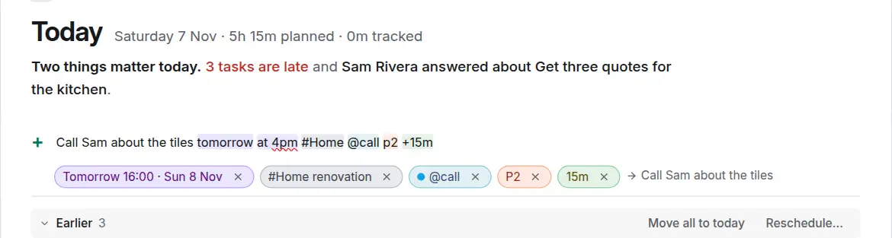
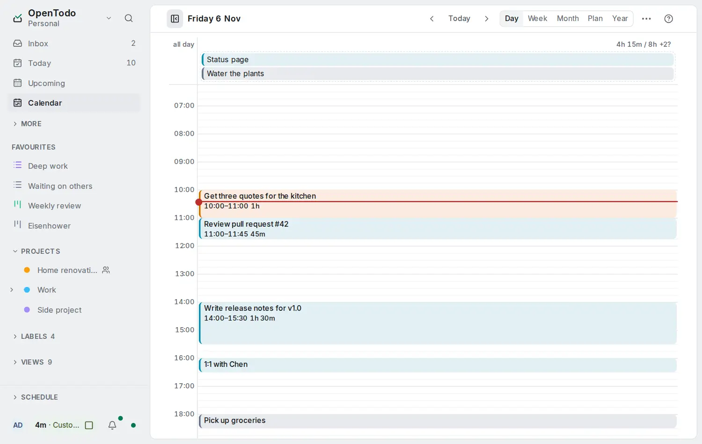
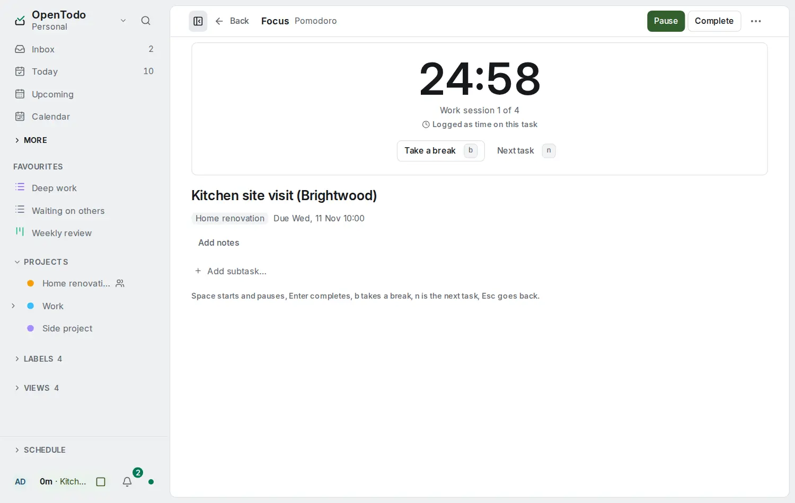
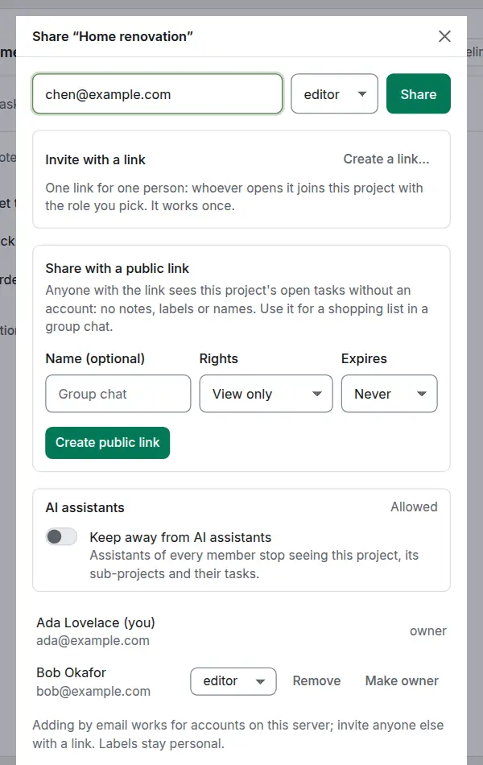

<p align="center">
  
</p>

<h1 align="center">OpenTodo</h1>

<p align="center"><strong>Plan your day without renting your to-do list.</strong></p>

<p align="center">OpenTodo is a free, open-source to-do app you run on your own server or have hosted for you. It works on your phone and your computer, even offline, shares lists with your family or your team, and keeps your data with you.</p>

<p align="center">
  <a href="https://demo.open-todo.app"><strong>Try the demo</strong></a> ·
  <a href="#install"><strong>Install</strong></a> ·
  <a href="https://open-todo.app/docs/"><strong>Docs</strong></a> ·
  <a href="https://open-todo.app"><strong>Website</strong></a>
</p>

<p align="center">
  <a href="LICENSE"></a>
  <a href="https://github.com/OpenTodoApp/OpenTodo/actions/workflows/ci.yml"></a>
  <a href="https://github.com/OpenTodoApp/OpenTodo/releases/latest"></a>
  <a href="https://github.com/sponsors/pixari"></a>
  <a href="https://buymeacoffee.com/pixari"></a>
  <a href="https://discord.gg/mmSsuCRduD"></a>
</p>

<p align="center">
  
</p>

<p align="center">
  <a href="https://apps.apple.com/us/app/opentodo/id6832200428"></a>
</p>

**New: OpenTodo for iPhone and iPad is in the App Store.** It's the first release, a first step: it connects to your OpenTodo server and adds reminders on the phone, the share sheet, a Today widget and Face ID unlock. Expect some rough edges; [tell us what to improve](https://github.com/OpenTodoApp/OpenTodo/issues/new/choose).

**Ways to run it:** [PikaPods](https://www.pikapods.com/apps/opentodo) (hosted, no server needed) · [Docker](docs/self-hosting/docker.md) · [Umbrel](docs/self-hosting/umbrel.md) (coming soon) · [Unraid](docs/self-hosting/unraid.md) · [Home Assistant](docs/self-hosting/home-assistant-addon.md) · [Kubernetes (Helm)](docs/self-hosting/kubernetes.md) · [Single binary](#single-binary) · [iPhone and iPad app](https://apps.apple.com/us/app/opentodo/id6832200428) (App Store) · [Android app](docs/android-app.md) (APK from GitHub; Google Play and F-Droid coming soon) · [all 20 platforms](docs/self-hosting/README.md)

## How it works

### 1. Capture

Type a task the way you say it: `Call Sarah next Wed 3pm #work p1` sets the date, time, project and priority. Dictate it, send a page from your phone's share menu, or forward an email. Anything without a home lands in the Inbox. [Quick add](docs/quick-add.md) · [Voice](docs/quick-add.md#voice) · [Capture](docs/capture.md)

<picture><source media="(prefers-color-scheme: dark)" srcset="docs/images/quick-add-dark.webp"></picture>

### 2. Plan your day

Today shows what is due and what is still open from earlier. Give tasks an estimate and drag them onto the Day or Week calendar to see whether the day fits. [Today](docs/today-and-upcoming.md) · [Time blocking](docs/time-blocking.md)

<picture><source media="(prefers-color-scheme: dark)" srcset="docs/images/day-dark.webp"></picture>

### 3. Focus

Open one task in Focus and start a Pomodoro, Flowtime or countdown timer. The time is logged to the task. [Focus](docs/focus.md)

<picture><source media="(prefers-color-scheme: dark)" srcset="docs/images/focus-dark.webp"></picture>

### 4. Share

Share a project with your family or your team as viewer, editor or admin. Assign tasks, comment, and see what changed. Everyone can edit offline. [Sharing](docs/sharing.md)

<picture><source media="(prefers-color-scheme: dark)" srcset="docs/images/share-dialog-dark.webp"></picture>

## Highlights

- **Your data stays yours.** Everything lives in one folder on your server. Export it at any time, import it anywhere, and schedule backups, encrypted if you like, to disk, S3 or WebDAV. [Backups](docs/backups.md) · [Import and export](docs/import-export.md)
- **Works offline on every device.** Each phone and computer keeps a full copy, so the app works with no connection and syncs when it's back. [Install the app](docs/install-app.md)
- **Bring your tasks.** Import from Todoist, TickTick, Things, Super Productivity, Microsoft To Do, Apple Reminders and more, with a preview and undo. [Import](docs/import.md)
- **Private by design.** No telemetry, no analytics, no third-party scripts. Turn on end-to-end encryption and the server holds only ciphertext. [Privacy](#privacy) · [Encryption](docs/e2ee.md)
- **Bring your own AI, if you want it.** Talk to an assistant in the app, or connect the one you already use. Off by default, and every change can be undone. [AI](docs/ai-and-agents.md)

No subscription, no lock-in, no tracking.

**[Explore all features →](https://open-todo.app/features/)**

## How it compares

| | OpenTodo | Todoist | TickTick | Things | Super Productivity |
| --- | :-: | :-: | :-: | :-: | :-: |
| Open source | ✅ | ❌ | ❌ | ❌ | ✅ |
| You can host it yourself | ✅ | ❌ | ❌ | ❌ | ✅ |
| Works offline | ✅ | ✅ | ⚠️ | ✅ | ✅ |
| Free, with every feature | ✅ | ❌ | ❌ | ❌ | ✅ |
| No subscription | ✅ | ❌ | ❌ | ✅ | ✅ |
| Optional end-to-end encryption | ✅ | ❌ | ❌ | ❌ | ✅ |
| Shared projects | ✅ | ✅ | ✅ | ❌ | ❌ |

✅ yes · ❌ no · ⚠️ partly, or not documented. Todoist and TickTick have a free plan with limits; Things is a one-time purchase per device type. Based on each product's public information as of November 2026. If an entry is wrong, open an issue with a source.

**[Full comparisons →](https://open-todo.app/switch/)**

## Install

### Try it in 30 seconds

- **No install:** open the [demo](https://demo.open-todo.app) and press **Try the demo**. You get a private copy with sample data, deleted after a few hours.
- **On your machine or server:**

  ```bash
  docker run -d -p 8080:8080 -v opentodo-data:/data ghcr.io/opentodoapp/opentodo:stable
  ```

  Open <http://localhost:8080>. The first visit creates your account. No configuration needed.

### Docker Compose

```bash
git clone https://github.com/OpenTodoApp/OpenTodo.git
cd OpenTodo
docker compose up -d
```

Data is kept in the `opentodo-data` volume. On a server reachable from the internet, finish setup right after starting it, or set `OPENTODO_SETUP_CODE=required` ([the setup code](docs/self-hosting/docker.md#the-setup-code)). Behind a reverse proxy, set `OPENTODO_BASE_URL=https://todo.example.com`.

The image is published for `linux/amd64` and `linux/arm64`. `:stable` is the latest release, `:1.1` follows the 1.1 releases (fixes only), `:1.1.1` pins one version, and `:latest` follows the main branch. Upgrades from any release since 0.1.0 work directly, and nothing you rely on breaks within 1.x ([stability](docs/stability.md)). More in [Running with Docker](docs/self-hosting/docker.md).

### Single binary

Download `opentodo-<os>-<arch>` for Linux, macOS or Windows from the [latest release](https://github.com/OpenTodoApp/OpenTodo/releases/latest) and run it. It serves on port 8080 and keeps its data in `./data`. To build from source: `make build && ./bin/opentodo` (Go 1.26+ and Node 22+).

### Configuration

Nothing is required. Every setting is an optional environment variable with a safe default: see the [configuration reference](docs/self-hosting/configuration.md). To add people, keep sign-up closed and send invitation links ([managing users](docs/self-hosting/docker.md#managing-users)).

The [self-hosting handbook](docs/self-hosting/README.md) covers every platform, TLS, backups, upgrades and monitoring. The `ot` command-line client is in [the CLI guide](docs/cli.md).

## Privacy

The app talks only to your own server: no analytics, crash reporters, update pings or third-party fonts. Two things are on by default and can be turned off: [maps](docs/self-hosting/maps.md) for task locations, fetched through your server with no account data, and web push to the service each phone's browser chose. Everything else the server contacts, such as webhooks, backup destinations, single sign-on, email or an AI provider, is something you set up. The audit log never records task content ([what is logged](SECURITY.md#what-is-logged)).

## Documentation

Read the docs with screenshots and search at **[open-todo.app/docs](https://open-todo.app/docs/)**, or in the app under **Help**. The same pages are in [`docs/`](docs/README.md).

- **Start here:** [getting started](docs/getting-started.md) · [all user guides](docs/README.md#using-opentodo)
- **Self-hosting:** [handbook](docs/self-hosting/README.md) · [configuration](docs/self-hosting/configuration.md) · [backups](docs/backups.md)
- **Build on it:** [REST API](docs/api.md) · [CLI](docs/cli.md) · [AI and agents](docs/ai-and-agents.md) · [stability](docs/stability.md)
- **Project:** [changelog](CHANGELOG.md) · [roadmap](ROADMAP.md) · [security](SECURITY.md)

<details>
<summary><strong>Under the hood</strong></summary>

```
┌───────────────────────── device ─────────────────────────┐      ┌──────────── server ────────────┐
│ React PWA  ──►  IndexedDB (source of truth)              │      │ Go binary + SQLite             │
│                 │ every edit = field ops {ts, device}    │ sync │  ops log (append-only)         │
│                 └► outbox ──────────────────────────────►├─────►│  fields (last-writer-wins)     │
│                 ◄─ ops from other devices ◄──────────────┤◄─────┤  REST, CalDAV, email, import   │
└──────────────────────────────────────────────────────────┘      │  all write through ops         │
                                                                  └────────────────────────────────┘
```

- Every change is a small operation that sets one field of one entity, stamped with a hybrid logical clock and the device id.
- Devices apply changes locally first, then sync. The same per-field rule runs everywhere, so all devices agree no matter the order. Notes merge character by character.
- The REST API, CalDAV, email and imports write through the same log, so a task created with `curl` shows up on your phone right away.
- One Go binary with the web app inside and a single SQLite file. It idles at about 20 MB of memory and runs on a Raspberry Pi.

More in [architecture](docs/architecture.md) and [the sync protocol](docs/sync.md).

</details>

## Help without coding

1. **Star and share.** A star on GitHub helps other people find OpenTodo.
2. **Leave feedback** in [Discussions](https://github.com/OpenTodoApp/OpenTodo/discussions) or on [Discord](https://discord.gg/mmSsuCRduD).
3. **Report bugs** in [issues](https://github.com/OpenTodoApp/OpenTodo/issues).
4. **Review a translation.** The app speaks seven languages; tell us where a word feels wrong ([translating](docs/translating.md)).
5. **Test it on your devices** and report back in the [call for testers](https://github.com/OpenTodoApp/OpenTodo/issues/9).
6. **Answer questions** from other people in Discussions and on Discord.
7. **Sponsor** on [GitHub Sponsors](https://github.com/sponsors/pixari) or [buy me a coffee](https://buymeacoffee.com/pixari).

To contribute code, read [CONTRIBUTING.md](CONTRIBUTING.md): changes that alter behaviour start as an [OpenSpec](openspec/) change. Security issues go to the address in [SECURITY.md](SECURITY.md).

## Supporters

Thank you to everyone who keeps OpenTodo going. Supporters who want to be listed appear here.

<!-- names added with consent -->

## Star History

<a href="https://www.star-history.com/?repos=opentodoapp%2Fopentodo&type=date&releases=&legend=bottom-right">
 <picture>
   <source media="(prefers-color-scheme: dark)" srcset="https://api.star-history.com/chart?repos=opentodoapp/opentodo&type=date&theme=dark&legend=bottom-right" />
   <source media="(prefers-color-scheme: light)" srcset="https://api.star-history.com/chart?repos=opentodoapp/opentodo&type=date&legend=bottom-right" />
   
 </picture>
</a>

## License

[AGPL-3.0-only](LICENSE). You can run, study, modify and share OpenTodo freely. If you offer a modified version as a network service, you must offer its source under the same license. That is what keeps a self-hosted project from being quietly turned back into a subscription.
