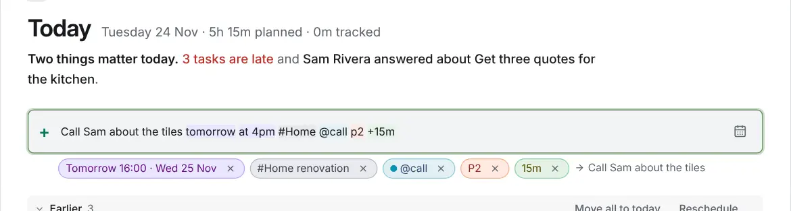
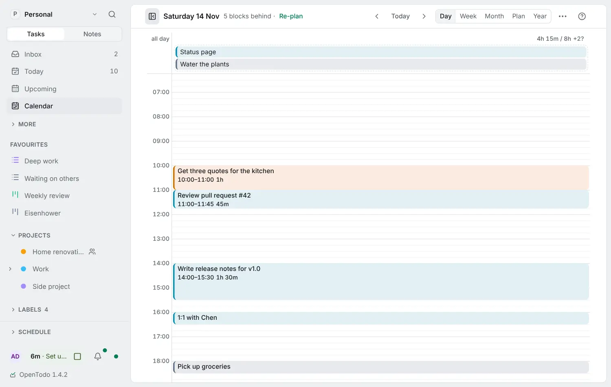
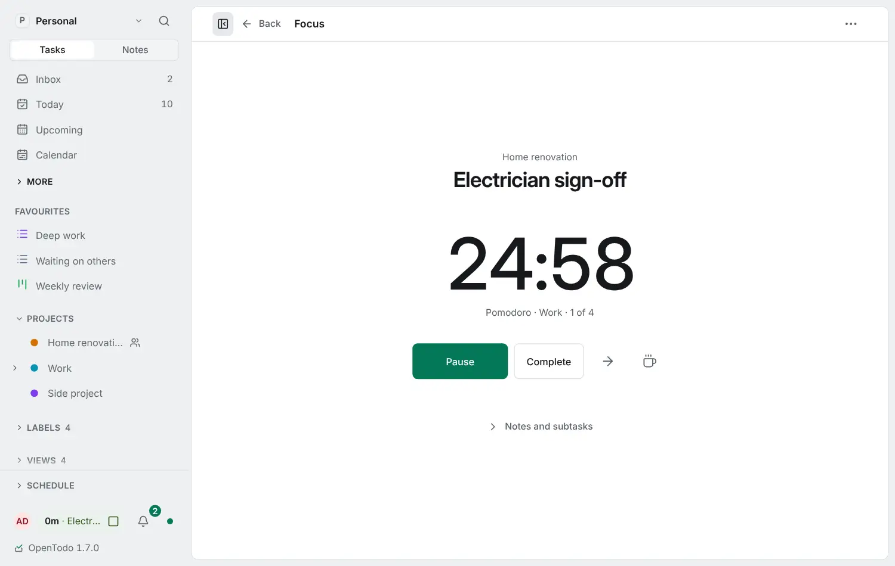
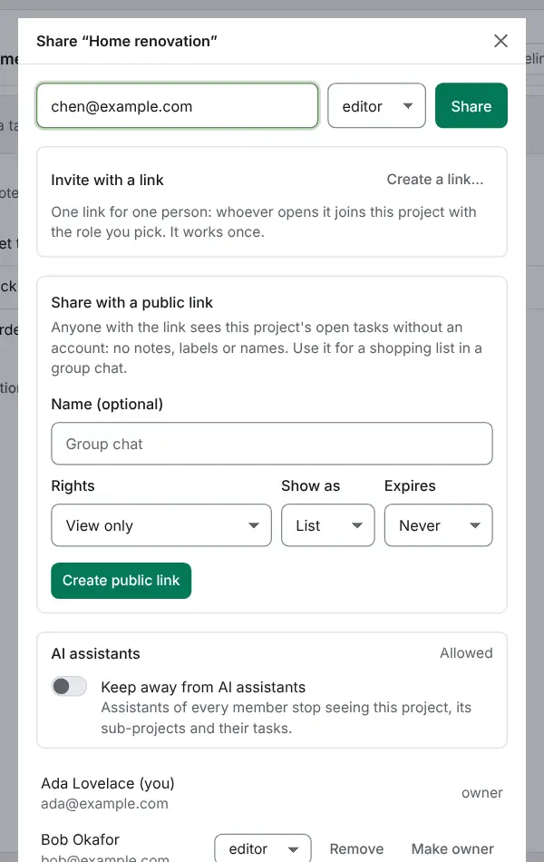

<h1 align="center">
  <picture>
    <source media="(prefers-color-scheme: dark)" srcset="brand/png/lockup-on-dark-852x192.png">
    
  </picture>
</h1>

<p align="center"><strong>Plan your day without renting your to-do list.</strong></p>

<p align="center">A free, open-source to-do app you run on your own server or have hosted for you. It works on your phone and your computer, even offline, shares lists with your family or your team, and keeps your data with you.</p>

<p align="center">
  <a href="https://demo.open-todo.app"><strong>Try the demo</strong></a> ·
  <a href="#install"><strong>Install</strong></a> ·
  <a href="https://open-todo.app/docs/"><strong>Docs</strong></a> ·
  <a href="https://open-todo.app"><strong>Website</strong></a>
</p>

<p align="center"><strong>5 minutes to help shape OpenTodo:</strong> <a href="https://tally.so/r/1W41xQ">take the anonymous survey</a></p>

<p align="center">
  <a href="LICENSE"></a>
  <a href="https://github.com/OpenTodoApp/OpenTodo/actions/workflows/ci.yml"></a>
  <a href="https://github.com/OpenTodoApp/OpenTodo/releases/latest"></a>
  <a href="https://github.com/OpenTodoApp/OpenTodo/stargazers"></a>
  <a href="https://discord.gg/mmSsuCRduD"></a>
  <br>
  <a href="https://github.com/sponsors/pixari"></a>
  <a href="https://buymeacoffee.com/pixari"></a>
</p>

<p align="center">
  
</p>

<p align="center">
  <a href="https://apps.apple.com/us/app/opentodo/id6832200428"></a>
  <a href="https://play.google.com/store/apps/details?id=app.opentodo"></a>
</p>

**New: OpenTodo is in the App Store and on Google Play.** The apps connect to your OpenTodo server and add reminders on the phone, the share sheet, widgets and Face ID or fingerprint unlock. The iPhone app is a first release, so expect some rough edges; [tell us what to improve](https://github.com/OpenTodoApp/OpenTodo/issues/new/choose).

**Ways to run it:** [PikaPods](https://www.pikapods.com/apps/opentodo) (hosted, no server needed) · [Docker](docs/self-hosting/docker.md) · [Umbrel](docs/self-hosting/umbrel.md) (coming soon) · [Unraid](docs/self-hosting/unraid.md) · [Home Assistant](docs/self-hosting/home-assistant-addon.md) · [Kubernetes (Helm)](docs/self-hosting/kubernetes.md) · [Single binary](#single-binary) · [iPhone and iPad app](https://apps.apple.com/us/app/opentodo/id6832200428) (App Store) · [Android app](docs/android-app.md) (Google Play or APK from GitHub; F-Droid coming soon) · [all 21 platforms](docs/self-hosting/README.md#1-install)

## Why OpenTodo

- **Local-first.** Every phone and computer keeps a full copy of your tasks. The app reads and writes that copy, so it is fast and works with no connection; changes sync when one is back. [Install the app](docs/install-app.md)
- **Self-hosted.** One Go binary or one container, one SQLite file, no other service to run. It needs no configuration and idles at about 20 MB of memory.
- **Open source.** AGPL-3.0, every feature included. No paid tier, no account with us, no telemetry.

## Features

### 1. Capture

Type a task the way you say it: `Call Sarah next Wed 3pm #work p1` sets the date, time, project and priority. Dictate it, send a page from your phone's share menu or the browser extension ([Chrome](https://chromewebstore.google.com/detail/opentodo-capture/aohlkamgjanbbmkobfhhemdbliadlned), [Firefox](https://addons.mozilla.org/firefox/addon/opentodo-capture/)), or forward an email. Anything without a home lands in the Inbox. [Quick add](docs/quick-add.md) · [Voice](docs/quick-add.md#voice) · [Capture](docs/capture.md)

<picture><source media="(prefers-color-scheme: dark)" srcset="docs/images/quick-add-dark.webp"></picture>

### 2. Plan your day

Today shows what is due and what is still open from earlier. Give tasks an estimate and drag them onto the Day or Week calendar to see whether the day fits. [Today](docs/today-and-upcoming.md) · [Time blocking](docs/time-blocking.md)

<picture><source media="(prefers-color-scheme: dark)" srcset="docs/images/day-dark.webp"></picture>

### 3. Focus

Open one task in Focus and start a Pomodoro, Flowtime or countdown timer. The time is logged to the task. [Focus](docs/focus.md)

<picture><source media="(prefers-color-scheme: dark)" srcset="docs/images/focus-dark.webp"></picture>

### 4. Share

Share a project with your family or your team as viewer, editor or admin. Assign tasks, comment, and see what changed. Everyone can edit offline. [Sharing](docs/sharing.md)

<picture><source media="(prefers-color-scheme: dark)" srcset="docs/images/share-dialog-dark.webp"></picture>

### And more

- **Your data stays yours.** Everything lives in one folder on your server. Export it at any time, import it anywhere, and schedule backups, encrypted if you like, to disk, S3 or WebDAV. [Backups](docs/backups.md) · [Import and export](docs/import-export.md)
- **Bring your tasks.** Import from Todoist, TickTick, Things, Super Productivity, Microsoft To Do, Apple Reminders and more, with a preview and undo. [Import](docs/import.md)
- **Private by design.** No telemetry, no analytics, no third-party scripts. Turn on end-to-end encryption and the server holds only ciphertext. [Privacy](#privacy) · [Encryption](docs/e2ee.md)
- **Bring your own AI, if you want it.** Talk to an assistant in the app, or connect the one you already use. Off by default, and every change can be undone. [AI](docs/ai-and-agents.md)

**[Explore all features →](https://open-todo.app/features/)**

## How it compares

| | OpenTodo | Todoist | TickTick | Things | Super Productivity |
| --- | :-: | :-: | :-: | :-: | :-: |
| Open source | ✅ | ❌ | ❌ | ❌ | ✅ |
| You can host it yourself | ✅ | ❌ | ❌ | ❌ | ✅ |
| Works offline | ✅ | ✅ | ⚠️ | ✅ | ✅ |
| Free, with every feature | ✅ | ❌ | ❌ | ❌ | ✅ |
| No subscription | ✅ | ❌ | ❌ | ✅ | ✅ |
| Optional end-to-end encryption | ✅ | ❌ | ❌ | ❌ | ✅ |
| Shared projects | ✅ | ✅ | ✅ | ❌ | ❌ |

✅ yes · ❌ no · ⚠️ partly, or not documented. Todoist and TickTick have a free plan with limits; Things is a one-time purchase per device type. Based on each product's public information as of November 2026. If an entry is wrong, open an issue with a source.

**[Full comparisons →](https://open-todo.app/switch/)**

## Install

### Try it in 30 seconds

- **No install:** open the [demo](https://demo.open-todo.app) and press **Try the demo**. You get a private copy with sample data, deleted after a few hours.
- **On your machine or server:**

  ```bash
  docker run -d -p 8080:8080 -v opentodo-data:/data ghcr.io/opentodoapp/opentodo:stable
  ```

  Open <http://localhost:8080>. The first visit creates your account. No configuration needed.

### Docker Compose

```bash
git clone https://github.com/OpenTodoApp/OpenTodo.git
cd OpenTodo
docker compose up -d
```

Data is kept in the `opentodo-data` volume. On a server reachable from the internet, finish setup right after starting it, or set `OPENTODO_SETUP_CODE=required` ([the setup code](docs/self-hosting/docker.md#the-setup-code)). Behind a reverse proxy, set `OPENTODO_BASE_URL=https://todo.example.com`.

The image is published for `linux/amd64` and `linux/arm64`. `:stable` is the latest release, `:1` follows every 1.x release, a minor tag such as `:1.5` gets that line's fixes only, a full version such as `:1.5.0` pins one release, and `:latest` follows the main branch. Upgrades from any release since 0.1.0 work directly, and nothing you rely on breaks within 1.x ([stability](docs/stability.md)). More in [Running with Docker](docs/self-hosting/docker.md).

### Single binary

Download `opentodo-<os>-<arch>` for Linux, macOS or Windows from the [latest release](https://github.com/OpenTodoApp/OpenTodo/releases/latest) and run it. It serves on port 8080 and keeps its data in `./data`.

### From source

With Go 1.27+, Node 22+ and GNU make:

```bash
git clone https://github.com/OpenTodoApp/OpenTodo.git
cd OpenTodo
make run
```

`make run` builds the web app and the server into `bin/opentodo` and starts it on port 8080. To work on the code, `(cd web && npm ci) && make dev` runs the API on :8080 and the web app with hot reload on <http://localhost:5173>; [your first contribution](docs/contributing/first-contribution.md) takes it from there.

**Managed hosting:** [PikaPods](https://www.pikapods.com/apps/opentodo), [Railway](https://railway.com/deploy/opentodo?referralCode=nbgVDr). These links support the project: OpenTodo receives a share when you host through them.

### Configuration

Nothing is required. Every setting is an optional environment variable with a safe default: see the [configuration reference](docs/self-hosting/configuration.md). To add people, keep sign-up closed and send invitation links ([managing users](docs/self-hosting/docker.md#managing-users)).

The [self-hosting handbook](docs/self-hosting/README.md) covers every platform, TLS, backups, upgrades and monitoring. The `ot` command-line client is in [the CLI guide](docs/cli.md).

## Privacy

The app talks only to your own server: no analytics, crash reporters, update pings or third-party fonts. Two things are on by default and can be turned off: [maps](docs/self-hosting/maps.md) for task locations, fetched through your server with no account data, and web push to the service each phone's browser chose. Everything else the server contacts, such as webhooks, backup destinations, single sign-on, email or an AI provider, is something you set up. The audit log never records task content ([what is logged](SECURITY.md#what-is-logged)).

## Documentation

Read the docs with screenshots and search at **[open-todo.app/docs](https://open-todo.app/docs/)**, or in the app under **Help**. The same pages are in [`docs/`](docs/README.md).

- **Start here:** [getting started](docs/getting-started.md) · [all user guides](docs/README.md#using-opentodo)
- **Self-hosting:** [handbook](docs/self-hosting/README.md) · [configuration](docs/self-hosting/configuration.md) · [backups](docs/backups.md)
- **Build on it:** [REST API](docs/api.md) · [OpenAPI description](docs/openapi.json) · [CLI](docs/cli.md) · [AI and agents](docs/ai-and-agents.md) · [stability](docs/stability.md)
- **Project:** [changelog](CHANGELOG.md) · [roadmap](ROADMAP.md) · [security](SECURITY.md) · [contributing](CONTRIBUTING.md)

## Build your own client

Every server describes its API at `/api/v1/openapi.json` (OpenAPI 3.1, generated from the code, stable through 1.x). Point a generator at it and you have a typed client:

```sh
curl -s https://todo.example.com/api/v1/openapi.json -o openapi.json
npx openapi-typescript openapi.json -o opentodo.d.ts
```

The same file is [`docs/openapi.json`](docs/openapi.json) and an asset of every [release](https://github.com/OpenTodoApp/OpenTodo/releases). Sign in with an API token from Settings → Integrations → API tokens; the [API guide](docs/api.md) has the details, and [`ot`](docs/cli.md), the [Obsidian plugin](obsidian/) and the [n8n nodes](https://github.com/OpenTodoApp/n8n-nodes-opentodo) are clients built on it.

## Architecture

```text
┌───────────────────────── device ─────────────────────────┐      ┌──────────── server ────────────┐
│ React PWA  ──►  IndexedDB (source of truth)              │      │ Go binary + SQLite             │
│                 │ every edit = field ops {ts, device}    │ sync │  ops log (append-only)         │
│                 └► outbox ──────────────────────────────►├─────►│  fields (last-writer-wins)     │
│                 ◄─ ops from other devices ◄──────────────┤◄─────┤  REST, CalDAV, email, import   │
└──────────────────────────────────────────────────────────┘      │  all write through ops         │
                                                                  └────────────────────────────────┘
```

- Every change is a small operation that sets one field of one entity, stamped with a hybrid logical clock and the device id.
- Devices apply changes locally first, then sync. The same per-field rule runs everywhere, so all devices agree no matter the order. Notes merge character by character.
- The REST API, CalDAV, email and imports write through the same log, so a task created with `curl` shows up on your phone right away.
- One Go binary with the web app inside and a single SQLite file. It idles at about 20 MB of memory and runs on a Raspberry Pi.

More in [architecture](docs/architecture.md), [the sync protocol](docs/sync.md) and the [architecture tour](docs/contributing/architecture-tour.md), which follows one edit from the click to the other device.

## Roadmap

The original roadmap is complete, and 1.x only grows: nothing you rely on is removed or renamed ([stability](docs/stability.md)). What is being built now and what comes next is in [ROADMAP.md](ROADMAP.md); what shipped is in the [changelog](CHANGELOG.md).

## Contributing

Code: start with [your first contribution](docs/contributing/first-contribution.md) (clone to pull request in about 30 minutes) and the rules in [CONTRIBUTING.md](CONTRIBUTING.md). A change of behaviour starts as an [OpenSpec](docs/contributing/openspec.md) change; `make check` runs what CI runs. Security issues go to the address in [SECURITY.md](SECURITY.md).

Without code:

- **Report bugs** in [issues](https://github.com/OpenTodoApp/OpenTodo/issues) and leave feedback in [Discussions](https://github.com/OpenTodoApp/OpenTodo/discussions) or on [Discord](https://discord.gg/mmSsuCRduD).
- **Review a translation.** The app speaks eleven languages; tell us where a word feels wrong ([translating](docs/translating.md)).
- **Test it on your devices** and report back in the [call for testers](https://github.com/OpenTodoApp/OpenTodo/issues/9).
- **Answer questions** from other people in Discussions and on Discord.
- **Star and share.** A star helps other people find OpenTodo.

## Support OpenTodo

OpenTodo is free and always will be, with no paid tier to fund it. If it helps you, you can help keep it going:

<p>
  <a href="https://github.com/sponsors/pixari"></a>
  <a href="https://buymeacoffee.com/pixari"></a>
</p>

- **[GitHub Sponsors](https://github.com/sponsors/pixari):** monthly or one-time.
- **[Buy Me a Coffee](https://buymeacoffee.com/pixari):** one-time, no GitHub account needed.
- **Managed hosting:** [PikaPods](https://www.pikapods.com/apps/opentodo) and [Railway](https://railway.com/deploy/opentodo?referralCode=nbgVDr) pass a share to the project when you host through them.

The [support page](https://open-todo.app/support/) says what it costs to run and where the money goes.

Thank you to everyone who keeps OpenTodo going. Supporters who want to be listed appear here.

<!-- names added with consent -->

## Star History

<a href="https://www.star-history.com/?repos=opentodoapp%2Fopentodo&type=date&releases=&legend=bottom-right">
 <picture>
   <source media="(prefers-color-scheme: dark)" srcset="https://api.star-history.com/chart?repos=opentodoapp/opentodo&type=date&theme=dark&legend=bottom-right" />
   <source media="(prefers-color-scheme: light)" srcset="https://api.star-history.com/chart?repos=opentodoapp/opentodo&type=date&legend=bottom-right" />
   
 </picture>
</a>

## License

[AGPL-3.0-only](LICENSE). You can run, study, modify and share OpenTodo freely. If you offer a modified version as a network service, you must offer its source under the same license. That is what keeps a self-hosted project from being quietly turned back into a subscription.
