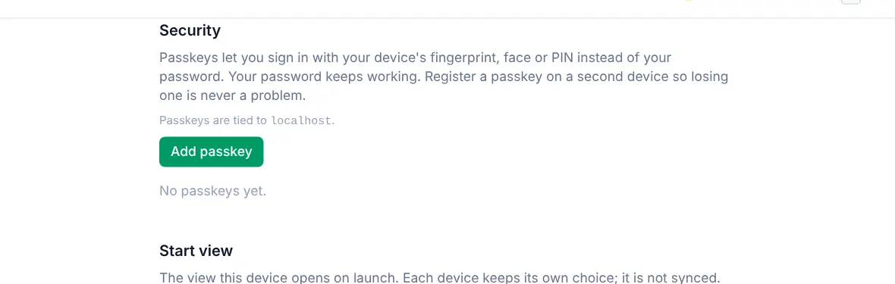
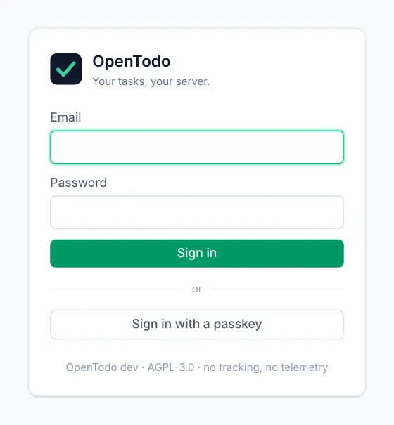
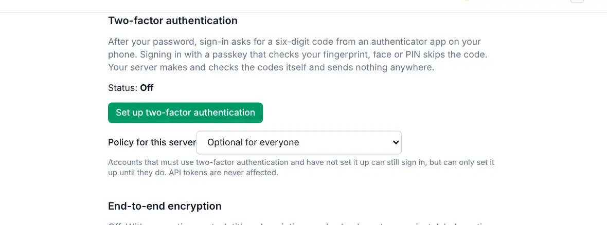

# Account security

Your password is the starting point. A passkey makes signing in quicker and safer, and two-factor authentication adds a second lock. All of it lives in **Settings**, and none of it involves anyone outside your server.

These settings need a connection to your server. While you're offline they're shown read-only.

## Sign in with a passkey

A passkey lets you sign in with your fingerprint, face or device PIN instead of typing a password. It can't be phished or reused on another site, and your password keeps working as a fallback.

1. Open **Settings → Security** and find the **Passkeys** card.
2. Select **Add passkey** and give it a name you'll recognise, like "Work laptop".
3. Confirm with your fingerprint, face or PIN when your device asks.

<picture><source srcset="images/settings-passkeys-dark.webp" media="(prefers-color-scheme: dark)"></picture>

Next time, choose **Sign in with a passkey** on the sign-in screen, or pick it from the suggestions in the email field.

<picture><source srcset="images/signin-dark.webp" media="(prefers-color-scheme: dark)"></picture>

Add a passkey on a second device too, so losing one isn't a problem. You can rename or delete passkeys in the same list. If one is marked as suspicious, OpenTodo noticed something that looks like a copied passkey; delete it if you don't recognise the device.

If you don't see the Security section, passkeys aren't available on your server. They need a secure `https://` address; ask whoever runs your server.

## Turn on two-factor authentication

With two-factor authentication, signing in takes your password plus a six-digit code from an authenticator app on your phone. Any app that supports time-based codes works.

1. Open **Settings → Security → Two-factor authentication** and select **Set up two-factor authentication**.
2. Scan the QR code with your authenticator app, or type in the key shown under it.
3. Enter the six-digit code the app shows.
4. Save the **recovery codes** that appear. They're shown only once: download them as a text file or write them down and keep them somewhere safe.

<picture><source srcset="images/settings-security-dark.webp" media="(prefers-color-scheme: dark)"></picture>

From then on, sign-in asks for a code after your password. Signing in with a passkey skips the code, because the passkey already checks it's you.

### Remember this browser

When you enter a code, you can tick **Remember this device for 30 days** so that browser doesn't ask again for a month. The list of remembered browsers is under **Two-factor authentication**, where you can forget them.

### Recovery codes

Each recovery code works once, in place of a code from the app. Use one if you lose your phone. Settings shows how many you have left and lets you generate a new set, which replaces the old one.

If you lose both your phone and your recovery codes, the owner of your server can reset your two-factor authentication.

Your server's owner can also make two-factor authentication required. If so, you'll be asked to set it up when you sign in, and you can't turn it off.

## Change your password

Open **Settings → Security**, select **Change password** in the **Password** card, enter your current password and a new one of at least 10 characters. Changing it signs you out everywhere else; the device you're on stays signed in.

Forgot it? If your server can send email, choose **Forgot password?** on the sign-in screen and enter your address: a reset link valid for 24 hours arrives by email (the screen answers the same way whether or not the address has an account). Otherwise ask the owner or an admin of your server for a reset link. If you're the owner and cannot receive mail, see [recovering owner access](self-hosting/docker.md#recovering-owner-access).

## Check recent sign-ins

**Settings → Activity → Recent activity** lists sign-ins and token changes on your account from the last 90 days. If you see one you don't recognise, change your password, revoke your API tokens and tell the owner of your server.

## Confirm it's you

Some changes, like creating an API token or turning off two-factor authentication, ask for your password or a code again, unless you entered one in the last ten minutes. That keeps someone who finds your unlocked laptop from changing them.

## Sign out

**Settings → Account → Session → Sign out** ends your session on that device and removes your tasks from it. Changes that haven't been sent yet are uploaded first when you're online.

## More protection

- [End-to-end encryption](e2ee.md) encrypts your task titles, notes and comments on your devices, so even your server only stores scrambled text.
- If your server uses a company or family login (single sign-on), you can link it under **Settings → Security → Linked accounts** and sign in with it.
