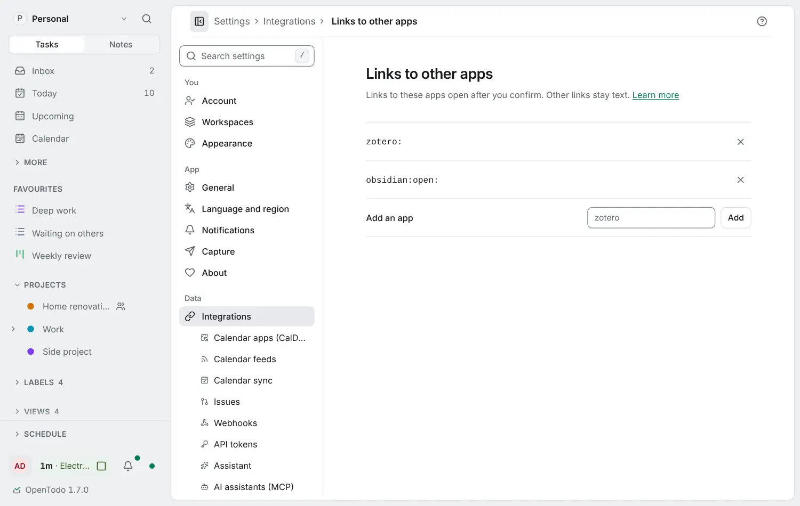

# Links to other apps

<picture><source srcset="images/app-links-dark.webp" media="(prefers-color-scheme: dark)"></picture>

A task often starts in another app: a note in Obsidian, a paper in Zotero, a mail. Those apps have links that open exactly that item, such as `zotero://select/items/ABC` or `mid:<message-id>`. OpenTodo keeps such links as you wrote them, and opens them only for the apps you allow.

## Allow an app

Open **Settings → Integrations → Links to other apps** and add the app's scheme: the part before the colon, such as `zotero`, `mid` or `onenote`. Add `obsidian:open` to allow only Obsidian's open action. The list is yours, syncs to your devices and holds up to 20 apps. It is empty until you add one.

Some kinds of link never open, whatever the list says: `javascript`, `data`, `vbscript`, `file`, `blob`, `about`, `filesystem`, `view-source`, `intent` and `opentodo`; browser-internal links (`chrome`, `chrome-extension`, `moz-extension`, `resource`, `jar`, `ms-appx`, `ms-appx-web`); and system handlers known to run code (`ms-msdt`, `search-ms`, `search`, `ms-officecmd`, `jnlp` and every `ms-cxh` link). A link with an invisible character in it, such as a right-to-left override, stays text. Web and mail links keep working as before and need no entry.

## Where links open

- **Notes and comments:** a link such as `[paper](zotero://select/items/ABC)` opens the app. Without the app on your list it reads as text, with the address in its tooltip.
- **A task's origin:** a link to another app can be where a task came from, shown with the app's name, such as **Zotero**. `ot add "Read the paper" --origin-url zotero://select/items/ABC` sets one from the command line.
- **Calendar apps:** when a calendar app sends a task with a link to another app and the task has no origin yet, the link becomes its origin. Tasks CalDAV Sync for Obsidian sends its backlink this way.

The first time an app opens on a device, OpenTodo shows the whole link and asks. Choose **Don't ask again** to open that app's links directly on that device from then on. A click, a middle click and Enter all go through this question, in a read-only note too. An AI assistant cannot set a link to another app as a task's origin, and importing an export does not bring back your list.

## Shared projects

Your list decides only what opens for you. A link someone else wrote in a shared project opens on your device only if your own list allows its app. On their devices it follows their list.

Older versions of the app show such a link as text and its origin by a plain name, without opening it.
