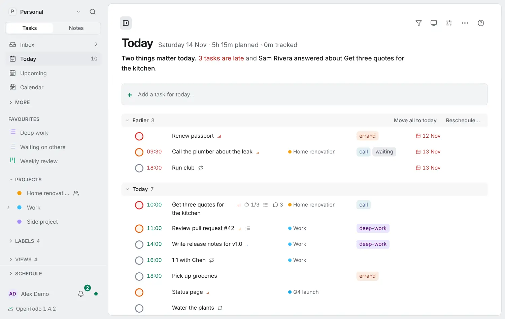

# Arrange Today, Upcoming and the Inbox

<picture><source srcset="images/today-dark.webp" media="(prefers-color-scheme: dark)"></picture>

**Display options**, the sliders button in the header (in the bottom bar on phones), arrange the list without changing its tasks or counts. [Projects and labels](group-and-order.md) use the same panel.

## What each view offers

| View | Group by | Order by | Nest subtasks |
| --- | --- | --- | --- |
| **Today** | **Time of day**, Project, Priority, Label or None | **Due date**, Priority, Created, Deadline, Title, Manual order or a number or date [custom field](custom-fields.md) | Off |
| **Upcoming** | One group per day | Within each day, as in Today | Off |
| **Inbox** | **None**, Due date, Priority or Label | **Manual order**, Priority, Due date, Created, Deadline, Title or [Urgency](urgency-order.md) | Always under their parent |

Bold is the default. Each view also has **Rows** (One line or Detailed) and, under **More options**, the direction.

Grouped by **Project**, headers show each project's icon.

## What stays in place

- **Today:** grouping applies to today's own tasks. **Earlier** stays first with **Move all to today** and **Reschedule…**. **Blocked**, **Waiting for a slot** and **Done today** stay at the end. Grouping preserves [slots](today-limit.md) and shows the [part of the day](day-parts.md) on each row outside Time of day.
- **Upcoming:** drag onto another day to reschedule. With [Start with Today](upcoming-with-today.md), Upcoming's options apply from Tomorrow on.
- **Inbox:** grouping and order apply to top-level tasks. Drag or <kbd>Alt</kbd>+<kbd>↑</kbd> / <kbd>↓</kbd> switches to **Manual order**. **Process** keeps that order.

## Arrange your day by hand

Today and Upcoming share one **Manual order**: arrange tomorrow in Upcoming, and Today keeps it tomorrow. Drag a task between rows, press <kbd>Alt</kbd>+<kbd>↑</kbd> / <kbd>↓</kbd> (with <kbd>Shift</kbd>, to the top or bottom) or use **Move up** and **Move down** in its menu. It moves within its part of the day, project, priority or label, or its day in Upcoming; the first move switches to **Manual order**. Earlier and Blocked keep their order.

Dropped at a line in another day or [part of the day](day-parts.md), a task takes it too, keeping its time, with one **Undo**. A date edited elsewhere keeps its place. With day parts on, **Due date** lists a day as Time of day does.

## Nest subtasks

With **Nest subtasks** on, Today and Upcoming nest tasks with their parent in the same group. Use the fold arrow or <kbd>←</kbd> and <kbd>→</kbd>. A child whose parent is elsewhere names it.

Today's tree also shows open undated and future direct subtasks as context. They keep their dates and stay out of counts, slots and selection; open, edit or complete them as usual.

## Move tasks between project groups

In Today grouped by **Project**, a line in another project moves the task there; a group heading moves it and keeps the sort. With **Nest subtasks** on, drop onto an editable task to nest, or move sideways to choose depth. Dates stay.

Drag a contextual subtask onto another Today task to change its parent, or use **Make top-level for today**; both are in the **Actions** menu, with **Undo**.

## Keys and Reset

<kbd>r</kbd> <kbd>g</kbd> and <kbd>r</kbd> <kbd>o</kbd> with a letter, and <kbd>r</kbd> <kbd>r</kbd> to reverse, set the same options [from the keyboard](keyboard.md#group-and-order); <kbd>r</kbd> <kbd>g</kbd> <kbd>t</kbd> is Time of day on Today.

Once you change something, **Reset** at the foot of the panel puts that view back as it was; the other views keep theirs. Your choices sync to your other devices, offline too. For other tasks, use a [saved view](saved-views.md).
