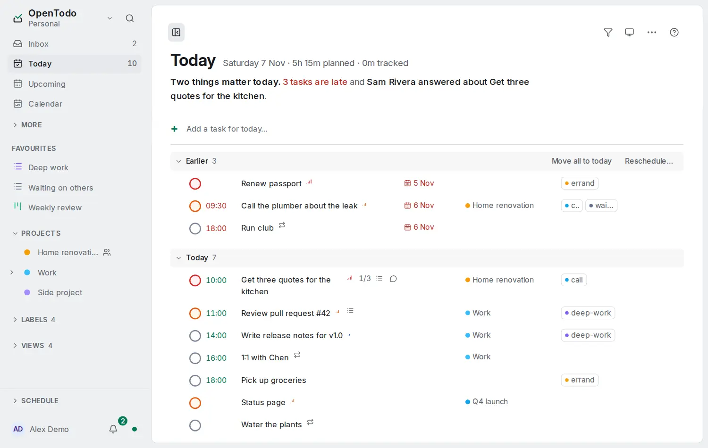

# Arrange Today, Upcoming and the Inbox

<picture><source srcset="images/today-dark.webp" media="(prefers-color-scheme: dark)"></picture>

**Display options**, the sliders button in the header of Today, Upcoming and the Inbox (on a phone, in the bar at the bottom), change how the list is laid out. They never change which tasks it holds, its count or the sidebar's. It is the same panel as on [projects and labels](group-and-order.md).

## What each view offers

| View | Group by | Order by | Nest subtasks |
| --- | --- | --- | --- |
| **Today** | **Time of day**, Project, Priority, Label or None | **Due date**, Priority, Created, Deadline, Title or a number or date [custom field](custom-fields.md) | Off |
| **Upcoming** | One group per day | Within each day, as in Today | Off |
| **Inbox** | **None**, Due date, Priority or Label | **Manual order**, Priority, Due date, Created, Deadline, Title or [Urgency](urgency-order.md) | Always under their parent |

Bold is the default. Each view also has **Rows** (One line or Detailed) and, under **More options**, the direction.

## What stays in place

- **Today:** the chosen grouping lays out only today's own tasks. **Earlier** stays first with **Move all to today** and **Reschedule…**; **Blocked**, **Waiting for a slot** and **Done today** stay at the end. The order applies inside Earlier, each group and Blocked. Waiting for a slot keeps the order its tasks come in, and Done today stays newest first. Under another grouping than Time of day, a row shows its [part of the day](day-parts.md).
- **Today limit:** the same tasks hold the [slots](today-limit.md), whatever the grouping and order.
- **Upcoming:** one group per day; dragging a task onto another day still moves it there. With [Start with Today](upcoming-with-today.md), the Today part follows Today's options and Upcoming's apply from Tomorrow on.
- **Inbox:** grouping and order apply to top-level tasks; subtasks stay under them in their own order. Moving a task by drag or <kbd>Alt</kbd>+<kbd>↑</kbd> / <kbd>↓</kbd> while another order is shown switches the Inbox back to **Manual order** first. **Process** keeps the manual order.

## Nest subtasks

With **Nest subtasks** on, Today and Upcoming list a subtask under its parent when both are in the same group, indented, with the fold arrow; <kbd>←</kbd> and <kbd>→</kbd> fold and unfold it. A subtask whose parent is in another group or not in the view stays a row of its own with its parent's name.

## Keys and Reset

<kbd>r</kbd> <kbd>g</kbd> and <kbd>r</kbd> <kbd>o</kbd> with a letter, and <kbd>r</kbd> <kbd>r</kbd> to reverse, set the same options [from the keyboard](keyboard.md#group-and-order); <kbd>r</kbd> <kbd>g</kbd> <kbd>t</kbd> is Time of day on Today. A key the view doesn't offer does nothing.

Once you change something, **Reset** at the foot of the panel puts that view back as it was; the other views keep theirs. Your choices follow you to your other devices, also when you change them offline. To list other tasks, make a [saved view](saved-views.md).
