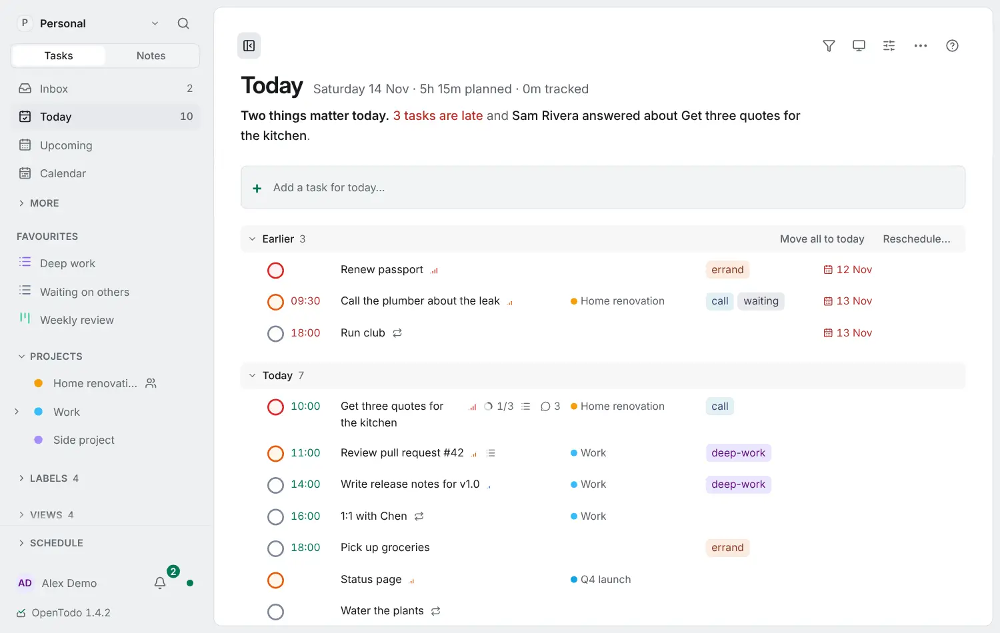

# Arrange your day by hand

<picture><source srcset="images/today-dark.webp" media="(prefers-color-scheme: dark)"></picture>

Today and Upcoming share one **Manual order** of your days: arrange tomorrow in Upcoming, and Today lists it that way tomorrow. Choose it under **Order by** in [Display options](arrange-built-in-views.md), or just move a task.

## Move a task

- **Drag** it between two rows.
- Select it and press <kbd>Alt</kbd>+<kbd>↑</kbd> / <kbd>↓</kbd>, with <kbd>Shift</kbd> to the top or bottom, or <kbd>Shift</kbd>+<kbd>K</kbd> / <kbd>J</kbd> with [Vim keybindings](keyboard.md#vim-keybindings).
- Use **Move up** and **Move down** in its menu.

A task moves within its group: a part of the day, a project, a priority or a label in Today, a day in Upcoming. At the edge of the group nothing moves. The first move switches that page to **Manual order** and keeps everything else where it was. **Earlier** and **Blocked** keep their order.

## Into another day or part

Drop a task at a line in another group and it takes that group too, with one **Undo**:

- another day in Upcoming changes its date, and its time stays;
- another part of the day sets the [part](day-parts.md), and its time stays;
- another project in Today grouped by Project moves it there.

A date you change elsewhere keeps the task's place. The order is yours: in a shared project you can arrange your day even as a viewer, without changing dates.

## By part of the day

With [day parts](day-parts.md) on, **Due date** lists a day as Time of day does: tasks without a part, then Morning, Afternoon and Evening, by time within each. Upcoming keeps that shape under Manual order too.
