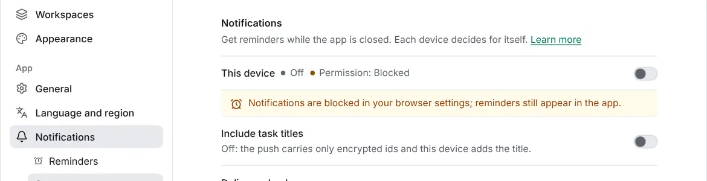

# Assignment notifications

<picture><source srcset="images/settings-notifications-dark.webp" media="(prefers-color-scheme: dark)"></picture>

In a shared project, you can hear about other people's changes to your tasks without opening the bell.

## Turn them on

1. On the device, turn on [push notifications](push-notifications.md) in **Settings → Notifications → Push notifications**.
2. Turn on one or both of the choices that appear below **Include task titles**:
   - **Assigned to me**: someone else assigns you a task, for example "Ben assigned you a task".
   - **Completed or reopened**: someone else completes or reopens a task assigned to you.

Each device decides for itself, and both are off until you turn them on. Clicking the notification opens the task.

## When you get one

- Never for your own changes.
- Not while your [away period](away.md) pauses reminders.
- With OpenTodo open in front, you see it in the [bell](notifications.md#the-bell) instead.
- At most one about the same task every five minutes, however often it's ticked and unticked.
- They are best effort: one that can't be delivered right away is not sent later.

The task's title is in the notification when that device has the task, or when **Include task titles** is on. With [end-to-end encryption](e2ee.md), the title never travels with the push.

## On your phone

The iPhone and Android apps don't receive these pushes yet. Add a [delivery channel](notification-channels.md) with **Assigned to me** and **Completed or reopened** to get them in ntfy, Pushover, Gotify or through a webhook.
