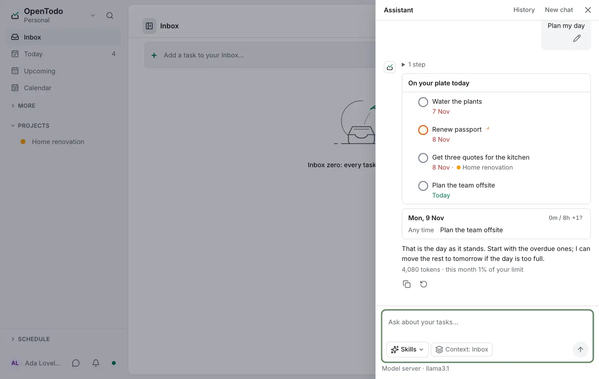

# Answers that show your tasks

<picture><source srcset="images/assistant-answers-dark.webp" media="(prefers-color-scheme: dark)"></picture>

Tasks the assistant names are links to the task, with its current title, struck through once it is done. A finished answer keeps what it read under **2 steps** (select it to see them). The conversation follows the answer as it grows; scroll up to read back and select **Jump to latest** to return.

A proposal can also show as a [calendar, an outline or a map](#proposals-in-their-own-shape), editable before you apply.

## What answers can show

Where it saves reading, an answer shows the app's own view of what it talks about, read from this device, so it stays current and works offline:

- **Tasks**: rows with their checkbox, dates and project. Ticking one completes it, with **Undo** as everywhere.
- **A day or a week**: each day with its planned total against your working day and its tasks in time order. Select a day to open it in the calendar.
- **A choice**: when the assistant needs a decision, its answers as buttons. Selecting one sends it as your reply; **Something else** puts the cursor in the message box.
- **Places**: tasks' places and saved places on the map with a numbered list, or the list alone when maps are off.
- **A note** or **a project's outline**, with a way to open it.
- **Tracked time**: your own time on a range of days as bars per project or per day, each with its total, and the total for the range. Select a bar to open Statistics.
- **Free time**: for a day or a week, the stretches within your working day (Settings → Calendar) that no calendar event, [frame](frames.md), [slot](slots.md) or task with a time takes. Select a day to open it. Event titles are never needed, so it looks the same with end-to-end encryption.
- **Deadlines**: the open tasks with a deadline on a range of days, in date order, each with its countdown. Select one to open it.
- **A project**: one column of its [board](sections-and-boards.md), such as **In progress**, its [timeline](project-timeline.md) with today marked, or its latest 20 changes and comments.
- **Statistics**: what you completed on a range of days, what is still open from earlier days, the Inbox, and Today against your [Today limit](today-limit.md).
- **A task** in full, with its notes, subtasks and latest comments, or **a habit**'s [month grid](recurring-and-reminders.md#track-a-habit) and streak.

These views are read-only, apart from ticking tasks. An answer shows at most four of them. Something that has been deleted since reads **Removed**.

## Copy, regenerate, edit

Under each answer, **Copy answer** copies it as Markdown, with the tasks, day, places or choice it showed written out. The latest answer has **Regenerate** to ask again, and your latest question has **Edit question** to change it and send it again; both replace what came after, and an applied proposal stays applied. They are not offered for a question with pasted text or photos, which are not kept.

## Proposals in their own shape

A proposal that moves tasks within one week shows as a **calendar**: the days, the tasks already on them and the proposed ones marked. One that creates a project shows as an **outline**, and one that sets places as a **map**. **List** switches to the lines, with the same checkboxes. <kbd>Enter</kbd> applies and <kbd>Esc</kbd> discards in every shape.

In the list, the pencil next to an item edits its proposed title, dates or priority before you apply. The item is marked **edited**, and what you entered is what applies; **Undo** works as for any proposal.
