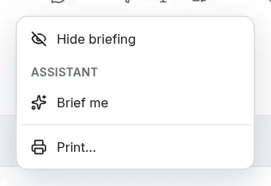

# The assistant where you work

<picture><source srcset="images/assistant-in-context-dark.webp" media="(prefers-color-scheme: dark)"></picture>

Some [skills](assistant-skills.md) start where their subject is. Each item sits under **Assistant** in a **⋯** menu, opens the assistant with the skill and its subject chosen, and sends at once. The items show only while the [assistant](assistant.md) is available to you.

| Where | Item | What it does |
|---|---|---|
| A task's **⋯** menu | **Rewrite this** | Proposes a clearer title and description, keeping every fact of the task. |
| A task's **⋯** menu | **Find a slot** | Proposes a day and time in your free time over the next 7 days, within your working day (Settings → Language and region → Calendar grid). The task's estimate, or 30 minutes without one, must fit; when nothing fits, it says so and proposes nothing. |
| A task's **⋯** menu | **Break this down** | Proposes subtasks with estimates. |
| A project's **⋯** menu | **What's next?** | Names the project's next actions and shows its board or timeline. It changes nothing. |
| Today's **⋯** menu | **Brief me** | Sums up the day: the agenda, deadlines coming up and how you are doing. It changes nothing. |

What a skill proposes is [reviewed, applied and undone](assistant-ask.md#ask-and-review) like any other answer. You can also pick these skills from **Skills** under the message box.
