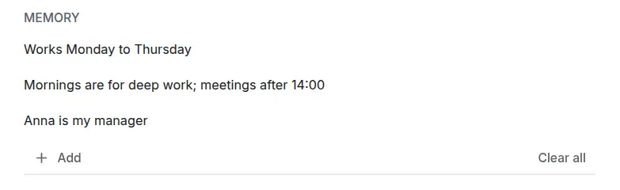

# What the assistant remembers

<picture><source srcset="images/assistant-memory-dark.webp" media="(prefers-color-scheme: dark)"></picture>

Memory holds short facts about you that the [assistant](assistant.md) keeps to, such as "Works Monday to Thursday" or "Anna is my manager": at most 20, each one line of up to 200 characters.

## Only what you confirm

You add an item in **Settings → Integrations → Assistant → Memory**, or the assistant proposes one when you state a fact ("Remember: Does not work on Fridays"). A proposed item exists only after you apply that proposal, and Undo removes it. Nothing is remembered silently, and the assistant is told to propose only facts you stated about yourself, never text from tasks, comments, pasted text or photos.

## Sent with every message

Every message sends your live items, in their order, to the provider of that turn as your stated preferences: the server's provider, your own, or the one set up on [your device](assistant-encrypted.md). The [disclosure](assistant-privacy.md#before-your-first-message) names them. If you accepted before memory existed, your consent still counts, and the assistant panel tells you once; **Got it** closes the notice on every device.

## Never to anyone else

MCP clients, read and agent tokens, routines' AI steps and other people never receive your items: no tool or resource returns them, and an export made with a read or agent token leaves them out.

## Synced and encrypted

Items reach your other devices through sync and work offline. With [end-to-end encryption](e2ee.md) their text is encrypted on your devices, so the server stores only ciphertext and never reads it; the on-device assistant sends the decrypted items to your provider.

## Change or remove them

In **Settings → Integrations → Assistant → Memory**, select an item to edit it (Enter saves, Escape cancels), move it with its handle or Alt+Up and Alt+Down, and delete it with the bin (Undo appears). **Add** takes a new one while fewer than 20 are kept; **Clear all** asks first.

A deleted item leaves every later message and your other devices once they sync; like a deleted task, it stays in the server's change history. Items are part of your [export](import-export.md), and an import of your own export brings them back.
