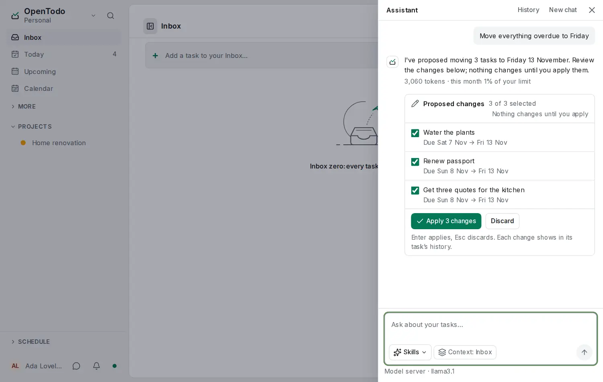

# Shape a proposal

<picture><source srcset="images/assistant-review-dark.webp" media="(prefers-color-scheme: dark)"></picture>

When the assistant proposes changes, nothing changes until you apply them. Until then, the proposal is yours to shape.

## Its own shape

A proposal that moves tasks within one week shows as a **calendar**: the days, the tasks already on them and the proposed ones marked. One that creates a project shows as an **outline**, and one that sets places as a **map**. **List** switches to the lines, with the same checkboxes. <kbd>Enter</kbd> applies and <kbd>Esc</kbd> discards in every shape.

## Edit an item

In every shape, the pencil next to an item edits its proposed title, dates, time or priority. The item is marked **edited**, and what you entered is what applies; **Undo** works as for any proposal.

In the calendar, drag a proposed task to another day, or focus it and press <kbd>Alt</kbd>+<kbd>↑</kbd> or <kbd>Alt</kbd>+<kbd>↓</kbd> to move it a day earlier or later. Its time stays; change it with the pencil.

## Ask for more

While a proposal is open, your next message amends it instead of starting over: "also add a task to call the plumber", "keep the venue for today", "move the agency reply to Wednesday". The card then shows the whole proposal, with what the latest message **added** or **changed** marked and anything it removed named at the top. The items you unchecked or edited stay that way unless you asked to change them.

The proposal goes with your message only while it is open. Applying or discarding it ends it, and **Regenerate** or **Edit question** start from the answer they replace. An open proposal can hold up to 50 items.

## Before and after

**Before and after** in the card's head shows each item's fields side by side: the value on this device now and the proposed one. A new item has nothing before. Select it again to return to the proposal's shape.
