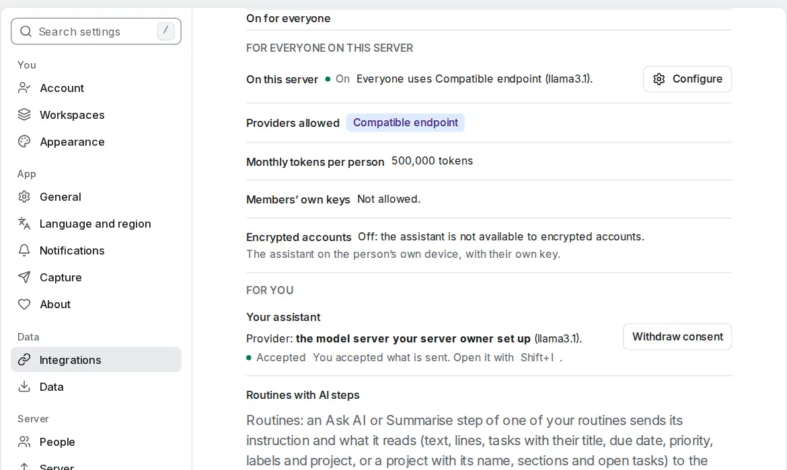

# Suggest after adding

<picture><source srcset="images/assistant-settings-dark.webp" media="(prefers-color-scheme: dark)"></picture>

**Settings → Integrations → Assistant → Suggest after adding** (this device) is off by default. With it on and the [assistant](assistant.md) available, adding a task from a quick-add line (a list's line, the add bar or palette, the phone's sheet) opens the assistant with one bounded question: a clearer title if it helps, a better project, at most four subtasks. Review, then **Apply**; **Undo** puts it back.

- The proposal is always shown for review, even if [**Small changes without review**](assistant-settings.md#apply-small-changes-without-review) is on.
- The assistant opens over the page and takes the cursor, like any dialog. To keep adding, close it or apply or discard the proposal.
- While the assistant is busy (its panel open, or a turn running) a task you add gets no suggestion: three quick adds in a row suggest for the first. Close the panel, or apply or discard the proposal, and the next add suggests again.
- Each suggestion is one assistant turn. Imports, the API, CalDAV, email, pasted lists and sync never ask.
