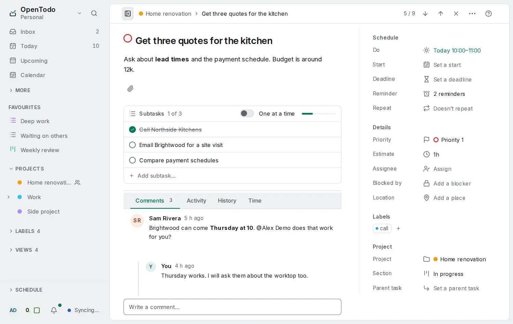

# Attachments

<picture><source srcset="images/task-detail-dark.webp" media="(prefers-color-scheme: dark)"></picture>

A task, a comment on it, or a [note](notes.md) can carry files and links: a receipt, a photo of a whiteboard, a PDF, the link to a design. Open a task and use **Attachments** below its subtasks, the paperclip in the comment box, or **Attach files…** in a note's menu.

## Add a file or a link

- **Pick, paste or drop.** Choose **Attach › Choose files…** to pick files, paste an image or a file into the task panel, or drop files onto it (a drop zone appears while you drag).
- **In the text.** An image pasted into the notes or a comment is attached and shown in place ([details](formatting.md#images)).
- **Links.** Choose **Attach › Add a link…** and paste an `http` or `https` address. A link is stored as a link: the server never downloads it.
- **Offline.** A file added without a connection appears at once, marked "waiting to upload", and uploads after the next sync; other devices show "uploading" until it arrives.

Images show a thumbnail; other files show their name, type and size. **Open** shows the file in a new tab when the browser can display it safely (images, PDF, text, audio, video); anything else, and every encrypted file, is downloaded. You can rename and remove your own attachments; the notice that follows undoes a removal.

## Who sees and changes them

Attachments belong to their task or note: everyone who can see it can see its attachments, viewers of a shared project included, and anyone who can comment can attach files. Only the person who added an attachment can rename it. The author, a project admin and the owner can remove it.

## Limits

The server owner sets a size limit per file (25 MB unless changed) and a total per account (1 GB unless changed) in **Settings → Server → Attachments**, and can turn attachments off. **Settings → Data** shows how much of your total you use. Removing an attachment frees your total at once; the file stays on the server for the Trash retention period (30 days unless changed), then is deleted. Until then any device can undo the removal, if your total still has room. Purging a task or a note from the Trash deletes its files immediately. A note turned into a task or moved to another project keeps its files without uploading them again; encrypted files stay with the original in the Trash when the project is shared.

## Encryption

On an account with [end-to-end encryption](e2ee.md), the file name, its type, a link's address and the file's bytes are encrypted on your device before they leave it. The server stores and serves only the encrypted bytes and never holds a key. Turning encryption on or off re-uploads existing files and links in the new form.

## Privacy and safety

Files are only ever served to signed-in people who can see the task. A file is never shown as a web page: documents that could run code (HTML, SVG and the like) are always downloaded, and every file is served with headers that stop the browser from running anything in it.

## For operators

Files live under `<data>/attachments/`, one file per attachment, written once and never changed. Backups include them after the database, the ZIP export (`GET /api/v1/export?format=zip`) adds them to a user's export, and `opentodo restore` puts them back. The optional `OPENTODO_ATTACHMENTS_MAX_FILE_MB` and `OPENTODO_ATTACHMENTS_QUOTA_MB` preset the two limits on the first start; after that the owner's settings decide. The public demo has attachments turned off. The routes are described in the [API reference](api.md#attachments).
