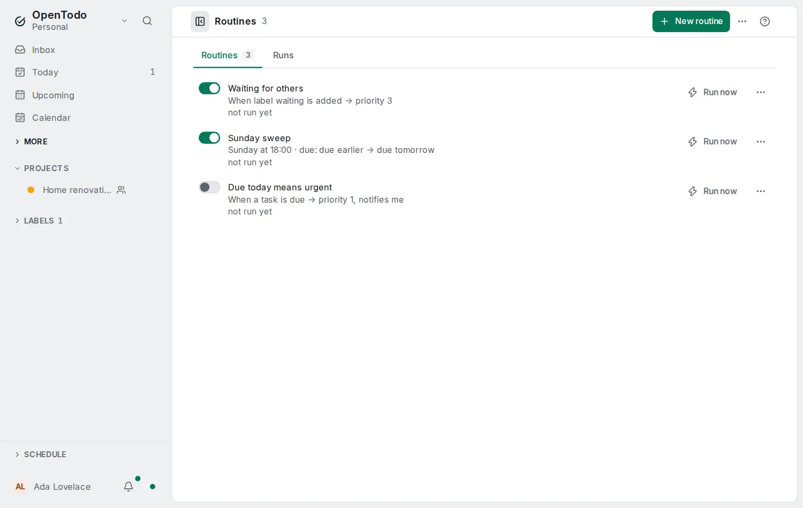

# Automation rules

<picture><source srcset="images/rules-dark.webp" media="(prefers-color-scheme: dark)"></picture>

A rule says **when** something happens, **which tasks** it is for, and **what** to change. *When the label waiting is added, move the task to the Waiting section of Work.* Rules run on your server, so they work while every device is closed. Open **More → [Routines](routines.md)**.

## Make a rule

Choose **New routine**, name it, then fill its **When** card and one **Change tasks** card:

- **When**: a task is created, completed or reopened; a label is added or removed; a task is assigned to you or moved to a project or section; a task is due (at its time, 09:00 for a date without a time); a task's date passes (at the start of the next day); or on a schedule, at a time on chosen weekdays.
- **Only for tasks that**: optional conditions, all of which must hold: project (with its sub-projects), labels, priority, date, deadline, assignee, blocked. The editor shows how many open tasks match now.
- **Then**: priority, date, start, deadline, assignee, labels to add or remove, project and section, complete or reopen, a comment, an in-app notification, or a delivery to one of your [webhooks](webhooks.md).

A rule saved offline is listed at once and runs after the next sync. Times use the time zone your devices report and your day start.

## What a rule changes

A rule writes the same changes you would: completing a repeating task moves it to its next date, and a moved date carries its reminders along. A change the task already has is not written. Each change appears in the task's history as **Routine (name)**, and **Restore this value** undoes it like any edit.

Rules fire only for your own edits, never for a teammate's change in a shared project or for an [import](import-export.md). A rule never moves tasks into or out of a shared project.

## Limits and pauses

An account runs at most 60 rule runs a minute and 2,000 a day, a run changes at most 500 tasks, and you can have 50 rules. A rule that keeps hitting the per-minute limit is paused with **Paused: it ran too often** and you get one notification; turn it back on when it is fixed. Rules that trigger each other stop after three in a row.

**Pause all rules** at the bottom of the page pauses every rule of yours until you resume.

## History

**History** in a rule's menu lists its recent runs (the last 100, for 30 days) with the tasks each one changed. The history is kept on the server, so it needs a connection.

## Routines

A rule is the simplest [routine](routines.md): one card that changes tasks. Routines can also have several steps, each using what the steps before it produced.

## Turn a filter into a rule

A saved view's menu and a board column's **Rule** dialog offer **Make an automation rule**. The editor opens with the column's changes as actions and the filter's project, label, priority, date and similar terms as conditions; terms a rule cannot use, such as a text search, are named.

## Encrypted accounts

Conditions and actions use ids and dates, which the server reads for every account, so rules work with [end-to-end encryption](e2ee.md). The comment action is not available: the server cannot encrypt a comment.

## For the server owner

**Settings → Server → Automations** turns rules off for every account. The optional variable `OPENTODO_AUTOMATIONS=off` (or `on`) sets it and makes the switch read-only; another value stops the server at startup. A demo instance never runs rules.
