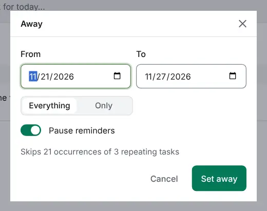

# Away

<picture><source srcset="images/away-dark.webp" media="(prefers-color-scheme: dark)"></picture>

Tell OpenTodo you are away and your repeating tasks skip those days, as if you had skipped each one yourself. Habit streaks survive, nothing piles up as overdue, and reminders stay quiet until you are back.

## Set an away period

Open Today's menu (**⋯**) and choose **Away…**, or type *away* in the command palette.

- **From** and **To**: the first and last day, both included, at most 90 days. The days can be in the past: set Away after a few ill days and the overdue occurrences of those days are skipped.
- **Everything** covers every repeating task you may edit. **Only** covers the ones in the projects, or with the labels, you choose.
- **Pause reminders** (on by default) holds every reminder and the email digest while the period lasts.

Before anything changes, the dialog says what it will do, for example *Skips 23 occurrences of 6 repeating tasks*. Choose **Set away**. **Undo** in the message that follows puts every occurrence back.

It works offline; your other devices catch up when they sync.

## What it does

Each occurrence in the period is skipped, exactly like [Skip this occurrence](recurrence.md#one-occurrence-alone):

- A task that is due in the period moves on to its next date after it.
- A habit's skipped days count as kept for its [streak](habits.md), and never as done.
- A task that repeats *after completion* and is due in the period moves to the day after it.
- Tasks that do not repeat keep their dates.
- In a shared project where you are a viewer, nothing changes.

Setting the same period again skips nothing more. Setting a new period replaces the old one.

## While you are away

Today's title reads *Away until Friday*. With reminders paused, no reminder arrives on any device or channel, and no digest is sent. Reminders held this way are dropped, not delivered later; each one is still listed on its task. From the day after the period, everything goes out as usual.

To come back early, choose **End now** in Today's menu. The period ends on every device; the days already skipped stay skipped.

## From a script

`ot away 2026-11-24 2026-11-30` sets a period, with `--project` and `--label` to narrow it and `--keep-reminders` to leave reminders on. `ot away --end` ends it. Scripts use `POST` and `DELETE /api/v1/away` ([API](api.md#away)).
