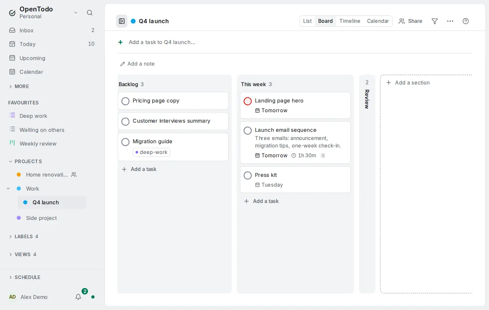

# Fold columns and show notes on cards

<picture><source srcset="images/board-fold-notes-dark.webp" media="(prefers-color-scheme: dark)"></picture>

A [board](sections-and-boards.md#switch-to-a-board) gives every column the same width. Fold the ones you are not reading right now, like **Done** or **Later**, and show the line of context people wrote in a card's notes without opening it.

## Fold a column

Open the column's **⋯** menu and choose **Fold column**, or select one of its cards and press <kbd>z</kbd>. The column becomes a narrow strip with its colour or icon, how many open tasks it holds and its name written sideways; the other columns take the space.

To unfold it, select the strip, or focus it and press <kbd>Enter</kbd> or <kbd>z</kbd>.

- **It still takes cards.** Drag a card onto the strip, or select a card next to it and press <kbd>Shift</kbd>+<kbd>→</kbd> or <kbd>Shift</kbd>+<kbd>←</kbd>. The card goes to the bottom of that column, the count goes up and the column stays folded.
- **On this device only.** Folding a column is the same as folding its section in the list layout: fold **Done** on the board and it is folded in the list too. Your other devices and other members keep their own choice.
- **The keyboard skips it.** <kbd>h</kbd> and <kbd>l</kbd> jump over folded columns.
- **On a phone** a folded column is a thin strip between the others. The dots above the board count only the unfolded columns; tap the strip to unfold it.
- **Viewers** of a shared project can fold columns too; they still can't move cards.

A [saved view](saved-views.md) in the board layout folds its columns the same way; in the list layout that group is collapsed. On a board of filters, a panel folds to its header line with its fold button or <kbd>z</kbd>, and still takes dropped cards.

## Show notes on cards

In the board's **⋯** project menu, turn on **Show notes on cards**. Each card then shows the first two lines of its notes under the title, as plain text: formatting is left out, links keep their words, pictures and tables are skipped, and checklist items are joined with dots. Cards without notes look as before. It is off by default.

The choice is yours alone for that project: other members of a shared project choose for themselves. It follows you to your other devices. A saved view in the board layout has the same choice as **Notes on cards** under **Show on rows** in its display options, stored on the view.

On an [encrypted account](e2ee.md) the preview comes from the notes this device has decrypted, also offline; notes it can't decrypt show nothing.
