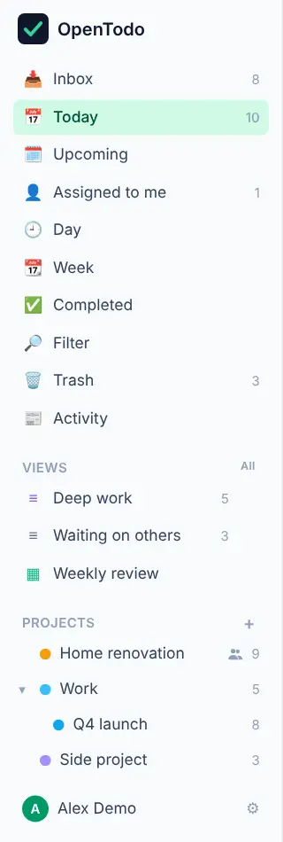

# The built-in views

<picture><source srcset="images/sidebar-dark.webp" media="(prefers-color-scheme: dark)"></picture>

Each view is built from your device's tasks, so it works offline. Today and Upcoming have [a page of their own](today-and-upcoming.md); for views you make yourself, see [Saved views](saved-views.md).

## What each view shows

[Quick add](quick-add.md) at the top of a list adds to it. To open a view, press <kbd>g</kbd>, then the letter:

| View | Shows | Shortcut |
| --- | --- | --- |
| **Inbox** | Tasks that aren't in a project yet; **Process** [walks them one at a time](process-the-inbox.md) | <kbd>g</kbd> <kbd>i</kbd> |
| **Today** | Tasks due today and tasks whose deadline is today, with overdue ones first | <kbd>g</kbd> <kbd>t</kbd> |
| **Upcoming** | Tasks due after today, and undated tasks with a deadline ahead, grouped by day | <kbd>g</kbd> <kbd>u</kbd> |
| **Anytime** | Open tasks with no date and no start: things to do whenever there is time | <kbd>g</kbd> <kbd>n</kbd> |
| **Someday** | Tasks you parked for later, by project | <kbd>g</kbd> <kbd>o</kbd> |
| **Next** | Each project's [next action](method/do.md), by context | <kbd>g</kbd> <kbd>Shift+N</kbd> |
| **Waiting** | Tasks [waiting](method/places.md) on someone or something | <kbd>g</kbd> <kbd>Shift+W</kbd> |
| **Assigned to me** | Open tasks assigned to you, across projects | <kbd>g</kbd> <kbd>a</kbd> |
| **Calendar** | Your dated tasks by Day, Week or Month, as you last left it | <kbd>g</kbd> <kbd>d</kbd>, <kbd>g</kbd> <kbd>w</kbd>, <kbd>g</kbd> <kbd>m</kbd> |
| **Completed** | What you finished, newest first, under a heading per day; **Show more** at the end reaches older days | <kbd>g</kbd> <kbd>c</kbd> |
| **Filter** | Any search you can describe | <kbd>g</kbd> <kbd>f</kbd> |
| **Trash** | Deleted tasks and projects | <kbd>g</kbd> <kbd>x</kbd> |
| **Updates** | What changed in your shared projects | <kbd>g</kbd> <kbd>h</kbd> |
| **Review** | Your [weekly review](review-and-statistics.md) | <kbd>g</kbd> <kbd>r</kbd> |
| **Statistics** | What you [completed and let slip](statistics.md#statistics) | <kbd>g</kbd> <kbd>Shift+S</kbd> |

The sidebar keeps Inbox, Today, Upcoming and Calendar at the top; the rest wait in **More**, a menu on a computer. Inbox and Today show open-task counts; a project shows its count on hover or focus. Deferred and parked tasks ([When a task starts](tasks-and-projects.md#when-a-task-starts)) are not counted.

Each project can also be shown three ways: as a **List**, as a **Board** with a column per section, or as a **Timeline** of its dates with arrows between tasks that wait for each other. Press <kbd>v</kbd> to cycle through them; see [Sections and boards](sections-and-boards.md).

## Anytime, for when you have time

Anytime lists every open task that has no due date, no deadline and no start date, grouped by project: the things you could do whenever there is a moment; [quick add](quick-add.md) here adds an undated one. A task leaves it as soon as it gets a date, from any device.

## Park ideas in Someday

Someday holds the tasks you parked: ideas and maybes you don't want to see every day; [quick add](quick-add.md) here parks what you add. They stay out of Today, Upcoming, Anytime and the counts, and are listed here by project and in their project's **Later** group. Press <kbd>n</kbd> on a task to park it or bring it back.

## Narrow a list by duration

The **Filter** action in the header of the Inbox, Today, Upcoming and project lists offers **Quick wins** (15 minutes or less), **Under 30 min**, **Over 1 h** and **Unestimated**. Turn one on to see only matching tasks; its chip in the header has a × to clear it. Your choice stays on that device. Set estimates with <kbd>e</kbd>.
