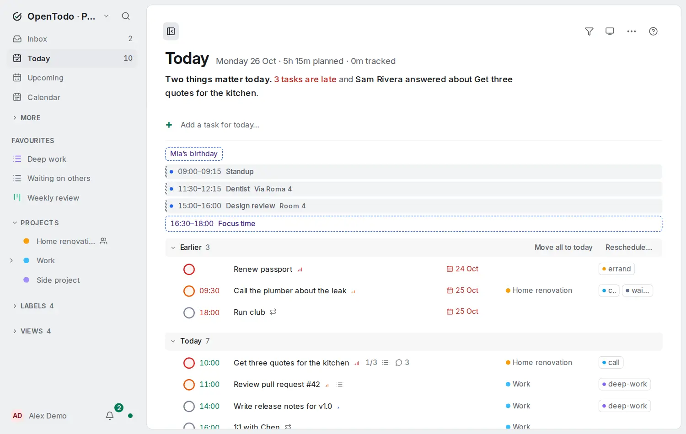

# Calendar events in Today

<picture><source srcset="images/today-agenda-dark.webp" media="(prefers-color-scheme: dark)"></picture>

If you subscribe to [other calendars](other-calendars.md), Today can show the day's appointments above your tasks, so one page gives you the whole day.

## Turn it on

Open Today's **More actions** menu (the <kbd>⋯</kbd> button in the header, or the bar's menu on a phone) and choose **Show calendar events**. **Hide calendar events** in the same menu turns it off again.

It's off until you turn it on. Your choice is saved with your account, so it follows you to your other devices, and it works offline like any other change.

The item only appears once you have at least one subscribed calendar, which needs [calendar feeds](calendar-feeds.md) turned on for the server.

## What the agenda shows

The agenda sits between the quick add and your first task:

- All-day and multi-day events come first, as chips.
- Timed events follow in the order they start, each with its time, title, the calendar's colour dot and its location.
- Events marked as *free* in their calendar are drawn as an outline only, as in Day and Week.
- Events that have already ended today are dimmed.

Click an event, or Tab to it and press Enter, to see its time, location and calendar. Events are read-only, as everywhere in OpenTodo; edit them in their own calendar app.

On a day without events, nothing is shown. Events of a calendar you disabled under **Settings → Integrations → Calendar feeds** never show. The **Calendars** button of Day and Week, which hides events on one device, doesn't change Today.

## Offline

Today uses the events your device keeps for Day and Week, so the agenda shows offline too, as of the last refresh. It then ends with **Calendars as of** and the time of that refresh. Online, Today refreshes the events when they are more than ten minutes old.
