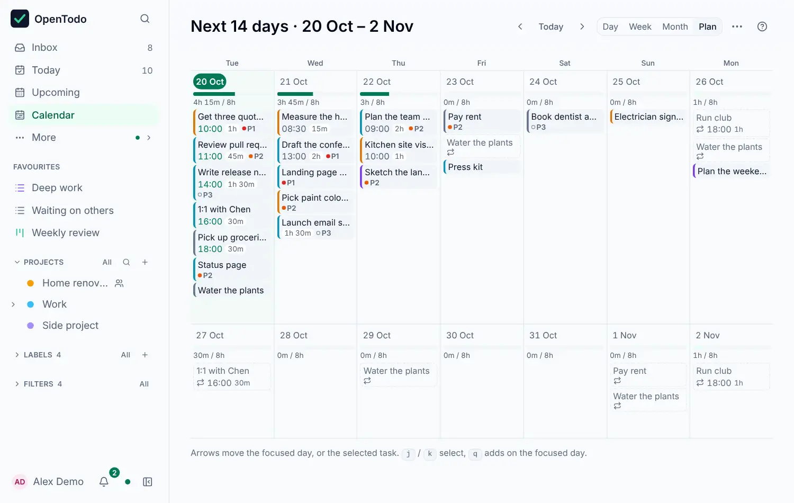

# Day, Week and Month

<picture><source srcset="images/week-dark.webp" media="(prefers-color-scheme: dark)"></picture>

The calendar shows your dated tasks by day, week, month or as a two-week plan. Dragging and keyboard moves are in [Place tasks on the calendar](place-tasks-on-the-calendar.md); estimates and the grid settings are in [Time blocking](time-blocking.md).

## Open the calendar

Choose **Calendar** in the sidebar, then **Day**, **Week**, **Month** or **Plan** in its header, or press <kbd>g</kbd> <kbd>d</kbd>, <kbd>g</kbd> <kbd>w</kbd>, <kbd>g</kbd> <kbd>m</kbd> or <kbd>g</kbd> <kbd>Shift+C</kbd>. The sidebar opens the calendar the way you last left it on this device.

- Tasks with a date **and** a time appear as blocks at that time. The block is as tall as the estimate.
- A timed task without an estimate gets a 30-minute block with a dashed outline.
- Tasks with a date but no time wait in the **Unscheduled** lane at the top of their day.
- A red line marks the current time.

Use **‹** and **›** (or <kbd>[</kbd> and <kbd>]</kbd>) to go back and forward, and **Today** (or <kbd>t</kbd>) to come back.

The Week view starts on your first day of the week, and the hours and block times follow your time format (`9 AM` or `09:00`). Both are set in **Settings → General → Date and time** and follow you to all your devices. Moving a block still sets the same time; only how it is shown changes.

## See the month

**Month** shows six weeks at a glance, starting on your first day of the week, with today marked and the days of other months dimmed. Each day lists its open tasks: the timed ones first by time, then the rest by priority. A crowded day shows the first few and **+N more**, which expands the day in place. When a day's tasks have estimates, the day shows the planned total against your day length, in red when it is over.

- Drag a task onto another day to move it. It keeps its time.
- Select a task with <kbd>j</kbd> and <kbd>k</kbd>, or by clicking it. The arrows then move it a day (<kbd>←</kbd> <kbd>→</kbd>) or a week (<kbd>↑</kbd> <kbd>↓</kbd>), into the next month if needed. <kbd>Enter</kbd> opens it, and <kbd>Esc</kbd> clears the selection.
- With no task selected, the arrows move between days. <kbd>q</kbd> adds a task due on the day you're on.
- <kbd>[</kbd> and <kbd>]</kbd> go to the previous and next month, and <kbd>t</kbd> comes back to today.

Switching between **Day**, **Week**, **Month** and **Plan** keeps the date you're looking at. On a phone, each day shows how many tasks it has, and the tasks of the day you tap are listed under the month. Tasks in a project where you're a viewer are shown but can't be moved. Like the rest of the calendar, the month works offline.

## Plan the next two weeks

<picture><source srcset="images/plan-dark.webp" media="(prefers-color-scheme: dark)"></picture>

**Plan** shows the next 14 days as columns, seven to a row. Each day lists its tasks with their time, estimate and priority, under a bar of planned time against your day length. The bar counts task estimates, busy meetings from [other calendars](other-calendars.md), and the coming occurrences of [repeating tasks](recurrence.md), which are dimmed and move with the task itself.

- Drag a task onto another day, or select it and press the arrows: a day (<kbd>←</kbd> <kbd>→</kbd>) or a week (<kbd>↑</kbd> <kbd>↓</kbd>). <kbd>q</kbd> adds a task on the focused day, <kbd>c</kbd> completes the selected one.
- Choose 7, 14 or 21 days in the page's menu; this device remembers it.

On a phone the days are listed vertically.
