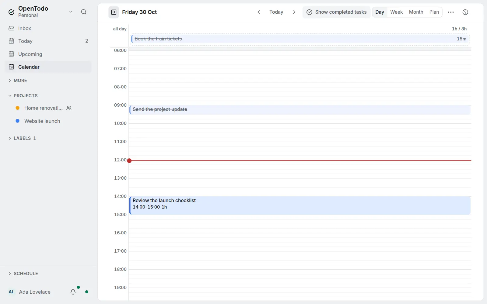

# Completed tasks on the calendar

<picture><source srcset="images/completed-calendar-dark.webp" media="(prefers-color-scheme: dark)"></picture>

## Show completed tasks

Choose **Show completed tasks** in the [Calendar](calendar-views.md) header, or in **More actions** on smaller screens. When the button is pressed or the menu item is checked, finished tasks appear with struck-through titles. Choose **Show completed tasks** again to hide them; the control keeps the same name in both states.

Completed tasks are hidden by default. This device remembers your choice across **Day**, **Week**, **Month** and **Plan**, including after a reload and while offline. Other devices keep their own choice.

## Read the schedule

A finished task appears on its scheduled due date and time, rather than the date it was completed. A task planned for Monday at 09:00 stays there even if you complete it on Tuesday. Date-only tasks appear in their day's Unscheduled lane or list.

Completed tasks do not add to the day's remaining planned time, tasks without estimates or future repeating-task projections. [Counted meetings](place-tasks-on-the-calendar.md#see-whether-the-day-fits) stay in the total when you show or hide completed tasks. Deleted tasks, undated tasks and tasks in archived projects stay out of the calendar.

## Open or edit a completed task

Select and open a completed task as usual. You can edit or reopen it in its details when your project role allows it. Calendar dragging, resizing and scheduling shortcuts leave completed tasks unchanged.

[Slots](slots.md) keep their own checklist, including checked tasks and their count. This control changes standalone calendar rows and blocks; it leaves a slot's checklist and container actions unchanged.
