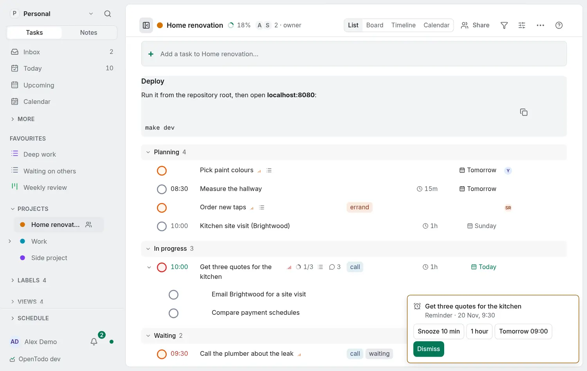

# Copy a code block

<picture><source srcset="images/copy-code-block-dark.webp" media="(prefers-color-scheme: dark)"></picture>

A code block shown as formatted text — in a note, in a comment or in an answer — has a **Copy** button at its top corner. Choose it and the block's text is on your clipboard as plain text: no backticks, no trailing blank line, and the indentation exactly as written, so a command pastes into a terminal and runs. The button confirms with a check, then goes back to the copy icon.

It works wherever notes are shown as text: a project note, a note's Markdown while its editor loads, an answer from the assistant, a public page. Anyone who can read the text can copy it, a viewer of a shared project included. If the browser refuses the clipboard, the button says it could not copy and the code stays on screen to select.

A note you may only read also offers **Copy note**, which copies the whole note as Markdown. It sits in the note's corner, before the text in the tab order, and stays out of sight until <kbd>Tab</kbd> reaches it.

To write or copy a note's Markdown yourself, use [a note's Markdown source](note-markdown-source.md).
