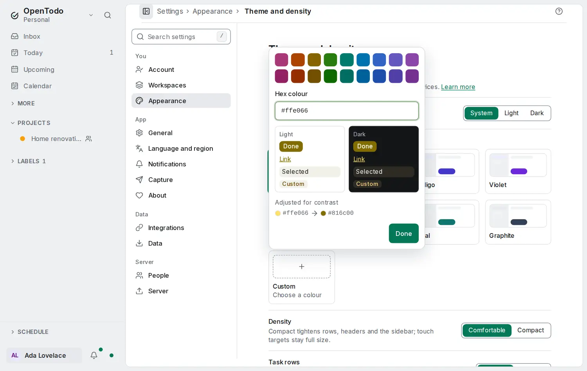

# Your own accent colour

<picture><source srcset="images/custom-accent-dark.webp" media="(prefers-color-scheme: dark)"></picture>

Besides the eight themes, the accent (the colour of buttons, links, the focus ring and selected items) can be a colour you choose: your brand colour, your team's, or a favourite. It follows your account to every device, also offline.

## Choose a colour

1. Open **Settings → Appearance → Theme and density**.
2. Select **Custom**, the last tile after Graphite. A picker opens next to it; on a phone it is a sheet at the bottom of the screen.
3. Pick one of the swatches, or type a hex code in **Hex colour**, such as `#1f6feb`, `1f6feb` or `#f60`, and press Enter (leaving the field applies it too). Anything else shows an error and changes nothing.
4. Select **Done**, or press Escape.

While you choose, the picker previews a button, a link, a selected row and a soft label in light and in dark, before anything changes. A swatch or a hex code applies at once.

With the keyboard: Tab to the theme tiles, the arrow keys to **Custom**, Enter to open the picker, the arrow keys through the swatches and Space or Enter to pick one. Escape closes the picker and returns to the tile.

Choosing another theme later keeps your colour: the Custom tile still shows it, and selecting the tile again brings it back.

## Readable in light and dark

Text on the accent and the accent on every surface must stay readable, in light and in dark mode. OpenTodo keeps the hue of the colour you picked and makes it lighter or darker until every contrast rule of the design system passes:

- a pale colour, such as a light yellow, becomes a darker yellow in light mode, so white text on a button stays readable, and a light yellow in dark mode;
- a very dark colour becomes a little lighter, so the selected row's text still reads;
- text on the accent is always white, as in every theme.

When the colour was changed, the picker says **Adjusted for contrast** and shows the colour you picked next to the one it uses.

## Away from the red of errors

Red means errors and priority 1 in OpenTodo, so the accent never takes their place. A colour very close to that red is turned a little towards orange or pink, until it is as far from it as the Rose theme is, and the picker says **Turned away from the colour for errors**.

## Where it shows

- The installed app's title bar uses your colour in light mode and the dark background in dark mode; the splash screen and the app's icons stay neutral.
- The high-contrast display shows a custom accent in black or white, as every theme.
- Priority colours, warnings, errors and the colours of your projects, labels and views keep their own colours.
- Your colour is part of your JSON export and comes back with an import.
- An older version of the app shows the Emerald theme instead and changes nothing.

Everything is computed on your device; nothing about the colour is sent anywhere but your own server, with your other settings.
