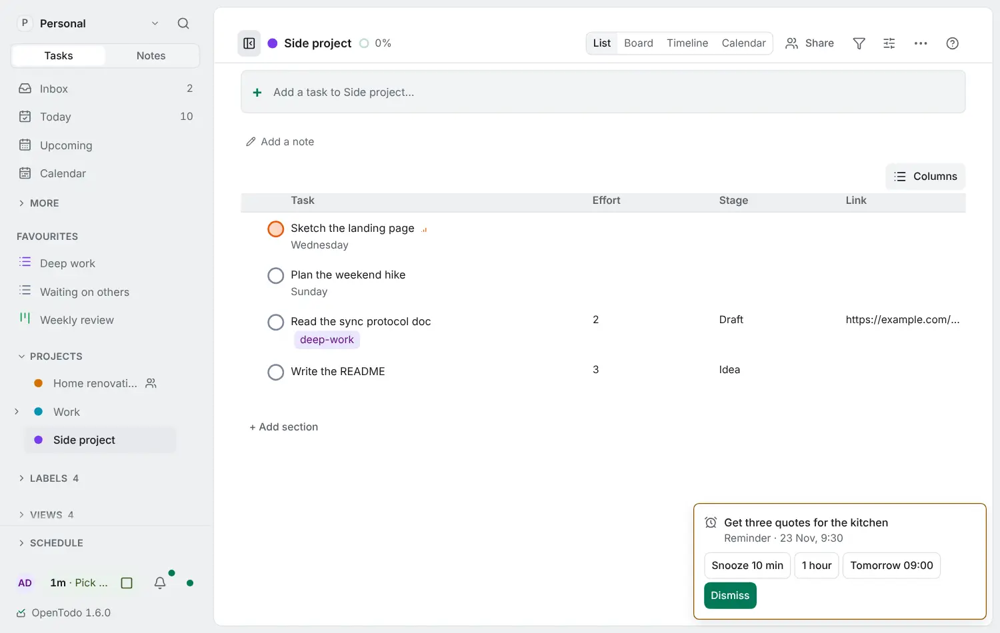

# Custom fields

<picture><source srcset="images/custom-fields-dark.webp" media="(prefers-color-scheme: dark)"></picture>

A project or a workspace can give its tasks a few typed fields: a cost, a client, a stage, a link. You see and filter them like any other property.

## Define the fields of a project

Open the project, open the **⋯** menu and choose **Fields…** (or press <kbd>Shift</kbd>+<kbd>F</kbd>). Type a name, pick a type and select **Add field**:

| Type | Holds |
| --- | --- |
| Text | up to 2,000 characters |
| Number | any number, shown with your language's digit grouping |
| Date | a calendar day |
| Choice | one of the options you list, one per line |
| Link | an `http` or `https` address |
| Checkbox | on or off |

A project has at most 30 fields, each with its own name. The type of a field is fixed once it exists. In the same dialog you can rename a field, edit the options of a choice, move a field up or down (drag it, or press <kbd>Alt</kbd>+<kbd>↑</kbd> / <kbd>↓</kbd> on its handle) and delete it.

Editors of a project manage its fields; viewers see the values only. The Inbox has no fields.

## Fill in values

A task's panel has a **Fields** group with an editor for each field. A number or text is saved when you press <kbd>Enter</kbd> or leave the field, a choice opens with <kbd>Enter</kbd> or <kbd>Alt</kbd>+<kbd>↓</kbd>, and a link has a button that opens it in a new tab. Values work offline and sync like every edit; two people editing different fields of one task both keep their change.

## See values on rows, cards and columns

Rows and board cards show up to three values as small badges, such as **Cost 1,200** or **Paid**, and **+2** for the rest. On a wide screen a project's list offers a **Columns** button above its tasks: one column per field, read-only, with the task panel for editing. The choice is remembered per project on that device.

## Fields of sub-projects

A field applies to its project and to every sub-project below it. The **Fields…** dialog of a sub-project lists the inherited fields first, under **From** and the parent's name; edit them in the parent. No two fields that apply to a project share a name, and the limit of 30 counts them all. Someone you share only the sub-project with sees its own fields, not the parent's.

## Fields of a workspace

A field can belong to a workspace: in **Settings → Workspaces**, open it and choose **Fields…**. It applies to every project of yours there, listed under **From** and the workspace's name, and no project may reuse its name. Only the owner defines and sees these fields.

## Move a task or delete a field

A task moved to another project keeps its values but shows only that project's fields; move it back and they reappear. Moving a sub-project or a project works the same way. Deleting a field asks first and says how many tasks hold a value: the values stay in the export, hidden, and **Undo** restores them.

Renaming a choice option in place updates the tasks holding it.

## Filter by a field

Use a field's name in a [filter query](filters.md#custom-fields): `cost > 100`, `client = "Acme"`, `"Order date" <= friday`, `paid = true`, or `no client` for tasks without a value.
See [Group and order](group-and-order.md) for field sorting. The setting stores definition IDs, keeping encrypted names out of sync operations.
