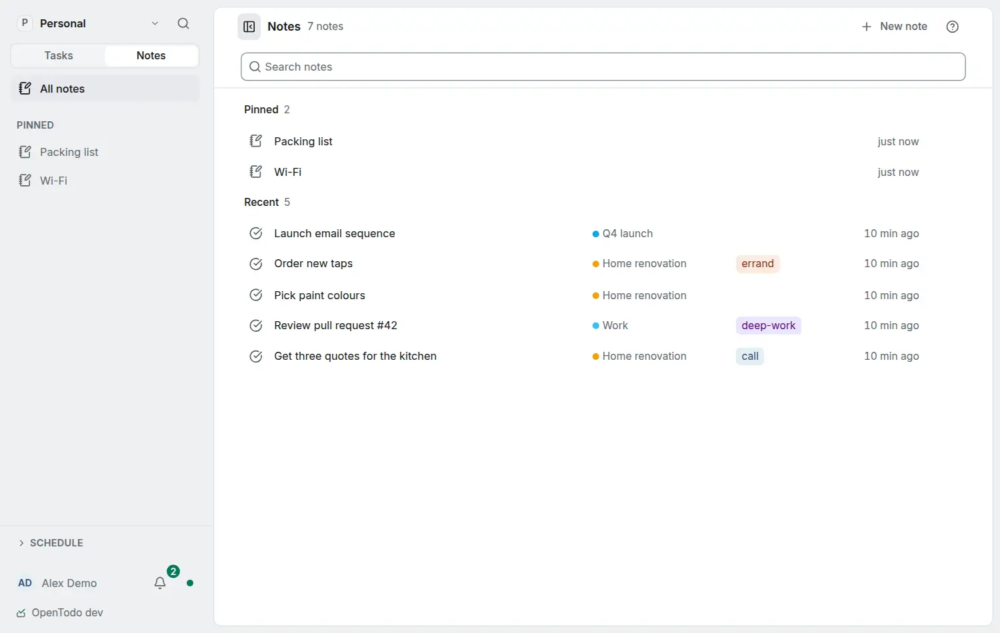

# Daily notes

<picture><source srcset="images/notes-home-dark.webp" media="(prefers-color-scheme: dark)"></picture>

A daily note is an ordinary [note](notes.md) that belongs to one day: a place for the day's plan, a log of what happened, and what you finished. Every device of yours opens the same note for the same day, offline included.

## Turn it on

Daily notes is off until you turn it on in **Settings › General › Notes**. There you also choose:

- **Project for daily notes**: where new daily notes go. Notes from earlier days stay where they are.
- **Template**: the built-in **Daily** (Plan, Notes, What I finished today), one of your own [note templates](note-templates.md), or **No template**. A template you later move to the Trash still shows as chosen, and new days start from the built-in Daily until you pick another.

While it is off, nothing below is shown and the daily notes you already have stay ordinary notes.

## Open today's note

- <kbd>g</kbd> <kbd>j</kbd> from anywhere,
- **Open today's note** in the command palette,
- **Today's note** under All notes in the Notes sidebar,
- the note button in Today's header.

Today is your date after your day start (Settings › General), so at 01:30 with a day that starts at 04:00 you get yesterday's note.

A day without a note opens as a draft showing the filled template. The note is written only when you change something: type, paste, tick a box or format. Opening days and leaving them untouched writes nothing.

## Move between days

In a daily note, ‹ and › in its header, or <kbd>[</kbd> and <kbd>]</kbd> while no text field has focus, open the previous and the next day.

## One note per day

The note's title is the day in your date format. Its id comes from your account and the day, so a laptop and a phone that both start the same day offline make one note when they sync, with the template text once and what you wrote on each. A daily note you move to the Trash comes back when you open that day again.

## In routines

**Get the daily note** (Notes and text) outputs the note of a day, today when the date is empty, and creates it from your settings when it does not exist yet. Follow it with **Add to a note** to keep a journal line, for example the tasks you completed today. The step needs Daily notes on (a run fails with *Daily notes are turned off* otherwise, writing nothing), and a workspace's routine fails when the project for daily notes is in another workspace. See [Notes in routines](routines.md#notes-in-routines).
