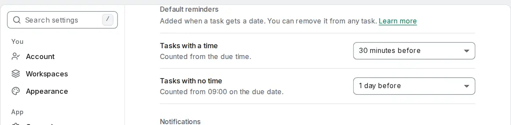

# Default reminders

<picture><source srcset="images/settings-default-reminders-dark.webp" media="(prefers-color-scheme: dark)"></picture>

Instead of adding the same reminder to every task, set a default once in **Settings → Notifications → Default reminders**:

- **Tasks with a time**: None, At the due time, 10 minutes before, 30 minutes before, 1 hour before, 1 day before, or **Custom…** for any number of minutes, hours or days before or after.
- **Tasks with no time**: None, On the day at 09:00, 1 day before, 2 days before, 3 days before, 1 week before, or **Custom…**. These count from 09:00 on the due date.

Both start at **None**, so nothing changes until you choose one. The choice is part of your account and reaches all your devices.

When a task that had no date gets one (you create it with a date, schedule it, drag it onto the calendar, type a date in quick add or set a date on several tasks at once), OpenTodo adds one ordinary reminder with the matching default. It shows under **Reminders** like any other, and you can change or delete it. Some rules keep it calm:

- **Once per task.** Moving the task to another day moves the reminder with it and adds nothing. A default reminder you deleted stays deleted, even if you clear the date and set a new one. **Undo** removes it together with the date.
- **Your own reminder wins.** If the task already has a reminder before its due time, or you type one in quick add (`remind me 5 min before`), no default is added.
- **It follows the kind of date.** When you give a date-only task a time (or remove the time) and you haven't changed its default reminder, it switches to your other default, so "1 day before" for a bill doesn't become "1 day before 15:00".
- **Not for habits, completed tasks or other people.** Habits get no default, so a daily habit doesn't remind you every day. On a shared project only the person who schedules a task gets their default; teammates who schedule a task you share don't add one for you.
- **Changing a default doesn't touch existing reminders.** It applies to the next task that gets a date.

The default also applies when an AI assistant schedules a task for you, and to `ot add` and `ot edit` (see [the CLI](cli.md#add-and-edit)) and the browser extension. Calendar apps connected over CalDAV, calendar sync, imports, automation rules and email capture write exactly what their source says and never add one.

For every other kind of reminder see [Task reminders](task-reminders.md), and for the details the [reminders reference](reminders.md#default-reminders).
