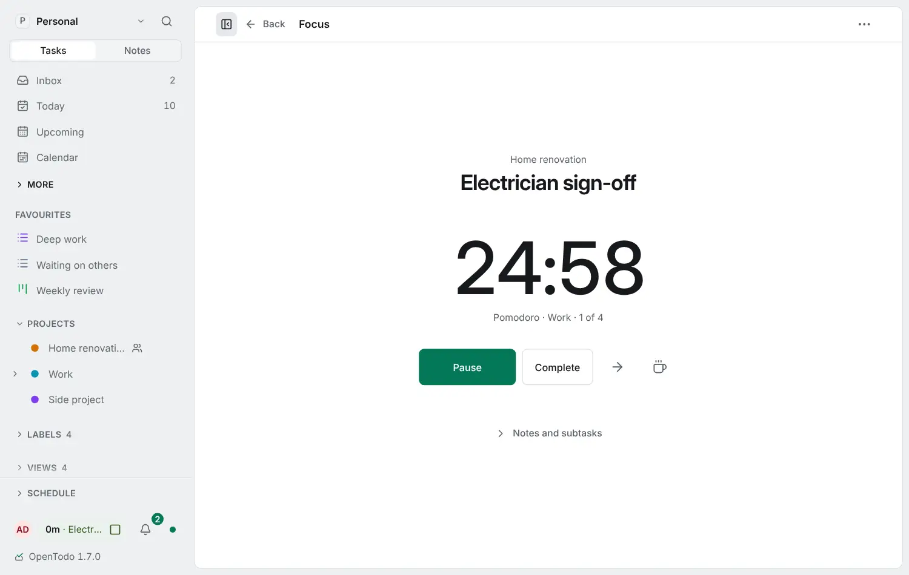

# Focus on every device

<picture><source srcset="images/focus-dark.webp" media="(prefers-color-scheme: dark)"></picture>

You have one [Focus](focus.md) session across your devices. Start it on the laptop and the phone shows the same task and time left after it syncs. Pause, resume, take a break or finish on either.

- **Offline**: the change shows at once and reaches your other devices when you're back online.
- **Two changes at once**: if two devices change the session while offline, the later change wins. You never get a mix of the two.
- **Sound and notifications** come from the device where you last started, paused or resumed the session, and so do the noise, the break reminder and the [lock-screen timer](ios-app.md#focus-on-the-lock-screen). The others stay quiet. To move them to the device in your hand, pause and resume there.
- **Stays on each device**: the last Countdown length.
- **Restoring a backup** never brings back an old session.
