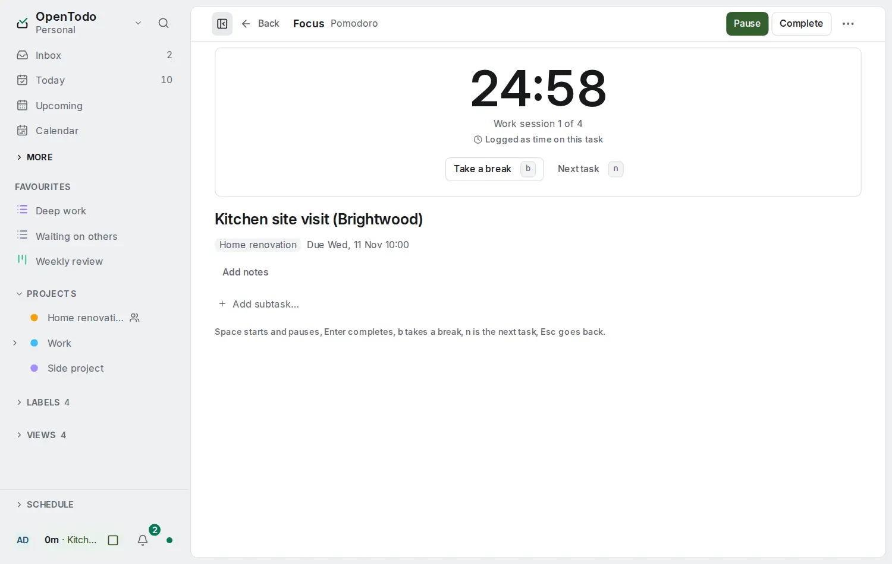

# Focus

<picture><source srcset="images/focus-dark.webp" media="(prefers-color-scheme: dark)"></picture>

Focus shows the one task you are working on now, the time left, and the button to start or pause. Everything else is in the **⋯** menu or one click away.

## Open it

- **Focus** in the sidebar's **More** group, after Statistics. To keep it next to Inbox and Today, see [Sidebar counts and order](sidebar-counts-and-order.md).
- The clock button at the top of the [task panel](task-panel.md), or **Focus on this task** in its **⋯** menu.
- **Start focus** in a task's menu: <kbd>.</kbd>, the row's **⋯** button or a right-click. On a phone, hold the task, then tap **Actions**.
- <kbd>g</kbd> <kbd>Shift+F</kbd>, or `focus` in [Search and commands](search.md).

From a task, Focus starts a session at once (Countdown asks for the length first). If another task's session runs, it stops, with **Undo**.

## Which task

Without a task of your own choosing, Focus takes the first open task of **today's focus**, picked in the [Daily check](method/rhythms.md#daily-check). Completing it, or <kbd>n</kbd>, moves on to the next one. **Change task** in the menu finds any open task by name.

## The screen

From the top: the project, the title, the next open subtask (tick it there), the timer, and a line such as **Pomodoro · Work · 2 of 4**. Under it: **Start**, **Pause** or **Resume**, **Complete**, and small buttons for the next task and a break. **Notes and subtasks** opens the notes, the due date and the checklist, and stays open on this device.

A break keeps the same screen, quieter, with **End the break**. The **⋯** menu holds the timer, **Change task**, the noise and **Today's sessions**: today's sessions with their length and the total.

## The three timers

Choose the timer in the menu or in Settings.

- **Pomodoro**: 25 minutes of work, then a 5 minute break, and a 15 minute break after every fourth session. All four numbers are yours to change.
- **Flowtime**: counts up from 0:00 until you select **Stop the timer**, then offers a break.
- **Countdown**: asks for a length first, from 5 to 180 minutes, and remembers the last one on this device. Your [presets](focus-options.md#countdown-presets) start a length in one tap.

When a session ends, Focus shows the time worked and offers the next step, with completing the task, the next task and [a few more minutes](focus-options.md#a-few-more-minutes) beside it. A tone, a [break reminder](focus-options.md#breaks-sound-and-notifications) and a notification are optional.

## Keys

| Key | What it does |
| --- | --- |
| <kbd>Space</kbd> | Start, pause or resume |
| <kbd>Enter</kbd> | Complete the task and end the session |
| <kbd>b</kbd> | Take a break now, or end the break |
| <kbd>n</kbd> | Next task of today's focus |
| <kbd>Esc</kbd> | Back to where you were; the session keeps running |

The keys show in the tooltips, and under the buttons with **Show shortcut hints** on. They don't fire while you type.

## Time worked

Each stretch of work is a [time entry](time-tracking.md) on the task; breaks are never logged. The entries sync and carry the timer and session, to [show elsewhere](focus-elsewhere.md). The running timer stays on this device and counts from the clock, so a reload or a laptop that slept still shows the right time.

## Settings

**Settings → General → Focus timer** holds the timer, the lengths, the auto-starts, and the [break reminder, sound, presets and noise](focus-options.md), for all your devices.
