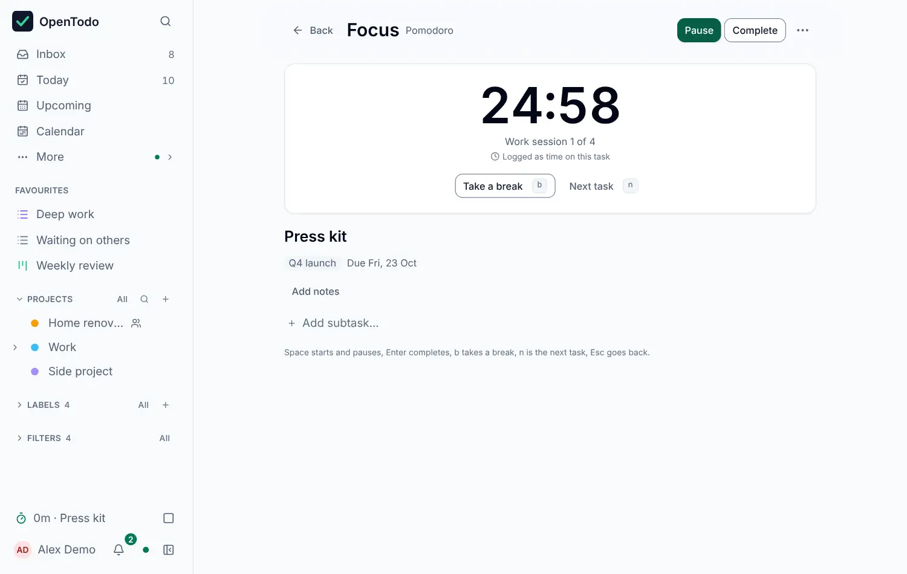

# Focus

<picture><source srcset="images/focus-dark.webp" media="(prefers-color-scheme: dark)"></picture>

Focus shows one task and a large timer, and nothing else to pick from. Open it with <kbd>g</kbd> <kbd>Shift+F</kbd>, from **Focus on this task** in the menu of the [task panel](task-panel.md), or by typing `focus` in [Search and commands](search.md).

## Which task

Without a task of your own choosing, Focus takes the first open task of **today's focus**, the up to three tasks you pick in the [Daily check](method/rhythms.md#daily-check). When you complete it, or press <kbd>n</kbd> for the next task, the next one of today's focus follows. When none is left, Focus says so and offers **Choose a task**, which finds any open task by name. **Change task** in the screen's menu does the same at any time.

The task's notes and subtasks are shown below the timer. Tick subtasks there; **Edit the notes** opens the task panel.

## The three timers

Choose the timer in the screen's menu or in Settings. It can't change while a session runs.

- **Pomodoro**: 25 minutes of work, then a 5 minute break, and a 15 minute break after every fourth session. All four numbers are yours to change.
- **Flowtime**: counts up from 0:00 until you select **Done**, then offers a break.
- **Countdown**: asks for a length first, from 5 to 180 minutes, and remembers the last one on this device.

When a session or a break ends, Focus says what ended and how long you worked, and offers the next step: start the break, complete the task, or the next task.

## Keys

| Key | What it does |
| --- | --- |
| <kbd>Space</kbd> | Start, pause or resume |
| <kbd>Enter</kbd> | Complete the task and end the session |
| <kbd>b</kbd> | Take a break now, or end the break |
| <kbd>n</kbd> | Next task of today's focus |
| <kbd>Esc</kbd> | Back to where you were; the session keeps running |

The keys don't fire while you type, for example in a new subtask. Press <kbd>g</kbd> <kbd>Shift+F</kbd> to come back to a running session.

## Time worked

Each stretch of work is a [time entry](time-tracking.md) on the task: starting starts an entry, pausing ends it, resuming starts a new one, and completing the task or starting a break ends it. Breaks are never logged. The entries sync like any other change, so your phone shows the time after the laptop syncs. When the app can't log time, the timer works the same and nothing is written.

The timer itself stays on the device: it is not synced or exported, and it is cleared when you sign out. The timer counts from the clock, so a reload, a laptop that slept or a tab in the background still shows the right time.

## Breaks, sound and notifications

**Break reminder** (off until you turn it on) shows a notice on any screen after 90 minutes of work without a break: **Take a break** starts a short break, **Not now** asks again after another 90 minutes. Pauses don't count as work.

**Sound** plays a short tone when a session or a break ends while the app is on screen. If the tab is in the background and you allowed [notifications](push-notifications.md) on this device, a system notification says the session is done; select it to come back to Focus.

## Settings

All of this is in **Settings → General → Focus**: the timer, the lengths, the long break, starting breaks and the next session automatically, the break reminder and its length, and the sound. These settings follow your account to every device.
