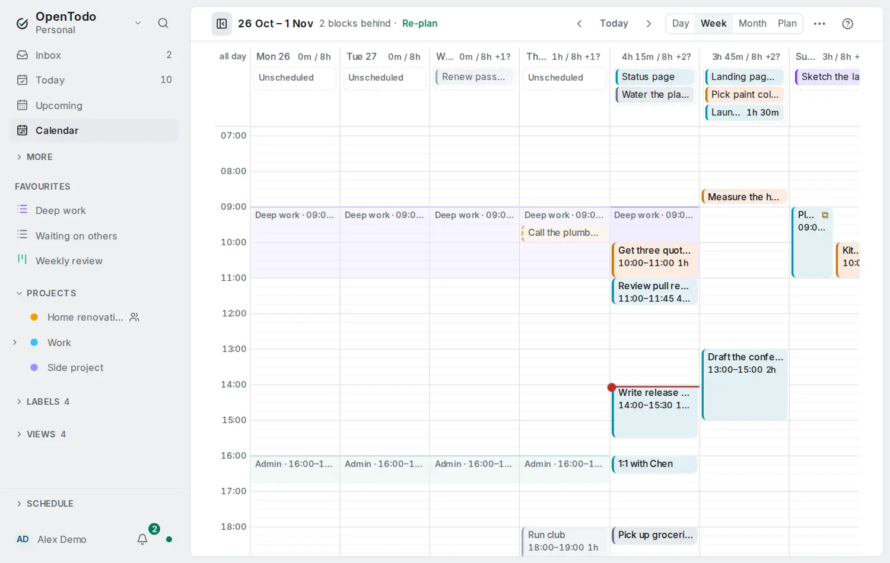

# Frames

<picture><source srcset="images/frames-dark.webp" media="(prefers-color-scheme: dark)"></picture>

A **frame** keeps hours for one kind of work, such as deep work every weekday morning. It repeats on the days you choose and shows as a quiet tinted band behind the [Day and Week calendar](calendar-views.md). Frames only guide you: they never move, block or create anything.

## Add a frame

1. Open **Day** or **Week**, then **⋯** › **Frames…**. You can also use **New frame** in the [command palette](search.md#commands).
2. Choose **Add frame** and give it a title, for example *Deep work*.
3. Under **Repeat on**, choose the days. The buttons follow your first day of the week.
4. Pick a **Start** and an **End** in quarter hours. A frame ends on the day it starts.
5. Optionally pick a **Colour** and a **Plan from** source: a project, a label or a saved view.
6. Under **More options**, set a first and a last day if it only applies for a while.

You can keep up to 50 frames. In the **Frames** dialog, drag them or use **Alt+↑** and **Alt+↓** to reorder; choose one to edit it.

## How frames look on the calendar

- Tasks, events and the now line are drawn above the bands. A task dropped inside a frame gets the time under the pointer, as usual.
- Two frames that overlap share the column side by side.
- On days before today the bands are dimmed, like past blocks.
- On a phone the Week is a list of days, and each frame is a heading line such as *Deep work · 09:00–11:00* above the tasks inside it.

Frames don't count toward the [day's capacity](place-tasks-on-the-calendar.md), and [Re-plan the rest of the day](replan-the-day.md) can move blocks into them freely.

## Plan from a frame

Choose a frame's title (or Tab to it and press Enter) for its details and three actions:

- **Plan from this frame** opens the [planning list](time-blocking.md#place-a-task-on-the-calendar) on the frame's source (without a source, or when it was deleted, the list keeps its own). While the list is open, **s** on a task proposes the first free quarter hour inside this frame that holds its estimate (30 minutes without one), or the usual start when nothing fits. Nothing changes until you press Enter.
- **Edit** opens the frame's form.
- **Delete** removes the frame from every day, with **Undo**.

## Times that need fixing

Changing the start on one device and the end on another can leave the start after the end. Such a frame is kept but not drawn, and the **Frames** dialog marks it **Times need fixing** until you edit it.

## Sync, privacy and other tools

- Frames are yours alone: they sync to your own devices, work offline and never reach people you share a project with.
- With [end-to-end encryption](e2ee.md), the title is encrypted on your devices.
- Frames are part of your [export](import-export.md). The [REST API](api.md#calendar-frames), the [command line](cli.md) (`ot frames`) and [MCP assistants](mcp.md) can read them; assistants cannot change them.
- Frames stay inside OpenTodo. They are not published to CalDAV or calendar feeds.

To batch small tasks inside a frame, choose **Make a slot here** in its details: see [Slots](slots.md).

A frame can't skip or move a single day yet, and it can't run past midnight.
