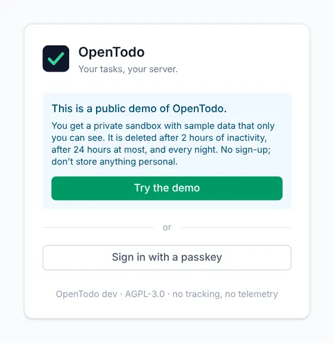
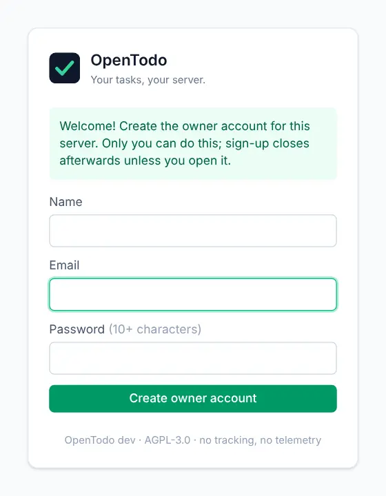

# Getting started

<picture><source srcset="images/today-dark.webp" media="(prefers-color-scheme: dark)"></picture>

This guide takes you from your first visit to a task added, dated and ticked off. Follow along in the demo or on your own server.

## Open OpenTodo

There are three ways in.

### Try the demo

Go to [demo.open-todo.app](https://demo.open-todo.app) and select **Try the demo**. You get a private sandbox with sample projects and tasks that only you can see. It is deleted after two hours without activity and every night, so keep personal things on your own server, which takes one container.

In the sandbox, one line at the top says so: **Details** shows the full text, **Learn more** opens this section and **Dismiss** hides it until you close the tab.

<picture><source srcset="images/demo-signin-dark.webp" media="(prefers-color-scheme: dark)"></picture>

### Set up your own server

The first person to open a new OpenTodo server creates the owner account: enter your name, email and a password of at least 10 characters, then select **Create owner account**. From outside its network, the form also asks for the **Setup code** from `docker logs opentodo` ([details](self-hosting/docker.md#the-setup-code)). After that, sign-up is closed: other people join with an invitation from you (see [Sharing and comments](sharing.md#invite-someone-new)).

<picture><source srcset="images/setup-owner-dark.webp" media="(prefers-color-scheme: dark)"></picture>

### Join with an invitation

Open the invitation link, choose a name and password, and you're in. If your server offers single sign-on or passkeys, the sign-in screen shows those buttons too.

Once you're signed in, the app is stored on your device. You can keep using it without a connection, and it catches up with the server when you're back online.

## Find your way around

The sidebar on the left lists your views and projects; its groups fold with a click on their name. The magnifier by the OpenTodo name searches everything (<kbd>Ctrl+K</kbd>); the one by **Projects** finds a project, label or filter. On a phone, a bar at the bottom goes to **Today**, **Inbox** and **Upcoming**, opens **Search**, and **More** opens the sidebar as a drawer; the round **+** adds a task from any page with the page's defaults (today's date in Today, the project in a project).

- **Inbox** collects tasks that don't belong to a project yet.
- **Today** shows what's due today, with anything overdue at the top.
- **Upcoming** shows the days ahead, grouped by date.
- **Projects** are your own lists, like "Home renovation" or "Work".

The circle to the left of each task completes it. More on all the views in [Views](views.md).

## Add your first task

Press <kbd>q</kbd> (or click the **Add a task** box at the top of the list), type `Call the dentist` and press <kbd>Enter</kbd>. The task appears straight away. [Your first task](your-first-task.md) walks through this step by step, starting with the start guide that opens on your first visit.

## Give it a date

Quick add understands everyday words: type `Call the dentist tomorrow at 9am` and a chip under the box shows the date it understood. See [Give it a date](your-first-task.md#give-it-a-date).

## Complete it

Click the circle next to the task, or select it and press <kbd>c</kbd>. It moves to **Completed** in the sidebar, where you can reopen it. See [Complete it](your-first-task.md#complete-it).

## Help inside the app

Every guide on this site is also in the app: choose **Help** in your name's menu (sidebar, bottom), or press <kbd>g</kbd> then <kbd>?</kbd>. It works offline and matches your server's version. Page headers have a **Help** action that opens the right section beside what you're doing.

## Where to go next

Continue with [Your first task](your-first-task.md): the start guide, the full quick add line and completing. Then [install the app](install-app.md) on your phone or computer.
