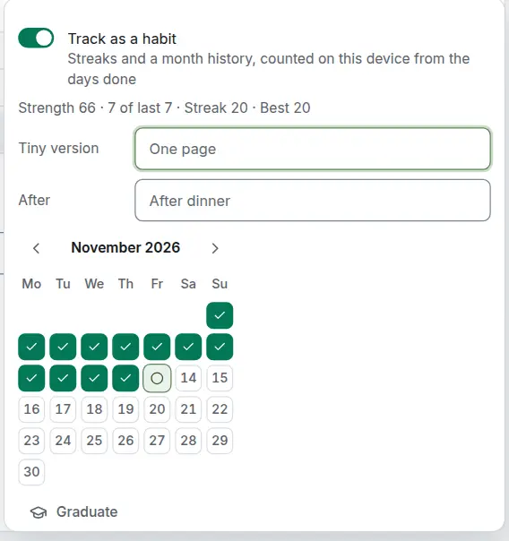

# A habit's days

<picture><source srcset="images/habit-page-dark.webp" media="(prefers-color-scheme: dark)"></picture>

A habit's page (open it from its title on the [Habits screen](habits.md)) shows its numbers, its month and its own fields under **Repeat**.

## The tiny version and the anchor

The **tiny version** is the two-minute form of the habit, for the days when the whole thing is too much ("One page", "Shoes on, out the door"). Logging it counts as done for every number, and the day shows half filled. A reminder for a habit with a tiny version says so: "Read", with "One page is enough".

The **anchor** is the moment the habit follows ("After dinner", "After coffee"). It shows under the habit's title. Both are written on the habit's page and are encrypted on an [end-to-end encrypted](e2ee.md) account.

## The thread and the numbers

The thread draws each scheduled day of the last seven: filled for done, half filled for the tiny version, a dash for skipped, an empty circle for missed and a ring for today. A solid line joins kept days, a dotted line crosses a skip, and a miss has no line; two misses in a row leave only a thin line. Days the habit does not repeat on are blank. Nothing turns red. Each day is announced with its date and state ("Wednesday 11 November, skipped").

- **Kept**: done days (the tiny version included) among the last seven scheduled days before today's occurrence, "6 of 7". For a weekly habit that is its last seven sessions.
- **Strength**, on the habit's page, from 0 to 100: a moving average over the scheduled days, so one miss after a long run lowers it by a few points only, and a habit kept three times a week means the same as one kept daily.
- **Streaks**, on the habit's page: the current and best run of scheduled days kept, a skip keeping the chain.
- **Back on track** shows after a kept day that follows two or more misses.

The numbers are worked out on each device from the habit and its days, so every device shows the same, offline too. The rules are in [Repeat rules: Habits](recurrence.md#habits).

## Fix a past day

A past scheduled day in the thread or in the month grid on the habit's page opens **Done**, **Tiny version**, **Skipped** and **Clear**. Done, the tiny version and Skipped record that day without moving the habit; Clear removes the record, so the day reads as missed again and leaves Completed. Each has one Undo and works offline. Days before the habit started and days after today cannot be changed.

## Graduate a habit

When a habit has stuck, **Graduate** on its page takes it out of every list, the calendar and reminders, and keeps its history. The Habits screen's **Graduated** group lists it with how long it was kept ("Kept for 94 days"). **Resume** brings it back from today: the days in between read as not scheduled, not missed. Graduating never completes or deletes the task.
