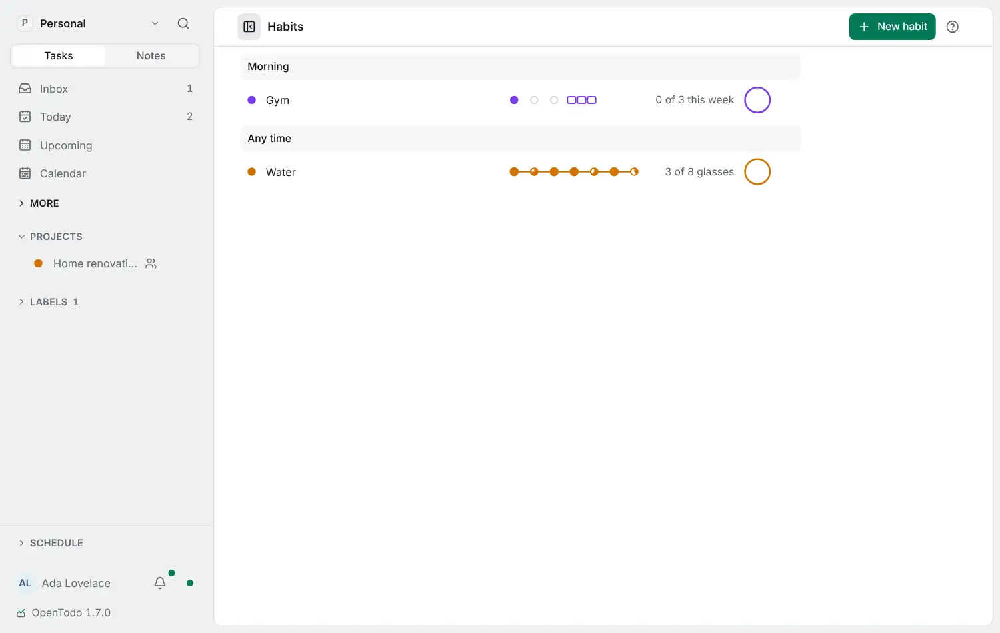

# Targets and amounts

<picture><source srcset="images/habit-targets-dark.webp" media="(prefers-color-scheme: dark)"></picture>

Some habits don't fit fixed days or a single tick. In the habit form, **How often** has **Times per week** and **Times per month**, and **Amount** counts how much you do each day.

## Times per week or month

"Gym, 3 times a week" is offered every day until the week holds three check-ins, then rests until the next week. A day without a check-in is a rest day, never a miss. The week starts on the first day of the week you chose in **Settings → General**; a month starts on the 1st.

- **The row** reads "2 of 3 this week". Its thread is the week as one bar in three parts, after the earlier weeks as filled (met) or empty (not met).
- **The numbers** count weeks: a week is met with three check-ins, the streak counts met weeks in a row, and strength adds each week's share of the target.
- **At risk** means the days left in the week are fewer than the check-ins still needed, or the last two weeks were not met. Skipping isn't offered.

## Amounts

"Water, 8 glasses" adds a glass each time you press the check button (or the step you chose). The row reads "5 of 8 glasses". A day at 8 is done and checks in as any habit does; a day with less is partial and counts like the tiny version. The button's menu has **Subtract** and **Set amount**, and a past day can be changed like any other.

Each device adds to its own count of the day, so two phones adding glasses offline both count once they sync. **Set amount** sets the day's total.

## From elsewhere

`log_habit` and `POST /api/v1/habits/{id}/log` take `{"amount": 1}` or `{"set_amount": 5}` ([Habits from elsewhere](habits-elsewhere.md)).
