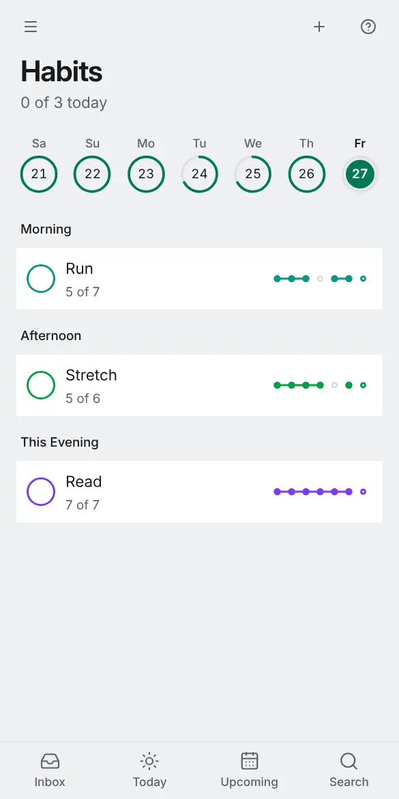

# Habits on a phone

<picture><source srcset="images/habits-phone-dark.webp" media="(prefers-color-scheme: dark)"></picture>

With the [phone screens](phone-screens.md) on, the [Habits screen](habits.md) is drawn for the thumb.

- **New habit** is the **+** in the bar.
- **The last seven days** are a strip under the title. Each day's ring fills as you keep its habits; today is chosen.
- **Each habit** has a ring at the start. Tap it to check in, and again to take the check-in back. Its title opens the habit, and its week is drawn small beside it.
- **Hold a habit** for its other actions: the tiny version, Skip this day, Open and Edit. An amount habit offers Subtract and Set amount.

## Fix an earlier day

Choose the day in the strip. The screen lists that day's habits and counts them under the title ("2 of 3").

- A ring sets a missed day to Done, and clears a kept one.
- An amount habit's ring opens **Set amount…** for that day.
- Holding a habit offers **Done**, **Tiny version**, **Skipped**, **Clear** and **Note…** for that day.

Each change has one Undo and works offline, as on a computer ([A habit's days](habit-days.md#fix-a-past-day)). A habit's page is the same on a phone, with its month across the width and its year a sideways scroll from this week.
