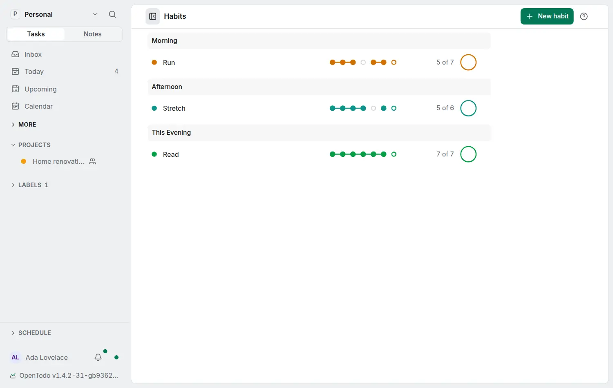

# Habits

<picture><source srcset="images/habits-dark.webp" media="(prefers-color-scheme: dark)"></picture>

A habit is a repeating task you want to keep doing, such as reading every evening or a run on Monday, Wednesday and Friday. Habits get their own screen, a line at the top of Today, a page each, and [numbers that forgive a bad day](habit-days.md).

## Turn Habits on or off

**Settings → Account → How you work → Habits** turns habits on or off for your account, on every device. Until you choose, two quiet ways in stay: this switch, and **Track as a habit** under a task's repeat rule. Using either turns Habits on, and the app says once where to find it. An account that already has a habit is on.

**Off means off**: no Habits screen, line in Today, button or switch anywhere, and habits show as plain repeating tasks. Nothing is deleted, and completing a habit while Habits is off still records the day.

## The Habits screen

Open **Habits** from the sidebar's **More** group, with `g` then `Shift+H`, or from the command palette (**Go to Habits**). **Settings → Appearance → Sidebar** can put it among the main destinations.

Habits are grouped by part of the day (Morning, Afternoon, This Evening, Any time) and ordered by time and title. Each row shows the habit's colour, its title on one line (hover it for the whole title when it is cut), its anchor ("After dinner"), a thread of the last seven days, how many of the last seven scheduled days you kept ("6 of 7") and a check button. Graduated habits are listed at the end, folded.

- **Check in**: the check button, or `Space` on a focused row. It completes the current occurrence exactly as completing the task does, with one Undo. A habit due later has a dashed button that checks in early.
- **The tiny version**: the button's menu, a long press on the button, or `Shift+Space`.
- **Open the habit**: its title, or `Enter` on a focused row.

## Habits in Today

While Habits is on, Today starts with one quiet line: **Habits** (opens the Habits screen), then each habit due today or earlier as a ring and its title. Tap a ring to check in (it stays filled until the day ends), a title to open the habit. The same habits are not listed again among Today's tasks, and, as before, they never take a [Today limit](today-limit.md) slot. What does not fit on the line becomes **+N**.

## A habit's page

A habit opens a page of its own, from search and links too: how often, the anchor, the tiny version, its numbers, **Check in** and the month history. Its menu has **Edit**, **Graduate**, **Open as a task** (for its project, labels and reminders), **Stop tracking as a habit** and **Delete**.

## Start a habit

**New habit** (on the Habits screen and in the command palette), **Make it a habit** (in a task's menu and on its page) and **Edit** (on a habit's page) open one form: the title, how often (**Every day**, **Days of the week** or **Other**, any calendar rule written as under **Repeat**), the tiny version, **After** (the routine it follows), the part of the day and the colour (**Automatic**: the project's, or one picked for the habit). The **?** after a label explains it. A task without a rule gets `every day`; a task that repeats after completion asks for a calendar rule first, because a habit is measured against the calendar.

The tiny version, the thread, the numbers, fixing a past day and graduating are in [A habit's days](habit-days.md).
