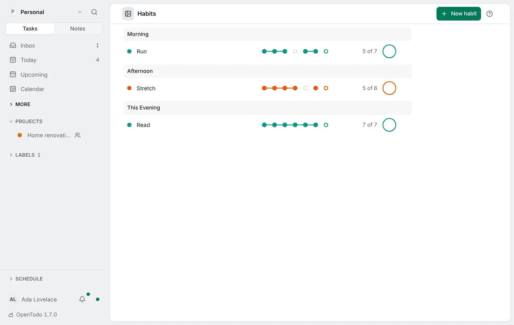

# Habits

<picture><source srcset="images/habits-dark.webp" media="(prefers-color-scheme: dark)"></picture>

A habit is a repeating task you want to keep, such as reading every evening. Habits get their own screen, a line at the top of Today, a page each, notes, and [numbers that forgive a bad day](habit-days.md).

## Turn Habits on or off

**Settings → Account → How you work → Habits** turns habits on or off for your account, on every device. Until you choose, **Track as a habit** under a task's repeat rule also turns them on.

**Off means off**: no Habits screen, line in Today or habit control anywhere, and habits show as plain repeating tasks. Nothing is deleted, and completing a habit still records the day.

## The Habits screen

Open **Habits** from the sidebar's **More** group, with `g` then `Shift+H`, or from the command palette.

Three tiles open the screen: **Today**, **Last 7 days** and your longest **Streak**. Below, the week board has a column per day and a row per habit by part of the day: its anchor, how many of the last seven you kept, a mark per day (an earlier day's sets it done or clears it) and its streak. Graduated habits come last; a narrow window shows rows.

- **Check in**: today's mark, or `Space` on a focused row, with one Undo. A habit due later has a dashed mark that checks in early.
- **Take it back**: press a kept habit's mark again.
- **The tiny version**: the row's menu or `Shift+Space`.
- **Skip this day**: the row's menu; the streak holds. Not for a target or an amount.
- **Open the habit**: its title, or `Enter` on a focused row.

## Habits in Today

While Habits is on, Today starts with one quiet line: **Habits**, then each habit due today or earlier as a ring and its title. Tap a ring to check in, a title to open the habit. They are not listed again among Today's tasks and take no [Today limit](today-limit.md) slot.

## A habit's page

A habit opens a page of its own: **Check in**, its streak, best, strength and last 30 days, the month, **By weekday**, its last 53 weeks, its note and tiny version, and **Check-ins**. Its menu has **Edit**, **Graduate**, **Open as a task** (for its project, labels and reminders), **Stop tracking as a habit** and **Delete**.

## Notes

- **The habit's note** is its task note: why you keep it. Days don't copy it.
- **How did it go?** After a check-in, one line opens under it (focus stays put until `Tab`). `Enter` keeps it as that day's note; `Escape` writes nothing. On a touch screen it is **Add a note** first.
- **A past day**: choose it in the month history, then **Note**.
- A day with a note has a small mark, read out as "with a note"; **Check-ins** lists them newest first.

A day's note is an ordinary task note: formatted, [linked](note-links.md), searchable and editable offline.

## Start a habit

**New habit**, **Make it a habit** (in a task's menu) and **Edit** (on a habit's page) open one form: the title, how often (any calendar rule written as under **Repeat**), the tiny version, **After** (the routine it follows), the part of the day, **Remind me** (a time to be reminded on each of its days) and the colour. A task without a rule gets `every day`; one that repeats after completion asks for a calendar rule first. **Make habits** turns a note's check-list lines into habits ([Notes to tasks](notes-to-tasks.md)).

More in [A habit's days](habit-days.md), [Targets and amounts](habit-targets.md) and [Habits on a phone](habits-phone.md).
