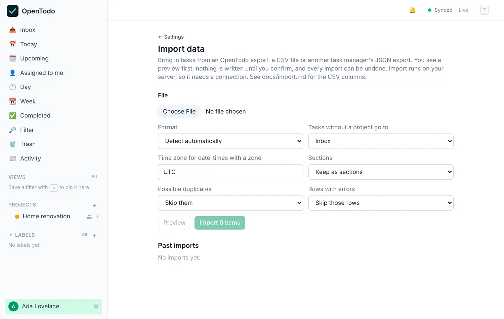

# Import and export

<picture><source srcset="images/import-dark.webp" media="(prefers-color-scheme: dark)"></picture>

Your tasks are yours. You can download all of them at any time, and bring tasks in from other places. Nothing is locked in.

## Download everything

Open **Settings → Data** and select **Download export (JSON)** in the **Export** row. You get one file with all your projects, sections, tasks and subtasks, labels, reminders, saved views and [time entries](time-tracking.md), including completed tasks and items in the Trash. Shared projects you're a member of are included too.

The file is plain JSON, so you can open it in any text editor, keep it as a backup, or load it into another OpenTodo server.

The JSON file lists your [attachments](attachments.md) but doesn't contain the files. To take the files with you, select **Download export with files (ZIP)** instead: you get the same JSON file plus every attached file, in one ZIP. Importing the JSON file alone brings back links and the names of files, but not the files themselves.

The person who runs your server can also set up automatic [backups](backups.md) of the whole server.

## Import from another app

Open **Settings → Data**, select **Import data…** (or press <kbd>g</kbd> then <kbd>Shift</kbd>+<kbd>I</kbd>) and choose a file: an **OpenTodo export**, a **CSV file** with a `title` column, or a **JSON export from another task app**. Nothing is written straight away. You check the format OpenTodo detected, choose the options, read a preview that says what will happen to each row, and then import. The tasks reach all your devices on their next sync.

[Import step by step](import-steps.md) walks through the preview and the options; the [import formats reference](import.md) has each format and how fields are mapped.

## Templates

A template is a project you want to start again and again, saved as a small file in the export format. **Save as template…** in a project's menu writes one. **+** next to **Projects** in the sidebar, then **From a template…**, starts a fresh project from it, with the dates counted from a start day you choose. The downloads on [open-todo.app/templates](https://open-todo.app/templates) are template files too. [Project templates](templates.md) has the details and the difference from Import.

## Duplicates

Importing the same file twice won't double your tasks: rows OpenTodo imported before, and tasks that look like ones you already have, are skipped unless you choose **Import them anyway**. See [Duplicates](import-steps.md#duplicates).

## Undo an import

Every import appears under **Past imports**. **Undo** removes everything that import created and leaves the rest alone. See [Undo an import](import-steps.md#undo-an-import).

## Good to know

Import needs a connection to your server. Files can be up to 20 MB and 50,000 rows, unless your server allows more. Comments aren't imported. Time entries come back from your own export; entries another member tracked on a shared task are left out, with a note in the preview. The [full list](import-steps.md#good-to-know) covers attachments, CSV dates and JSON files that aren't recognised.
