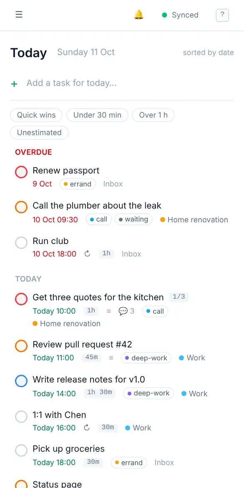

# Installing the app

<picture><source srcset="images/mobile-today-dark.webp" media="(prefers-color-scheme: dark)"></picture>

OpenTodo is a web app you can install. Once installed it has its own icon, opens in its own window without browser bars, starts without a connection, and on most platforms can show reminders while it's closed. There is no app store involved: you install it from your server's address, and updates arrive by themselves.

On a phone the app is built for one hand: the bar at the bottom switches between Today, Inbox, Upcoming, Search and More (the sidebar), the **+** button adds a task from anywhere, a task opens as a full-screen page you close with Back or by swiping its header down, a project's board shows one column at a time (swipe sideways, or tap a dot), and the Week calendar is a day-by-day list.

Before you start, open your OpenTodo address in the browser and sign in once. Installing needs a secure address (one starting with `https://`); if your browser offers no install option at all, ask whoever runs your server to set that up.

## iPhone and iPad

In **Safari**, tap **Share**, then **Add to Home Screen** and **Add**. Open OpenTodo from the home screen from now on: on iOS 16.4 and later, push notifications for reminders work only in the installed app. The steps are in [Install on your phone](install-phone.md#iphone-and-ipad).

## Android

In **Chrome** (Edge and Samsung Internet work the same way), open the browser menu and tap **Install app** or **Add to Home screen**. Afterwards OpenTodo also appears in Android's share menu. The steps are in [Install on your phone](install-phone.md#android).

## Windows, macOS, Linux and ChromeOS

In **Chrome** or **Edge**:

1. Open your OpenTodo address.
2. Click the install icon at the right end of the address bar (a small screen with a down arrow), or open the browser menu and choose **Install OpenTodo** (in Edge: **Apps → Install this site as an app**).
3. Confirm with **Install**.

OpenTodo opens in its own window and gets an entry in your Start menu, Dock or app launcher. You can pin it to the taskbar like any other app.

In **Safari on macOS** (Sonoma or later), choose **File → Add to Dock**.

Firefox on the desktop doesn't install web apps. You can still use OpenTodo in a Firefox tab with everything working, including offline use once the page has loaded.

## On a tablet or an e-ink display

Open [display mode](display-mode.md) and make it the device's start view. For a shared screen, use a viewer account and kiosk mode; see [Set up a shared screen](display-mode.md#set-up-a-shared-screen).

## Keep using it offline

The installed app keeps a full copy of your tasks on the device. You can open it on a plane, add and complete tasks, and it syncs when you're online again. The status at the top right tells you where things stand. More in [Offline and sync](offline-and-sync.md).

## Updates

When your server is updated, the app fetches the new version in the background and switches to it on its own, usually with one quick reload. If you think you're still on an old version, close the app completely and open it again.

## Remove it

Remove it the way you remove any app on that device: long-press the icon and choose **Remove App** (iPhone) or **Uninstall** (Android), or use **Uninstall** from the app window's menu on a computer. Your tasks stay on your server.

Signing out (**Settings → Account → Sign out here**) clears the copy of your tasks on that device. Changes that haven't reached the server yet are uploaded first when you're online.
