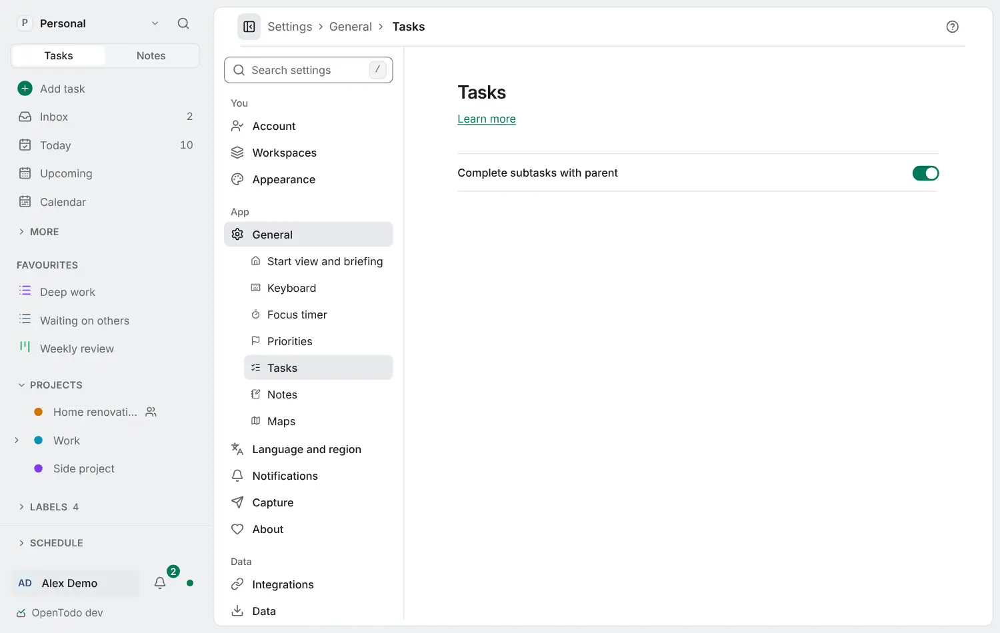

# Keep open subtasks

<picture><source srcset="images/keep-open-subtasks-dark.webp" media="(prefers-color-scheme: dark)"></picture>

Completing a task completes its open subtasks too. To finish a task but keep a follow-up open, turn off **Complete subtasks with parent** in **Settings → General → Tasks**. The choice belongs to your account, so your other devices follow once they sync.

With the switch off, completing a task completes only that task. Its open subtasks, and theirs, are **kept**:

- they leave your lists, Today, Upcoming, the calendar, filters and search,
- they're left out of counts, the app badge, the briefing and the weekly digest,
- their reminders wait, and AI assistants don't list them.

They stay in the completed task's **Subtasks**, with their state, where you can still open, edit, complete or delete them. Reopen the task and they're back everywhere, reminders included. **Undo** after completing reopens what the completion completed, either way.

Open subtasks of tasks completed earlier are kept the same way, for example when an older app or the API completed only the parent. Open that task to find them.

See [Notes, subtasks and dependencies](notes-and-subtasks.md) for how subtasks work.
