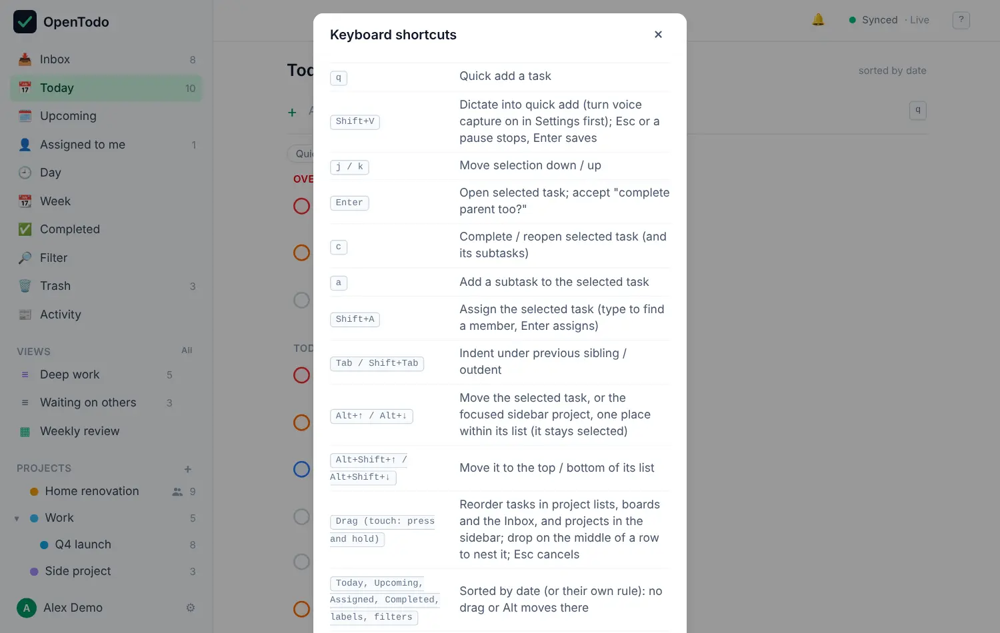

# Keyboard shortcuts

Everything in OpenTodo can be done from the keyboard. You don't need to learn it all: <kbd>q</kbd> to add, <kbd>j</kbd> / <kbd>k</kbd> to move, <kbd>c</kbd> to complete and <kbd>?</kbd> to look up the rest gets you a long way.

Shortcuts don't fire while you're typing in a field. Press <kbd>Esc</kbd> to leave the field first.

## See them in the app

Press <kbd>?</kbd> at any time for the cheat sheet. The shortcuts for where you are come first (the list, the board, the calendar, the task panel), then the ones that work everywhere and the **Go to** keys, and a search box at the top finds a shortcut by key or by what it does. It's the same list as on this page, generated from the same source, so the two always match.

<picture><source srcset="images/shortcuts-dark.webp" media="(prefers-color-scheme: dark)"></picture>

## The ones to learn first

| Keys | Does |
| --- | --- |
| <kbd>q</kbd> | Add a task |
| <kbd>j</kbd> / <kbd>k</kbd> | Move down and up the list |
| <kbd>Enter</kbd> | Open the selected task |
| <kbd>c</kbd> | Complete it |
| <kbd>1</kbd> … <kbd>4</kbd> | Set its priority |
| <kbd>g</kbd> then <kbd>t</kbd> | Go to Today (<kbd>i</kbd> for Inbox, <kbd>u</kbd> for Upcoming) |
| <kbd>Esc</kbd> | Close the panel |

A two-step shortcut like <kbd>g</kbd> then <kbd>t</kbd> means: press <kbd>g</kbd>, let go, then press <kbd>t</kbd>.

On a Mac, use <kbd>⌘</kbd> where this page says <kbd>Ctrl</kbd>, and <kbd>Option</kbd> for <kbd>Alt</kbd>.

## All shortcuts

<!-- shortcuts:start (generated by `make docs` from the app; do not edit) -->

### Everywhere

| Keys | What it does |
| --- | --- |
| <kbd>Ctrl+K</kbd> / <kbd>⌘+K</kbd> | Search and commands: find any task, project, label, view or setting, or run a command by name (also while typing, except in notes) |
| <kbd>q</kbd> | Quick add a task |
| <kbd>Shift+I</kbd> | Open the assistant (when the server owner has turned it on): ask about your tasks, review proposed changes; Enter sends, Esc closes |
| <kbd>Enter</kbd> / <kbd>Esc</kbd> | Proposed changes: assistant: apply the checked changes / discard the proposal; Space toggles an item |
| <kbd>Shift+V</kbd> | Dictate into quick add (turn voice capture on in Settings first); Esc or a pause stops, Enter saves |
| <kbd>.</kbd> / <kbd>Shift+F10</kbd> / <kbd>Menu key</kbd> | Open the menu of the focused row: a label, view, section heading or project |
| <kbd>F2</kbd> | Focused label: rename the label in place; Alt+↑ / Alt+↓ move it, Alt+Shift+↑ / ↓ to the top / bottom |
| <kbd>Esc</kbd> | Close panel, clear selection |
| <kbd>?</kbd> | Toggle this help |

### Go to a view

| Keys | What it does |
| --- | --- |
| <kbd>g</kbd> then <kbd>i</kbd> / <kbd>t</kbd> / <kbd>u</kbd> / <kbd>c</kbd> / <kbd>l</kbd> / <kbd>f</kbd> / <kbd>v</kbd> / <kbd>s</kbd> | Go to Inbox / Today / Upcoming / Completed / Labels / Filter / Filters / Settings |
| <kbd>g</kbd> then <kbd>a</kbd> | Go to Assigned to me |
| <kbd>g</kbd> then <kbd>n</kbd> / <kbd>o</kbd> | Go to Anytime / Someday |
| <kbd>g</kbd> then <kbd>x</kbd> | Go to the Trash |
| <kbd>g</kbd> then <kbd>k</kbd> | Go to Ask: the assistant’s composer and skills (when the assistant is on) |
| <kbd>g</kbd> then <kbd>h</kbd> | Go to Updates: what changed in your shared projects (j / k select, Enter opens the task, Tab reaches the filters) |
| <kbd>g</kbd> then <kbd>Shift+I</kbd> | Go to Settings → Data → Import data |
| <kbd>g</kbd> then <kbd>d</kbd> / <kbd>w</kbd> / <kbd>m</kbd> | Go to the Calendar as Day / Week / Month (the sidebar opens it as last used) |
| <kbd>g</kbd> then <kbd>?</kbd> | Open Help: the user guide, offline, with search |

### Tasks in a list

| Keys | What it does |
| --- | --- |
| <kbd>j</kbd> / <kbd>k</kbd> | Move selection down / up |
| <kbd>Enter</kbd> | Open selected task; accept "complete parent too?" |
| <kbd>c</kbd> | Complete / reopen selected task (and its subtasks) |
| <kbd>a</kbd> | Add a subtask to the selected task |
| <kbd>Shift+A</kbd> | Assign the selected task (type to find a member, Enter assigns) |
| <kbd>Tab</kbd> / <kbd>Shift+Tab</kbd> | Indent under previous sibling / outdent |
| <kbd>Alt+↑</kbd> / <kbd>Alt+↓</kbd> | Move the selected task, or the focused sidebar project, one place within its list (it stays selected) |
| <kbd>Alt+Shift+↑</kbd> / <kbd>Alt+Shift+↓</kbd> | Move it to the top / bottom of its list |
| <kbd>Drag</kbd> (touch: press and hold) | Reorder tasks in project lists, boards and the Inbox, and projects in the sidebar; drop on the middle of a row to nest it; Esc cancels |
| Today, Upcoming, Assigned, Completed, labels, filters | Sorted by date (or their own rule): no drag or Alt moves there |
| <kbd>←</kbd> / <kbd>→</kbd> | Collapse / expand subtasks of the selected task, or sub-projects of the focused sidebar project |
| <kbd>v</kbd> | Cycle the current project through list, board and timeline (remembered per project on this device) |
| <kbd>Shift+S</kbd> | Share the current project: add members by email, change roles, remove, leave, transfer |
| <kbd>Shift+F</kbd> | In a project: manage its custom fields (editors and owners) |
| <kbd>1</kbd> – <kbd>4</kbd> | Set priority of selected task |
| <kbd>L</kbd> | Labels of selected task (type to find, Enter adds or creates) |
| <kbd>e</kbd> | Edit the estimate of the selected task (type 20, 45m, 1h30; Enter) |
| <kbd>d</kbd> | Set the deadline of the selected task (type fri, 2026-11-06; Enter) |
| <kbd>b</kbd> | Choose the tasks the selected task waits for (Blocked by) |
| <kbd>Shift+D</kbd> | Duplicate the selected task and its subtasks |
| <kbd>n</kbd> | Park the selected task in Someday, or bring it back |
| <kbd>x</kbd> / <kbd>Space</kbd> | Tick the selected task for a bulk action (Space with Vim keybindings on) |
| <kbd>Shift+↓</kbd> / <kbd>Shift+↑</kbd> | Extend the ticked range down / up (also Shift+J / Shift+K without Vim keybindings) |
| <kbd>Ctrl+A</kbd> / <kbd>⌘+A</kbd> | Tick every task in the list, once something is ticked |
| <kbd>.</kbd> | Actions for the ticked tasks (or the selected one): complete, priority, labels, date, move, assign, Trash |
| <kbd>Ctrl+Z</kbd> / <kbd>⌘+Z</kbd> | Undo the last bulk action while its notice is shown |
| <kbd>Shift+N</kbd> | Defer the selected task: type its start date, Enter |
| <kbd>Shift+E</kbd> | Toggle This Evening on the selected task |
| <kbd>s</kbd> | Schedule the selected task: Day view in placement mode |
| <kbd>Shift+S</kbd> | Skip the current occurrence of a recurring task |
| <kbd>Shift+O</kbd> | Recurring task: this occurrence only (standalone copy, series moves on) |
| <kbd>Delete</kbd> | Delete selected task (and its subtasks) |
| <kbd>z</kbd> | Task panel open: fix a timed due to your time zone, or release it to a floating time |

### Board and timeline

| Keys | What it does |
| --- | --- |
| <kbd>←</kbd> / <kbd>→</kbd> | Timeline: move the selected task’s dates one day |
| <kbd>Shift+←</kbd> / <kbd>Shift+→</kbd> | Timeline: move the selected task’s deadline one day (from the due date when it has none) |
| <kbd>[</kbd> / <kbd>]</kbd> / <kbd>t</kbd> | Timeline: move the visible range, back to today |
| <kbd>h</kbd> / <kbd>l</kbd>, <kbd>←</kbd> / <kbd>→</kbd> | Select the first task of the previous / next column; j / k move within a column |
| <kbd>Shift+←</kbd> / <kbd>Shift+→</kbd> | Move the selected task to the previous / next column (it stays selected) |
| <kbd>a</kbd> | Add a task to the selected task’s column |

### Day, Week and Month calendar

| Keys | What it does |
| --- | --- |
| <kbd>j</kbd> / <kbd>k</kbd> | Select the next / previous task (lane, then blocks) |
| <kbd>↑</kbd> / <kbd>↓</kbd> | Move the selected task 15 minutes (a lane task gets a time) |
| <kbd>←</kbd> / <kbd>→</kbd> | Move the selected task one day |
| <kbd>Shift+↑</kbd> / <kbd>Shift+↓</kbd> | Shorten / lengthen the estimate by 15 minutes |
| <kbd>u</kbd> / <kbd>p</kbd> | Unschedule (keep the date) / placement mode for the selected task |
| <kbd>Enter</kbd> / <kbd>Esc</kbd> | Place the task at the ghost / cancel without changes |
| <kbd>[</kbd> / <kbd>]</kbd> / <kbd>t</kbd> | Previous / next day, week or month, back to today |
| <kbd>← → ↑ ↓</kbd> | Month: move the focused day; with a task selected, move it a day or a week (keeps its time) |
| <kbd>j</kbd> / <kbd>k</kbd>, <kbd>Enter</kbd>, <kbd>Esc</kbd> | Month: select the next / previous task of the month, open it, clear the selection |
| <kbd>q</kbd> | Month: add a task due on the focused day |

### Filter, saved filters and boards

| Keys | What it does |
| --- | --- |
| <kbd>Enter</kbd> / <kbd>Esc</kbd> | In Filter: jump from the query to the first result / back to the query |
| <kbd>s</kbd> | In Filter results: save the query as a view, pinned to the sidebar |
| <kbd>/</kbd> | In a saved view: edit the query; Enter saves it, Esc discards |
| <kbd>Tab</kbd> / <kbd>Shift+Tab</kbd> | On a dashboard: move between panels; j / k inside a panel, Enter opens, o opens the view |
| <kbd>↑</kbd> / <kbd>↓</kbd> | In the filter query: recall recent queries on this device |

### Trash and projects

| Keys | What it does |
| --- | --- |
| <kbd>m</kbd> | Move the current project under another project or to the top level |
| <kbd>j</kbd> / <kbd>k</kbd>, <kbd>r</kbd>, <kbd>Delete</kbd> | In the Trash: select, restore, delete permanently (Enter confirms, Esc cancels) |
| <kbd>Enter</kbd> | After completing the last task of a project: archive the project; any other key dismisses |

### Comments and notes

| Keys | What it does |
| --- | --- |
| <kbd>Shift+C</kbd> | Comment on the open task: switch to the Comments tab and focus the composer (markdown; @ completes members, ↑ / ↓ and Enter pick) |
| <kbd>Ctrl+Enter</kbd> / <kbd>⌘+Enter</kbd> | In a comment: post the comment, reply or edit; Esc cancels or leaves the field |
| <kbd>Tab</kbd>, <kbd>Enter</kbd> | In the comment thread: in the Comments tab: reach Reply, Edit and Delete; in the Activity tab: expand a group or load older activity |
| <kbd>←</kbd> / <kbd>→</kbd> | On the task tabs: switch between Comments, Activity and History in the task panel |
| <kbd>Shift+H</kbd> | In a project: show or hide the project activity; Tab reaches the person and kind filters |
| <kbd>Ctrl/⌘+B</kbd>, <kbd>I</kbd>, <kbd>Shift+X</kbd>, <kbd>E</kbd>, <kbd>K</kbd> | In the notes: bold, italic, strikethrough, inline code, link |
| <kbd>Ctrl/⌘+Alt+1</kbd>–<kbd>3</kbd> / <kbd>0</kbd> | In the notes: heading 1–3 / normal text |
| <kbd>Ctrl/⌘+Shift+8</kbd> / <kbd>7</kbd> / <kbd>9</kbd> | In the notes: bullet, numbered, check list; Ctrl/⌘+Enter ticks a check item; Tab / Shift+Tab indent |
| <kbd>-</kbd> · <kbd>1.</kbd> · <kbd>#</kbd> · <kbd>[ ]</kbd> · <kbd>**x**</kbd> | Typed in the notes: markdown typing becomes formatting; Shift+Enter is a line break, Esc leaves the notes |

### Settings

| Keys | What it does |
| --- | --- |
| <kbd>Enter</kbd> | On an invitation: Settings → Administration → Members: copy the invite link created in this session |
| <kbd>Delete</kbd> | On an invitation: Settings → Administration → Members: revoke a pending invitation |
| <kbd>d</kbd> / <kbd>r</kbd> / <kbd>Delete</kbd> | On a user: Settings → Administration → Users: deactivate or reactivate, create a reset link, delete (each confirms) |
| <kbd>Tab</kbd> | In Settings → Security: passkeys: add, rename (Enter saves, Esc cancels) or remove passkeys |

### Quick add syntax

| Type | What it does |
| --- | --- |
| <code>tomorrow · next Wed · 3 Feb · at 3pm</code> | Due date and time (6 languages) |
| <code>#project @label p1 +30m</code> | Project, label, priority, estimate |
| <code>every Monday · remind me 30 min before</code> | Repeat and remind (6 languages) |
| <code>"quoted text"</code> | Keep text literally |
| <kbd>Backspace ×2</kbd> | End of line: highlight, then dismiss the last chip |

<!-- shortcuts:end -->

## Vim keybindings

If you're used to Vim, turn on **Settings → Preferences → Keyboard → Vim keybindings**. It's off by default and applies to that device only. With it on, a small indicator shows the mode (Normal, Insert or Command), and you get:

- counts like <kbd>3</kbd><kbd>j</kbd>, <kbd>g</kbd><kbd>g</kbd> and <kbd>G</kbd> for the first and last task,
- <kbd>d</kbd><kbd>d</kbd> to delete, <kbd>x</kbd> to complete, <kbd>o</kbd> to add a task below and <kbd>i</kbd> to edit,
- <kbd>J</kbd> / <kbd>K</kbd> to move the selected task,
- a command line on <kbd>:</kbd> with `:today`, `:project <name>`, `:new <title>`, `:sync` and `:help`.

All the usual shortcuts keep working. With Vim keybindings on, the <kbd>?</kbd> list includes a Vim section.
