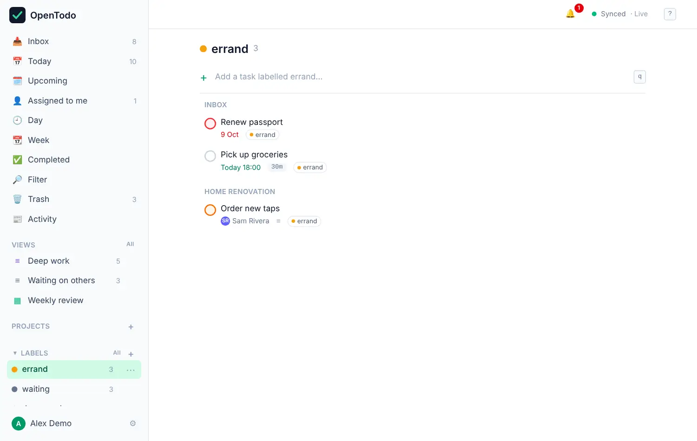
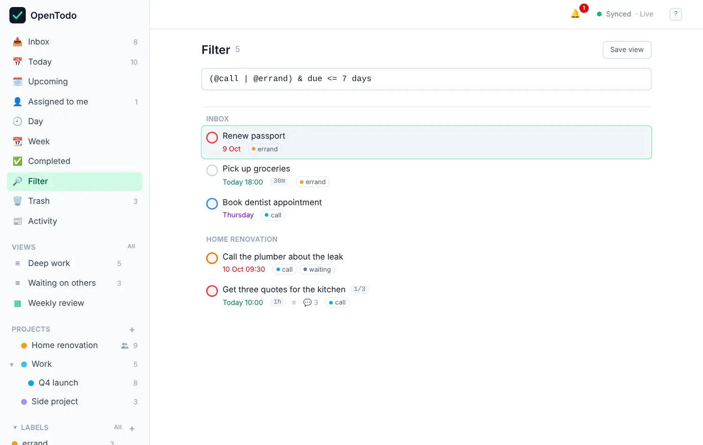

# Labels and filters

Projects say where a task belongs. Labels say what kind of task it is, across all projects: `@call`, `@errand`, `@waiting`, `@deep-work`. Filters then let you ask questions like "every call I need to make this week".

## Add a label to a task

Pick whichever is quickest:

- Type it in quick add: `Phone the bank @call`.
- Select a task and press <kbd>L</kbd>, start typing, and press <kbd>Enter</kbd>. The picker stays open so you can add more.
- Open the task and use **Labels** in the panel.

If the label doesn't exist yet, typing its name and pressing <kbd>Enter</kbd> creates it. Labels show as small colored chips on the task. To remove one, open the task and select the **×** on the chip.

## See everything with one label

The **Labels** group in the sidebar lists your labels with the number of open tasks for each. Select one to see all its tasks, grouped by project.

<picture><source srcset="images/labels-dark.webp" media="(prefers-color-scheme: dark)"></picture>

**All** next to Labels (or <kbd>g</kbd> <kbd>l</kbd>) opens the full list. From there, or from a label's **⋯** menu in the sidebar, you can:

- **Rename** it or change its **Color**. Every task shows the new name immediately.
- **Move up** or **Move down** in the list.
- **Merge into…** another label: tasks with the first label get the second one instead, and the first is deleted. Handy when you end up with both "Errand" and "errand".
- **Delete label**: it's removed from every task.

If two of your devices created the same label while offline, both copies appear with a duplicate marker and an offer to merge them.

Labels are personal. In a shared project, other members don't see the labels you add.

## Find tasks with a filter

Open **Filter** in the sidebar (or press <kbd>g</kbd> <kbd>f</kbd>) and type a query. Results appear as you type, grouped by project.

<picture><source srcset="images/filter-dark.webp" media="(prefers-color-scheme: dark)"></picture>

A query combines small pieces:

| Piece | Means | Example |
| --- | --- | --- |
| `@name` | has this label | `@call` |
| `#name` | in this project | `#Work` |
| `##name` | in this project or its sub-projects | `##Work` |
| `p1` … `p4` | priority | `p1` |
| `today`, `tomorrow`, `overdue`, `no date` | due then, or not at all | `overdue` |
| `due <= 7 days` | due within the next week | `due before friday` |
| `search: text` | words in the title or notes | `search: invoice` |
| `completed` | include completed tasks | `#Home & completed` |

Join them with `&` (and), `|` (or) and `!` (not), and use brackets to group:

```
(@call | @errand) & due <= 7 days
```

That reads: tasks labeled call or errand, due within the next seven days. A few more:

- `#Work & p1 & due <= tomorrow`: the most important work for today and tomorrow.
- `overdue & no project`: overdue tasks still sitting in the Inbox.
- `@waiting & !#Work`: everything you're waiting on, outside work.

Names with spaces go in quotes: `#"Client A"`. Upper and lower case don't matter. If you mistype, a message under the box says where, and the previous results stay visible.

Press <kbd>Enter</kbd> to jump from the box to the first result, and <kbd>Esc</kbd> to go back. <kbd>↑</kbd> and <kbd>↓</kbd> in the box bring back your recent queries.

The full language, with ten worked examples, is in [Filter queries](filters.md).

## Save a filter as a view

When a query is useful, keep it: press <kbd>s</kbd> in the results, give it a name, and it appears under **Views** in the sidebar with a live count. Saved views sync to your other devices. See [Views](views.md#save-your-own-views) for grouping, sorting and dashboards.

## Tips

- Labels for context work well: `@call`, `@computer`, `@errand`, `@home`. Then a view like `@errand & due <= 2 days` is your shopping list.
- A `@waiting` label plus a pinned "Waiting on others" view makes follow-ups hard to forget.
- Filters run on your device. They're instant, and they work offline.
