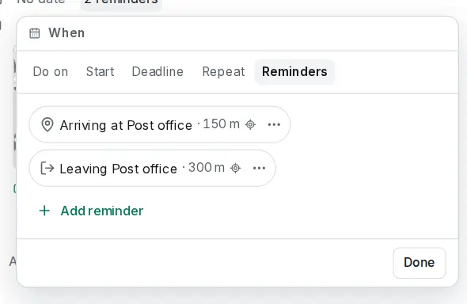

# Location reminders

<picture><source srcset="images/location-reminders-dark.webp" media="(prefers-color-scheme: dark)"></picture>

A location reminder fires when you arrive at a place or leave it: "Buy stamps" when you get to the post office, "Take the parcel" when you leave home. It is a [reminder](task-reminders.md) like the others, so it syncs, works offline and goes to the Trash with its task.

## Add one

Give the task a [location](locations-and-places.md) with a point on the map first: a saved location, coordinates, **Pick on the map** or **Use my location**. An address alone has no point.

Then, under **+ Add reminder**, **At a place** offers **When I arrive** and **When I leave**. Pick the radius, the size of the circle around the place: 100, 150 (the default), 300, 500 m or 1 km, or anything from 100 m to 5 km with the slider. The reminder reads "Arriving at Post office · 150 m". Without a point on the map both are greyed out, with **Add a location…** to set one. If the task links a saved location, the reminder follows it when you move the location's pin.

## Where they fire

Location reminders fire only in the [Android app](android-app.md#location-reminders) (the iPhone app follows), after you turn on **Settings → Notifications → Location reminders → On this phone** there. In a browser or on a computer you can add and change them, and the reminder says **Fires on your phone**. Nothing fires in the browser and nothing is pushed.

Turning it on first explains what the location is used for, then asks for location access. Choose **Allow all the time**: with only "While using the app" nothing is watched, and the setting tells you how to change it.

## When one fires

- The notification offers **Done**, which completes the task, and **Dismiss**, which turns this reminder off on all your devices. Both work offline and sync later. **Arm again** in the reminder's menu turns a dismissed one back on.
- Every time you cross the circle in the reminder's direction it fires again, at most once an hour, so a GPS jump at the edge doesn't notify you three times.
- Several phones with the setting on each notify you; dismissing on one silences the others after they sync.

## Privacy and limits

- **Your position stays on the phone.** The phone's own region monitoring watches the places; the position is never sent to your server, never handed to the app's pages and never logged.
- **At most 19 places at a time:** phones watch about 20 regions per app. With more location reminders, the phone watches the 19 nearest and picks again when you travel.
- **With end-to-end encryption**, the places reach the phone only while the account is unlocked there; locking removes them until you unlock again.
- Calendar apps don't show location reminders ([CalDAV](caldav.md#alarms-and-reminders) has no matching alarm). The [API](api.md#reminders-and-push) and `ot task show` list them like any reminder.
