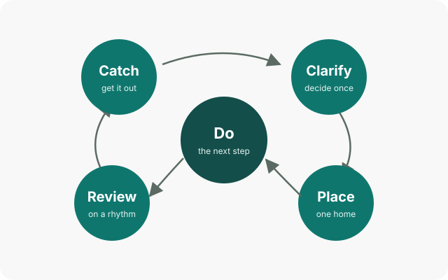
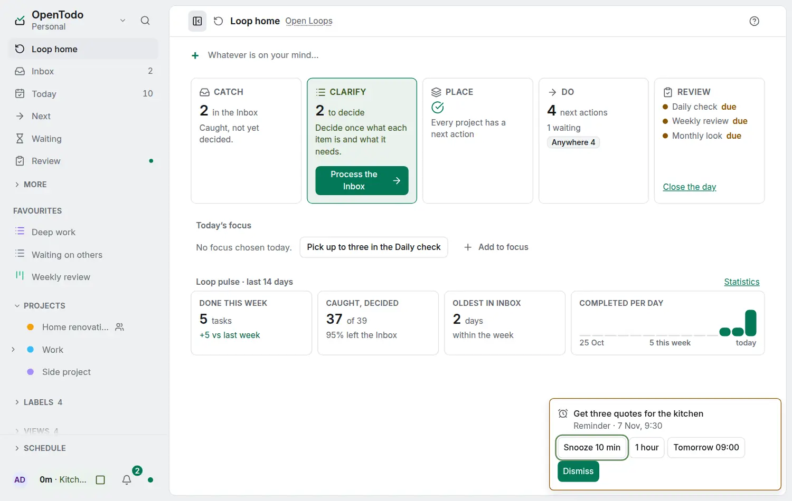

# Open Loops

An open loop is anything that has your attention and has not been dealt with: a call to return, an idea for the garden, the tax form on the desk. Kept in your head, open loops nag. **Open Loops** is a calm method for closing them: everything that has your attention gets a home you trust, so your head is free for the work in front of you.

It is OpenTodo's own method, inspired by David Allen's GTD and simplified. You can use as much of it as you like: the app works the same without it.

## The five moves

1. [Catch](catch.md): get whatever is on your mind into the Inbox the moment it appears.
2. [Clarify](clarify.md): decide once what each item is and what it needs.
3. [Place](place.md): give every item one home: a project, a date, Waiting or Someday.
4. [Do](do.md): work from your next actions, by context, one step at a time.
5. [Review](review.md): look over the whole system on a rhythm, so you can trust it.

## Seven principles

- **Catch everything.** If it is on your mind, it goes in the Inbox.
- **Decide once.** Each item gets one decision, the first time you look at it.
- **Do it if it is quicker than filing it.** A task of a minute or two is done on the spot, not filed.
- **One next step.** Every project always shows its very next action.
- **Hide what is not now.** Deferred, waiting and someday items stay out of sight until they matter.
- **Review on a rhythm.** A system works only while you trust it, and you trust it by reviewing it.
- **Your loops, your server.** Everything stays on your devices and your own server, private by design.

## The rest of the method

- [Places](places.md): the seven homes a task can have, and the screen for each.
- [Rhythms](rhythms.md): the Daily check, the weekly review and the Monthly look.
- [Horizons](horizons.md): next steps, projects and areas.
- [Set up in ten minutes](set-up.md): turn the method on and start.
- [Coming from GTD](coming-from-gtd.md): the words you know, and where they live here.

## How prominent it is

<picture><source srcset="../images/loop-dark.webp" media="(prefers-color-scheme: dark)"></picture>

The **Loop home** (<kbd>g</kbd> <kbd>Shift+L</kbd>, and the start view with the full Open Loops method) is the method on one screen, and it tells you what to do next.

- The **Next step** card names one move and why, with one button: Clarify while the Inbox has items ("7 things in the Inbox are waiting."), then Place while a project has no next action, then Review while the Daily check, the weekly review or the Monthly look is due, then Do while a next action is ready. When everything is clear it says your loops are closed and offers to catch something.
- The **stepper** lists the five moves in method order: Catch, Clarify, Place, Do and Review. Each shows its count, or a check mark when it has nothing for you; Review shows **due** when a rhythm is due. Only the next move is highlighted. <kbd>←</kbd> and <kbd>→</kbd> move between the steps.
- A move **opens in place**, below the stepper; the address becomes `/loop/<move>`, so Back closes it and a link opens it. **Catch** has the field **Catch into the Inbox** and your latest captures; **Clarify** has the [triage card](../process-the-inbox.md) with its single-key decisions and how many are left; **Place** lists the projects without a next action, each with a field to add one, then the stalled ones; **Do** has [today's focus](rhythms.md#daily-check) with how many of the chosen tasks are done, then your next actions by context; **Review** lists the three rhythms with when each was last done, and **Close the day**. <kbd>Esc</kbd> closes the open move. On a phone the open move takes the screen, with Back.
- The **Loop pulse** is one quiet line under the stepper: tasks done this week, how many of the items caught in the last fourteen days have been decided, and the age of the oldest Inbox item, marked when it is over a week. Select it for the details: done this week against last week, completions per day for fourteen days, and a link to Statistics. The pulse uses the same definitions as [Statistics](../statistics.md), is computed on your device and sends nothing anywhere.

<kbd>q</kbd> and the add button still capture into the Inbox from the Loop home, as from everywhere.

In **Settings → Account → Profile → How you work** you choose how much the app shows the method: **Simple lists** (no method words at all), **Lists with method hints** (each screen gets a hint on its purpose and links here) or **Full Open Loops method** (the Loop home opens first and the sidebar is arranged by the Places). See [Set up in ten minutes](set-up.md).
