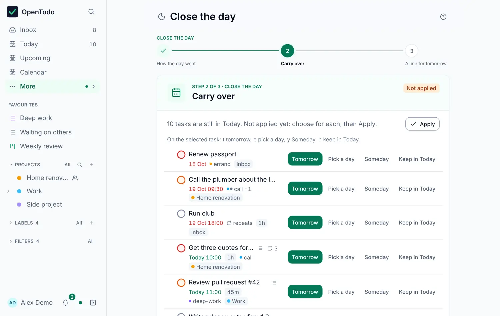

# Rhythms

Reviews keep the system trustworthy. Open Loops has three, each short enough to actually do, and an optional step to end the day.

## Daily check

Five minutes, usually in the morning: open it from the Review screen's menu, the Loop home or <kbd>g</kbd> <kbd>Shift+R</kbd>.

1. **Process the Inbox** if anything is in it.
2. Look at what is **overdue**: complete it, or give it a new date.
3. Pick **today's focus**: press <kbd>f</kbd> on up to three of today's tasks. They are shown on the Loop home on every device, with how many of them are done. To work through them one at a time with a timer, press <kbd>g</kbd> <kbd>Shift+F</kbd> for [Focus](../focus.md).

**Done for today** records the check. In Open Loops first, the app offers it once a day. If you closed yesterday with a line for tomorrow, it is shown at the top.

A day here ends at your [day start](../dates-and-times.md#when-a-day-ends): with 04:00, a check done or a focus picked at 00:30 still belongs to the evening before, and the focus stays until 04:00.

## Close the day

<picture><source srcset="../images/close-day-dark.webp" media="(prefers-color-scheme: dark)"></picture>

A few minutes in the evening: open it from the end of the Today list, the Review move on the Loop home, the command palette or <kbd>g</kbd> <kbd>Shift+D</kbd>. It has three steps; <kbd>[</kbd> and <kbd>]</kbd> move between them.

1. **How the day went**: how many tasks were planned (what Today lists plus what you finished today), how many you completed (the same count as [Statistics](../review-and-statistics.md)) and how much of today's focus is done.
2. **Carry over**: every unfinished task of Today, each going to **Tomorrow** unless you choose otherwise: **Pick a day**, **Someday** or **Keep in Today**. On the selected task, press <kbd>t</kbd>, <kbd>p</kbd>, <kbd>y</kbd> or <kbd>h</kbd>. Nothing changes until you select **Apply**; then every task moves at once and **Undo** (or <kbd>Ctrl</kbd>+<kbd>Z</kbd>) puts them all back in one step.
3. **A line for tomorrow**: an optional note, shown at the top of tomorrow's Daily check.

**Close the day** records the close and returns to Today, which then ends with **Day closed** and the time; so does the Review entry in the sidebar. You can close again later the same day. Close the day is never due: nothing reminds you of it.

## Weekly review

Thirty minutes, on a day that suits you (<kbd>g</kbd> <kbd>r</kbd>). Seven steps in three phases: Get clear (Inbox, Mind sweep), Get current (Look back, Waiting, Projects, Look ahead) and Get creative (Someday). See [Weekly review](../review-and-statistics.md).

## Monthly look

Twenty minutes, once a month, from the Review screen's menu or the Loop home:

- **Areas**: each top-level project that holds sub-projects, with how many of them need attention.
- **Old someday**: Someday tasks older than three months. Promote, complete or trash them.
- **Trend**: what you completed, created and let slip over the last four weeks.

## When a rhythm is due

| Rhythm | Due when | Marker shown in |
| --- | --- | --- |
| Weekly review | last finished more than 7 days ago | every mode |
| Monthly look | last finished more than 30 days ago | Companion and Open Loops first |
| Daily check | not done today | Open Loops first |
| Close the day | never | none; the Review entry says Day closed |

Each finish syncs to all your devices: a Daily check on the phone clears the marker on the laptop.
