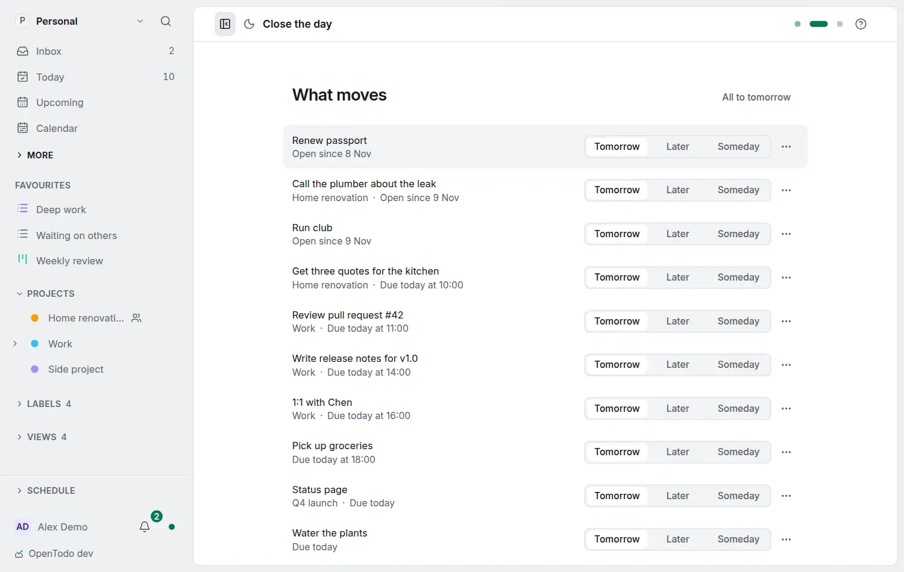

# Rhythms

Reviews keep the system trustworthy. Open Loops has three, each short enough to actually do, and an optional step to end the day.

## Daily check

Five minutes, usually in the morning: open it from the Review screen's menu, the Loop home or <kbd>g</kbd> <kbd>Shift+R</kbd>.

1. **Process the Inbox** if anything is in it.
2. Look at what is still open from **Earlier**: complete it, or give it a new date.
3. Pick **today's focus**: press <kbd>f</kbd> on up to three of today's tasks. They are shown on the Loop home on every device, with how many of them are done. To work through them one at a time with a timer, press <kbd>g</kbd> <kbd>Shift+F</kbd> for [Focus](../focus.md).

### Pick the focus by touch

On a phone, or without a keyboard:

- Tap **Add to focus** under Today's focus in the Daily check, or on the Loop home, and choose a task. The picker lists today's and overdue tasks first; type to find any open task.
- In a task's menu, choose **Add to focus**, or **Remove from focus** when it is in. The menu is the **⋯** of the task panel or page, the Focus screen's **⋯**, and the **Actions** menu: on a phone, hold the task, then tap **Actions**.

These follow the same rules as <kbd>f</kbd>: at most three tasks, and every change has **Undo**. The focus is yours, so a task of a shared project you only view can be in it too.

The check opens with the same [briefing](../briefing.md) as Today: what is late, a full day and replies waiting. **Done for today** records the check. With the full Open Loops method, the app offers it once a day. If you closed yesterday with a line for tomorrow, it is shown right under the briefing.

### Bento

Three tasks of any size can still be three two-hour tasks. **Bento** makes today's focus one **Large**, one **Medium** and one **Small** task instead. Choose it in the Daily check's **⋯** menu (**Daily focus**) or in **Settings › Account › Profile › How you work**; **Three tasks** is the default and works as before. Switching changes nothing about the focus itself: the tasks you picked move into slots by their estimates.

The slots follow a task's [estimate](../time-blocking.md): **Small** up to 30 minutes, **Medium** 31 to 89, **Large** 90 or more. In Bento, the focus shows the three slots above the list; an empty one says what fits in it.

- <kbd>f</kbd> on a task with an estimate puts it in its slot. If that slot is taken, the message names the task in it and offers **Choose a slot**.
- <kbd>f</kbd> on a task without an estimate opens a menu with the free slots and **Set estimate…**, which sets the estimate and then places the task by it. **Set estimate…** is only there for tasks you can edit; a task you only view can still go in a slot.
- Any task can go in any free slot from that menu: the slot you choose wins, so a 45-minute task can be the day's Large when it is the hard one. Choosing a slot never changes the task.
- <kbd>f</kbd> on a task in a slot takes it out. Each change has **Undo**.
- By touch, tap an empty slot: a picker lists today's and overdue tasks, the ones whose estimate fits the slot first, then those without an estimate; the task you choose goes in that slot. A task's menu offers **Put in a slot** (placed by its estimate, as with <kbd>f</kbd>) and **Remove from focus**.

The **order** sets how the focus is listed: **Frog** (Large, Medium, Small; the default) eats the frog first, **Summit** (Medium, Large, Small) warms up first. It applies to the slots here, to Today's focus on the Loop home and to the task [Focus](../focus.md) opens on. Choose it in the same menu, or in How you work, where it shows only while Bento is on.

The slots sync like the rest of the focus. A device with an older version of the app shows the same three tasks as a plain focus; if it changes the focus, the new tasks take slots by their estimates.

A day here ends at your [day start](../dates-and-times.md#when-a-day-ends): with 04:00, a check done or a focus picked at 00:30 still belongs to the evening before, and the focus stays until 04:00.

## Close the day

<picture><source srcset="../images/close-day-dark.webp" media="(prefers-color-scheme: dark)"></picture>

A few minutes in the evening: open it from the end of the Today list, the Review move on the Loop home, the command palette or <kbd>g</kbd> <kbd>Shift+D</kbd>. It walks you through three steps, one at a time; the dots at the top show where you are. <kbd>Enter</kbd> or <kbd>]</kbd> continues, <kbd>[</kbd> goes back, and <kbd>Esc</kbd> leaves without changing anything. The day you close is the day you opened it on: start at 23:59 and finish after midnight, and it is still that evening that gets closed.

1. **What got done**: the tasks you finished today, in the order you finished them, with how many of the planned tasks are done (the same count as [Statistics](../review-and-statistics.md)) and how much of today's focus.
2. **What moves**: every unfinished task of Today on one list, with its project and why it is in Today. Each row is on **Tomorrow** until you choose **Later** (a day you pick) or **Someday**; its menu holds **Keep in Today** and **Done already**. <kbd>j</kbd> and <kbd>k</kbd> move between rows; <kbd>t</kbd>, <kbd>p</kbd>, <kbd>y</kbd>, <kbd>h</kbd> and <kbd>d</kbd> decide the current row and go to the next. **All to tomorrow** (<kbd>Shift+T</kbd>) puts every row back on Tomorrow. Someday parks a task without a date; nothing here ever goes to the Trash.
3. **Tomorrow's first thing**: tomorrow's tasks, including the ones you are moving there tonight. Pick the one tomorrow starts with; it becomes tomorrow's focus, so the Daily check and the Focus screen start from it. Under the list, an optional line for tomorrow morning.

Nothing changes until you choose **Close the day**, which every step offers: a step you skip keeps its defaults. Then everything happens at once, as one change: the tasks move, tomorrow's first thing is set and the close is recorded, and **Undo** (or <kbd>Ctrl</kbd>+<kbd>Z</kbd> while the message shows) puts it all back in one step, your focus included; your line for tomorrow is kept.

The screen ends on **Done for today**: the time, the day's figures ("5 done, 3 moved to tomorrow, 1 kept"), tomorrow's first thing and your line for tomorrow. No streak, no score. **Back to Today** (or <kbd>Esc</kbd>) returns to Today, which then ends with **Day closed** and the time; so does the Review entry in the sidebar. You can close again later the same day. Close the day is never due: nothing reminds you of it.

Changed your mind? Until your day ends, **Reopen the day** (next to **Day closed**, or at the top of the Close the day screen) puts the carried-over tasks and your focus back where they were and clears the close, on any of your devices; your line for tomorrow is kept. A task you moved again by hand after closing stays where you put it, and the message names it. **Undo** takes the reopen back.

## Weekly review

Thirty minutes, on a day that suits you (<kbd>g</kbd> <kbd>r</kbd>). Seven steps in three phases: Get clear (Inbox, Mind sweep), Get current (Look back, Waiting, Projects, Look ahead) and Get creative (Someday). See [Weekly review](../review-and-statistics.md).

## Monthly look

Twenty minutes, once a month, from the Review screen's menu or the Loop home:

- **Areas**: each top-level project that holds sub-projects or is an [area](../project-flows.md), with how many of its sub-projects need attention.
- **Old someday**: Someday tasks older than three months. Promote, complete or trash them.
- **Trend**: what you completed, created and let slip over the last four weeks.

## When a rhythm is due

| Rhythm | Due when | Marker shown in |
| --- | --- | --- |
| Weekly review | last finished more than 7 days ago | every mode |
| Monthly look | last finished more than 30 days ago | Method hints and the full method |
| Daily check | not done today | The full method |
| Close the day | never | none; the Review entry says Day closed |

Each finish syncs to all your devices: a Daily check on the phone clears the marker on the laptop.
