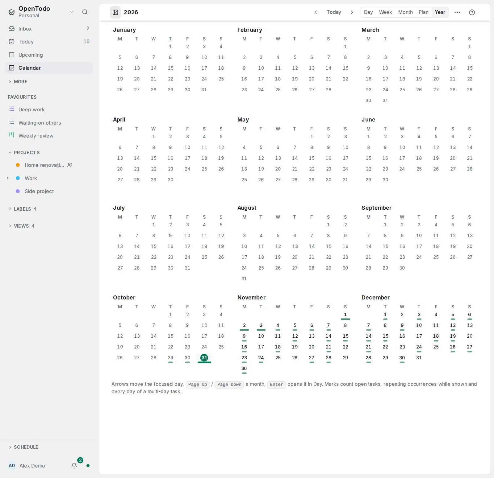

# Several months and the year

<picture><source srcset="images/year-calendar-dark.webp" media="(prefers-color-scheme: dark)"></picture>

The [Month](calendar-views.md#see-the-month) shows one month by default. To look further ahead, stack several months, or open **Year** to see the whole year at once.

## See several months

Choose **Months shown: 1**, **2**, **3** or **6** in the Month's page menu to stack that many months, one under the other, each with its name. The title names the range, such as "Nov 2026 – Jan 2027". Each month shows only its own days, so a day and its tasks appear once and a drag has one place to land; everything else works as in one month.

- The arrows and <kbd>j</kbd> / <kbd>k</kbd> carry on from one month into the next. Moving past the last month moves the months along.
- <kbd>[</kbd> and <kbd>]</kbd> move by one month, so the next months come into view while you keep the ones you were looking at. <kbd>t</kbd> puts the current month first.

This device remembers the choice; your other devices keep their own. On a phone, Month always shows one month and keeps your choice for wider screens.

## See the year

**Year** shows the twelve months of a year as small grids, four to a row on a wide screen, three or two on narrower ones. It is for seeing where the busy weeks are and which months are still empty; it never moves tasks.

- Under each day's number a mark shows how much is planned: none for an empty day, then a short, a longer and a full bar for 1–2, 3–5 and 6 or more. The number gets bolder with each step too, so the marks don't rely on colour.
- A red dot marks a day whose estimates are over your day length, counted the same way as the Month's planned total.
- Hover over or move to a day to see how many tasks it has and the first three titles.
- Today is marked, and days before today are dimmed.

A day counts its open tasks (not completed ones), every day of a [multi-day task](tasks-that-span-days.md), and the coming occurrences of [repeating tasks](repeating-on-the-calendar.md) while **Show repeating occurrences** is on. Events from [other calendars](other-calendars.md) and deadlines don't count. The calendar's [filter](calendar-filter.md) applies, and in a project's Calendar layout only the project's tasks count.

Click a day to open it in Day; click a month's name to open it in Month. With the keyboard, the twelve months are one grid:

- <kbd>←</kbd> <kbd>→</kbd> move a day and <kbd>↑</kbd> <kbd>↓</kbd> a week, across the edges of months.
- <kbd>Page Up</kbd> and <kbd>Page Down</kbd> go to the same day of the previous and next month; <kbd>Home</kbd> and <kbd>End</kbd> to the first and last day of the month.
- <kbd>[</kbd> and <kbd>]</kbd> go to the previous and next year, keeping the day, and <kbd>t</kbd> comes back to today.
- <kbd>Enter</kbd> opens the day in Day view, and <kbd>Esc</kbd> moves the focus back to the page header.

On a phone the months are in two columns and the days are too small to tap, so tapping a month opens it in Month, where you can tap a day.
