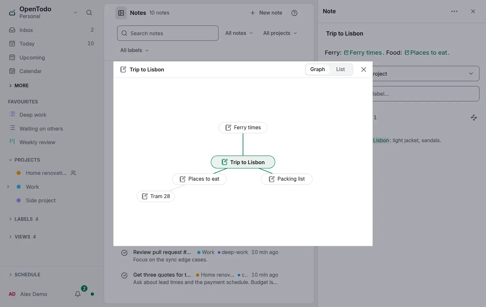

# See an item's connections

<picture><source srcset="images/note-connections-dark.webp" media="(prefers-color-scheme: dark)"></picture>

[Links](note-links.md) answer "what points here?" one step at a time. **Show connections** answers "what is connected to this?": the item in the middle, everything it links to or that links to it around it, and what those link with one step further.

## Open it

**Show connections** is offered while a note, task or project links to something, or something links to it:

- in the note's, the task's or the project's menu,
- with the graph button at the end of the **Linked references** heading,
- in the command palette (`Ctrl+K`, `⌘K` on a Mac) while the item is open.

## The graph

The item sits in the middle. On the inner ring is every item it links with, in either direction: notes first, then tasks, then projects, each by title. On the outer ring are the items those link with that are not already shown. A line joins every pair that links; which way a link points is in the List. A ring shows at most 24 items on the inside and 48 on the outside, the most recently changed, with a marker such as **+16** for the rest.

The same items always draw the same picture, and nothing moves on its own. Lines start and end at the items and never pass behind one; a link between two outer items that would cross the middle is left to the List. On a phone, when the titles do not fit around the item, the dialog opens on the List, with the graph one tap away.

Click or tap an item to move it to the middle; click the item in the middle to open it.

| Key | What it does |
| --- | --- |
| <kbd>←</kbd> <kbd>→</kbd> | Move around a ring |
| <kbd>↑</kbd> <kbd>↓</kbd> | Move toward the middle or outward |
| <kbd>Space</kbd> | Move the focused item to the middle |
| <kbd>Enter</kbd> | Open the focused item |
| <kbd>Backspace</kbd> | Back to the previous item in the middle |
| <kbd>Esc</kbd> | Close |

These keys work only inside the dialog.

## The List

**List** in the dialog's header shows the same as two lists: **Links**, what the item links to, and **Linked from**, what links to it, with the line around each link. Choose a row to open it, or its target button to move it to the middle. Your device remembers whether you chose Graph or List. When the graph does not fit, as with a busy note on a phone, the dialog opens in List unless you chose Graph.

## Private and offline

Connections are worked out on your device from your own copy, so they work offline and with [end-to-end encryption](e2ee.md), and nothing is sent to the server. Only items you can open are shown: a note in the Trash, or another member's personal note, is left out. A task's project, its subtasks and its dependencies are not drawn; only the links people wrote.
