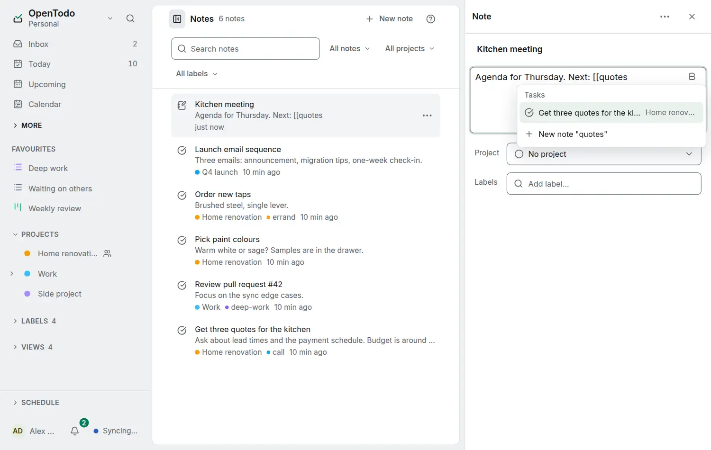

# Link notes, tasks and projects

<picture><source srcset="images/note-links-dark.webp" media="(prefers-color-scheme: dark)"></picture>

Type `[[` in any note (a task's, a project's or a standalone note) and a few letters of what you want to link to. A list of matching notes, tasks and projects opens at the caret, grouped by kind, with the project beside each; <kbd>↑</kbd> and <kbd>↓</kbd> move, <kbd>Enter</kbd> inserts the link and <kbd>Esc</kbd> keeps what you typed. When nothing has that title, the last row, **New note "…"**, creates the note (in the same project as the note you are writing) and links it; <kbd>Ctrl</kbd>+<kbd>Z</kbd> right after takes both back. **Link to…** in the `/` menu does the same.

A link always shows the current title of what it points to, so renaming a task or a note never breaks it, and a link to a completed task is struck through. Click a link in a note you are reading, or <kbd>Ctrl</kbd>+click (<kbd>⌘</kbd>+click on a Mac) while you write, to open it. A link to something in the Trash, or to something you cannot see, reads as plain muted text; it works again when the item is restored.

In a note of a shared project, the list offers only that project's notes and tasks, so a private title never ends up in a shared note by accident. You can still paste any link.

## Linked references

At the end of a note, below a task's notes and as one folded line in a project's note area, **Linked references** lists every note that links there, newest change first, with the line around the link. When nothing links there, the section is not shown. Linked references are worked out on your device from your own copy, so they work offline and with [end-to-end encryption](e2ee.md), and the server never learns which notes link where.

The graph button at the end of the heading shows the item's connections two steps out: [See an item's connections](note-connections.md).

## Unlinked mentions

Under Linked references, the folded line **Unlinked mentions** counts the notes that name the item's title without linking to it: the whole title as words, ignoring case, accents and formatting, but not inside code or the text of a link. Titles shorter than three letters, and untitled notes, are never matched. Open the line to see each note with the mention highlighted, and choose **Link** to turn that mention into a link; <kbd>Ctrl</kbd>+<kbd>Z</kbd> takes it back. A note you may only read shows no Link. Like Linked references, mentions are found on your device, offline and with encryption included.

## Links in Markdown

A link is stored as Markdown: `[Trip](?note=<id>)`, `[Call the plumber](?task=<id>)` or `[Renovation](?project=<id>)`, with the title it had when the note was last edited. The API, exports, calendar apps and the command line see that text, and a script or an assistant that writes it makes a link ([Notes, tasks and scripts](notes-to-tasks.md)). Older versions of the app show a link as its text and keep it when they edit the note. An address ending in `?note=<id>` or `?project=<id>` opens that note or project, as `?task=<id>` opens a task.
