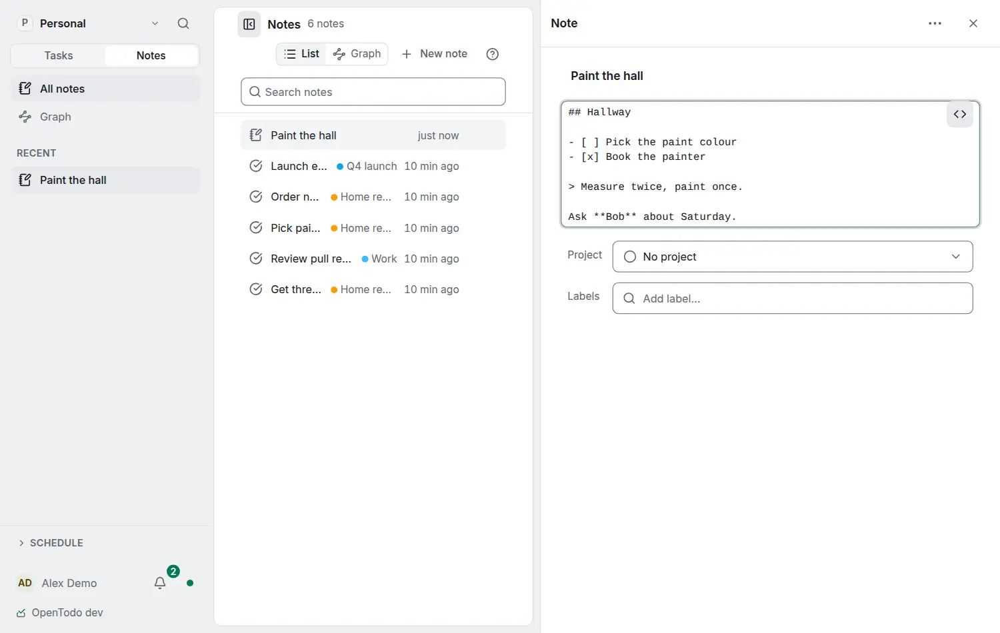

# Edit a note's Markdown

<picture><source srcset="images/note-markdown-source-dark.webp" media="(prefers-color-scheme: dark)"></picture>

Notes are written as formatted text and kept as Markdown. To see and edit the Markdown itself (to fix a list, or to paste text written elsewhere), switch the note to its source:

- press <kbd>Ctrl</kbd>+<kbd>Shift</kbd>+<kbd>M</kbd> (<kbd>⌘</kbd>+<kbd>Shift</kbd>+<kbd>M</kbd> on a Mac) in the note,
- choose **Markdown** in the `/` menu, or
- on a computer, choose the **Markdown** button in the note's top corner.

The note shows its Markdown as plain text in the same place. Edit it, then press the same key or button to go back to formatted text, with the cursor in the block where you were. The note stays in its source until you switch back or close it; it opens as formatted text next time.

Your edits are saved as you pause, block by block: only the paragraphs, lists or tables you changed are replaced, so mentions and images in the rest of the note stay as they are. Edits from your other devices or from people you share the project with merge with yours, and appear in the source without moving your cursor. It works offline like any note edit.

If you may only read a note, its source is shown read-only.
