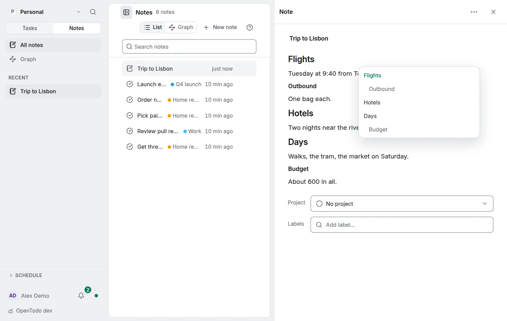

# Find your way in a long note

<picture><source srcset="images/note-outline-dark.webp" media="(prefers-color-scheme: dark)"></picture>

Task notes, project notes and standalone notes with three or more headings have an outline: the headings in order, indented by level, with the one you are reading marked.

- Beside a wide note (a standalone note with room on a computer, or a task page on a large screen) the outline is a column at the note's side that stays in view as you scroll.
- Elsewhere (the task panel, project notes, phones) it is the **Outline** button in the note's top corner. On a computer it shows when you point at the note.

Choose a heading to scroll the note to it; in a note you can edit, the cursor goes to the start of the heading.

## From the keyboard

In a note, press <kbd>Ctrl</kbd>+<kbd>Shift</kbd>+<kbd>O</kbd> (<kbd>⌘</kbd>+<kbd>Shift</kbd>+<kbd>O</kbd> on a Mac) to go to the outline. <kbd>↑</kbd> and <kbd>↓</kbd> move between headings, <kbd>Home</kbd> and <kbd>End</kbd> jump to the first and last, <kbd>Enter</kbd> goes to the heading and <kbd>Esc</kbd> returns to the note where you were.

The outline is read from the note on your device, so it works offline and with end-to-end encryption, and it changes as soon as you or someone else adds a heading. Nothing about it is stored or synced.
